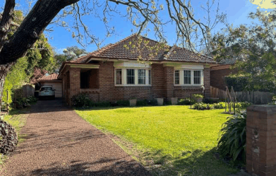
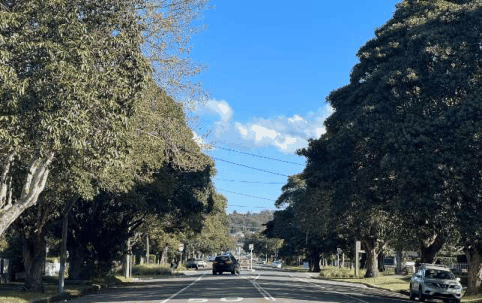
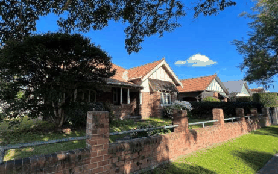
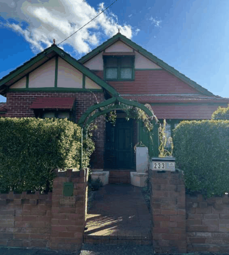

### 11.2 Desired future character statement

The character of the Hamilton South 'Garden Suburb' Heritage Conservation Area is made up of a variety of building styles that date from the late 19th and early decades of the 20th century. The special character of Hamilton South 'Garden Suburb' is to be preserved and maintained through the retention of contributory buildings, open space, existing subdivision pattern and maintenance of the 'Garden Suburb' layout, street trees and elements of visual interest and heritage significance such as Parkway Avenue, Learmonth Park, small pocket parks, and the vegetated edges of Cottage Creek.

Elements to preserve and/or sensitively restore or reconstruct (based on evidence of original appearance) include: Original dwellings of the 'Garden Suburb' which were built up to 1935. Single storey scale of housing stock that is an original defining feature of the 'Garden Suburb'. Exposed face brick and stone of existing building facades and front fencing. Consistent front and side setbacks including retaining the offsets to side boundaries and keeping front gardens as open space. Side driveways with new garages located at the rear of the dwelling, and new carports located at the back or at the side of the dwelling. Existing subdivision pattern and street layout as evidence of Sulman's 'garden suburb' layout and town plan. Strong symmetrical and hierarchical pattern of streets including Parkway, Gordon and Stewart Avenues. Existing appearance, form and function of Parkway Avenue, including the road verges, street trees, bridge abutments at Cottage Creek, and the central median that splits the carriageway into two single lane roads. Mature trees in gardens and public domain. Public open space including pocket parks at Wilson Place, Corona Street, and elsewhere. Relationship of houses to their gardens and houses to each other. Items of heritage significance individually listed as heritage items in Schedule 5 of LEP 2012, including

retention of the three-dimensional form and adaptive re-use of heritage item buildings.

The following images demonstrates characteristic features of the Hamilton South 'Garden Suburb' Heritage

> [Picture on page 20: a picture, saved as a picture (images/section-e2-heritage-conservation-areas-page-20-2.gif, 150 dpi).]

Conservation Area.

> [Picture on page 20: a picture, saved as a picture (images/section-e2-heritage-conservation-areas-page-20-4.gif, 150 dpi).]

#### Figure E2.24: Mature trees present in public domain.

> [Picture on page 20: a picture, saved as a picture (images/section-e2-heritage-conservation-areas-page-20-7.gif, 150 dpi).]

Figure E2.25: Single storey detached bungalow exhibiting characteristics prevalent to the

#### 'Garden Suburb'.

> [Picture on page 20: a picture, saved as a picture (images/section-e2-heritage-conservation-areas-page-20-11.gif, 150 dpi).]

Figure E2.26: Houses showcasing consistent built form, front gardens and side setbacks/side driveway.

Figure E2.27: Cottage with ornate elements contributing to the distinctive character.
