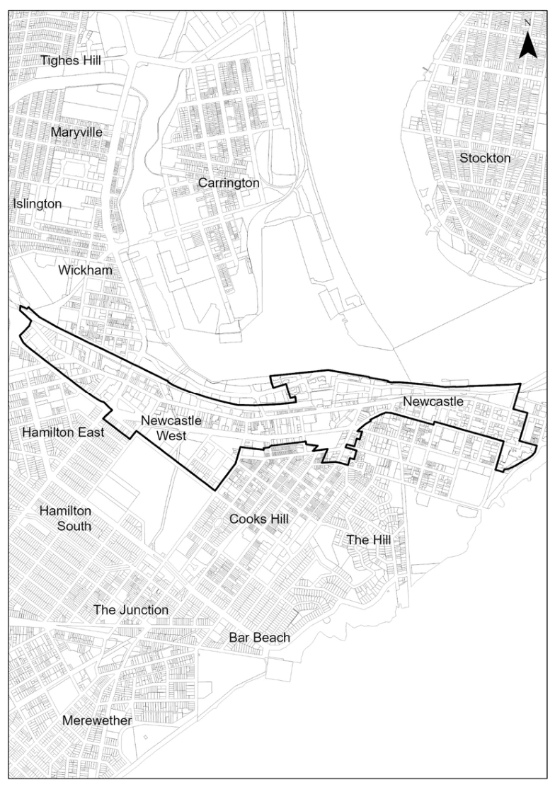

### 12.0 Newcastle City Centre Heritage Conservation Area

This section applies to land within the Newcastle City Centre Heritage Conservation Area as listed in Schedule 5 and mapped in LEP 2012 - Heritage Maps (HER_004FA, HER_004G and HER_004K). The heritage conservation area is in Newcastle West and Newcastle located between Newcastle railway line, Wright Lane and Newcastle harbour to the north, Watt Street, Pacific Street and Shortland Esplanade to the east, King Street, Queen Street, Laman Street, Gibson Street and Parry Street to the south, Stewart Avenue and Selma Street to the west.

It maps the area for controls provided in Section E1 Built and landscape heritage, and is to be read with that section and the heritage significance and desired future character statements of this section, to understand the heritage requirements.

> [Picture on page 21: a picture, saved as a picture (images/section-e2-heritage-conservation-areas-page-21-10.gif, 150 dpi).]

#### Map E2.07: Land application – Newcastle City Centre Heritage Conservation Area

#### Key period of significance – circa 1801 to 1940

Newcastle City Centre Heritage Conservation Area is significant on many levels. The mix of commercial, retail and civic buildings is a powerful reminder of the city's past, its economic and social history. Historic buildings provide the backdrop to a city of dramatic topography on the edge of the sea and the mouth of a harbour.

Inner Newcastle has a rich archaeological record of national significance, with potential to yield information about early convict settlement and industrial activities. The heritage conservation area is a place of contact between colonists and Indigenous population. This evidence is available in historical accounts and archaeological record surviving beneath the modern city.

The high numbers of commercial and civic buildings of the 19th and 20th centuries gives a rich historic character which is notable and allows an understanding of the importance as a place of commerce, governance and city building. The historical foundation was the discovery and exploitation of coal with good shipping access via a safe and navigable harbour. The town's layout by surveyor Henry Dangar in 1823 is visible in the streets and is an element of historical value, particularly in the vicinity of Thorn, Keightley, Hunter and Market Streets.
