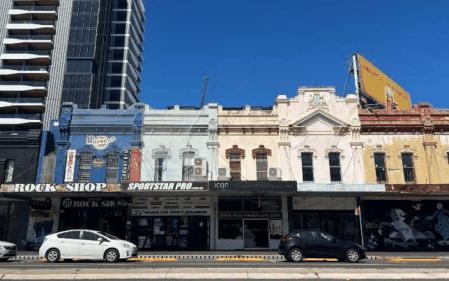
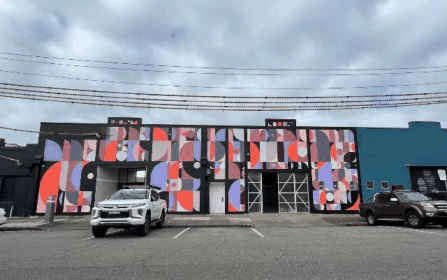
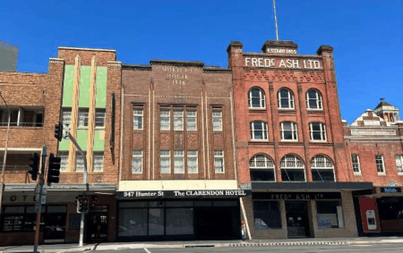
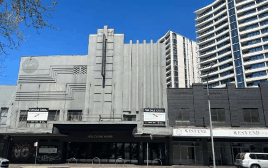

### 12.2 Desired future character statement

The character of the Newcastle City Centre Heritage Conservation Area is made up of a variety of building styles and settlement patterns that date from the 19th and early decades of the 20th century. The special character is

to be preserved, celebrated and maintained through the retention of contributory buildings, open space, street trees, existing subdivision pattern, and elements of visual interest and heritage significance.

Elements to preserve and/or sensitively restore or reconstruct (based on evidence of original appearance) include:

Range of contributory and historic buildings constructed prior to the Second World War, particularly intact or historically significant groupings, heritage items, iconic structures, and the appearance and layout of streets. Existing subdivision pattern and street layout, including preserving the human scale of development, the integrity of laneways and the fine grain of Henry Dangar's 1823 'Old Town' plan in the Newcastle East End Precinct from Pacific Street to Brown Street, and from Church Street to Hunter Street. Existing subdivision pattern and street layout, including preserving the human scale of development, the integrity of laneways, the fine grain and the groupings of contributory late 19th century and art deco buildings which predominate in the cultural, educational and administrative Civic Precinct between Brown and Ravenshaw/Steel streets. Single to two storey scale of distinctive early industrial and warehouse buildings in Parry Street between National Park Street and Stewart Avenue, and between Wood Street and Railway Street. Emerging commercial core of tall and landmark mixed-use retail, office and residential apartment buildings of the Newcastle West End Precinct between Ravenshaw/Steel Street and Wood Street are of high-quality contextual design, compatible with and preserve the remnant contributory 19th century and early 20th century properties and their two to three storey scale and setting, the integrity of laneways and the fine grain of Beresford Lane and Beresford Street. Exposed face brick and stone of existing building facades and front fencing. Street furniture such as sandstone kerbing and guttering, and other features of historical interest such as heritage items, public stairs, lanes, parks. Distinctive early industrial, warehouse and retail buildings, including prominent corner buildings. Views and vistas to and from significant cultural landmarks such as the T&G Building and the former Newcastle Post Office. Views which terminate at significant heritage buildings such as Fort Scratchley and the former Newcastle Courthouse. Views from Market Street and Morgan Street to Christ Church Cathedral. Views to the Hunter River are protected and framed along Market Street, Watt Street and Newcomen Street. Views to and the visual interconnections between significant Aboriginal cultural landscape features including Whibayganba (Nobbys Head), Tahlbihn (Flagstaff Hill / Fort Scratchley), Burrabihngarn (Pirate Point, Stockton), Yohaaba (Port Hunter), Coquun (Hunter River: South Channel), Khanterin (Shepherds Hill), and Cathedral Park. Mature trees in the public domain, and parks and public spaces including Market Street Lawn, Civic Park, Wheeler Place, Museum Park, Christie Place and Birdwood Park.

Items of heritage significance individually listed as heritage items in Schedule 5 of LEP 2012, including retention of the three-dimensional form and adaptive re-use of heritage item buildings. The rich record of relics and archaeological sites beneath the modern city.

The following images demonstrate characteristic features of Newcastle City Centre Heritage Conservation Area.

> [Picture on page 23: a picture, saved as a picture (images/section-e2-heritage-conservation-areas-page-23-5.gif, 150 dpi).]

> [Picture on page 23: a picture, saved as a picture (images/section-e2-heritage-conservation-areas-page-23-6.gif, 150 dpi).]

Figure E2.28: Row of buildings with consistent urban form, design elements and fine grain.

> [Picture on page 23: a picture, saved as a picture (images/section-e2-heritage-conservation-areas-page-23-9.gif, 150 dpi).]

Figure E2.29: Refurbished early industrial warehouses retaining heritage characteristics.

> [Picture on page 23: a picture, saved as a picture (images/section-e2-heritage-conservation-areas-page-23-12.gif, 150 dpi).]

#### Figure E2.31: Contributory buildings preserving human scale.

#### Figure E2.30: Buildings built in mid-19th to early

#### 20th centuries enhance the rich historic character.
