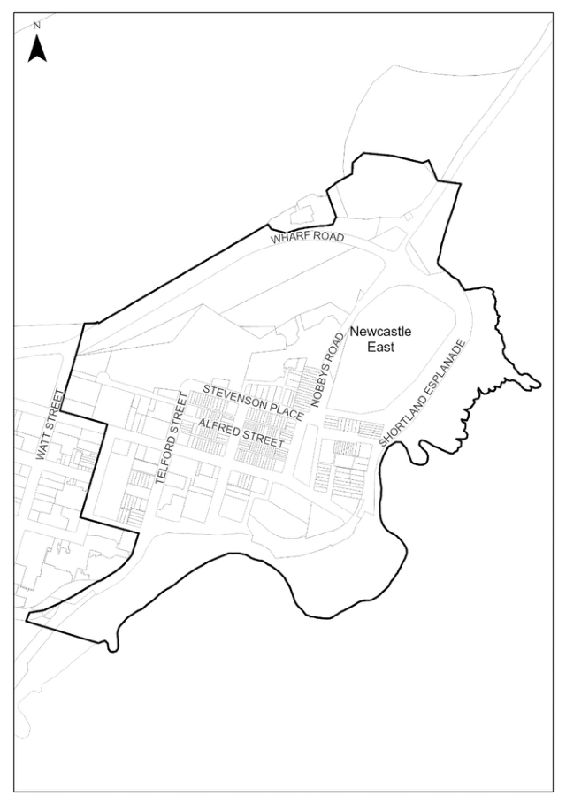

### 13.0 Newcastle East Heritage Conservation Area

This section applies to land within the Newcastle East Heritage Conservation Area as identified and mapped in LEP 2012 - Heritage Maps (HER_004K). The heritage conservation area is in Newcastle East located between Newcastle Harbour to the north, the Pacific Ocean to the east and south, Pacific Street and Watt Street to the West.

It maps the area for controls provided in Section E1 Built and landscape heritage, and is to be read with that section and the heritage significance and desired future character statements of this section, to understand the

> [Picture on page 24: a picture, saved as a picture (images/section-e2-heritage-conservation-areas-page-24-8.gif, 150 dpi).]

heritage requirements.

#### Map E2.08: Land application – Newcastle East Heritage Conservation Area
