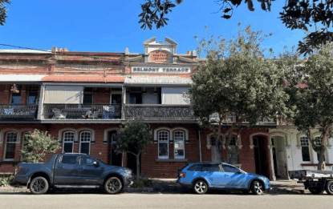
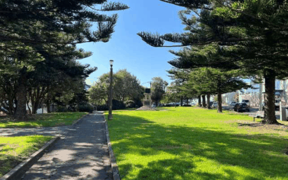
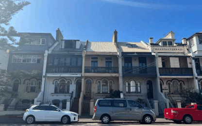
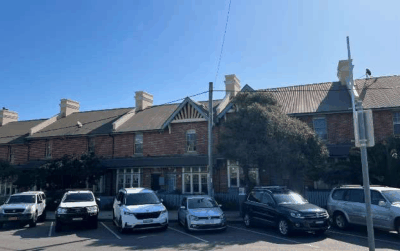

### 13.2 Desired future character statement

The character of the Newcastle East Heritage Conservation Area is made up of a variety of building styles and settlement patterns that date from the late 19th and early decades of the 20th century. The special character of Newcastle East is to be preserved and maintained through the retention of contributory buildings, open space, street trees and elements of visual interest and heritage significance such as the many iconic buildings located in Newcastle East, parks and open space, views and vistas, the unique coastal topography and street layout, and

the character of the streetscapes including street trees, buildings and the relationship of built elements.

Elements to be preserved and/or sensitively restored or reconstructed (based on evidence of original appearance) include: Range of contributory and historic buildings, particularly intact or historically significant groupings, heritage items, iconic structures, and the appearance and layout of streets. Existing subdivision pattern and street layout, including preserving the integrity of laneways. Two to three-storey scale of housing stock located in the area to the north of Scott Street and east of Telford Street. Exposed face brick and stone of existing building facades and front fencing. Street furniture such as sandstone kerbing and guttering, and other features of historical interest such as heritage items, public stairs, lanes, parks, views and vistas. Regular and homogenous urban form which reflects a regular pattern of subdivision and development, and building stock from between the 1870s and 1930, demonstrating the gradual urbanisation of a once indigenous landscape. Existing appearance of Newcastle East, views outwards to the coastline and harbour, and views into the area from Foreshore Park and the Newcastle coastline and Ocean Baths. Significant heritage places including the Coal River Precinct, the Nobbys headland and breakwater, Fort Scratchley Historic Site, Convict Lumber Yard and Customs House precinct, the Newcastle Ocean Baths, Joy Cummings Centre and other significant groups such as the Earp Gillam Bond Store Precinct and Stevenson Place terraces. Views to and visual interconnections between significant Aboriginal cultural landscape features including Whibayganba (Nobbys Head), Tahlbihn (Flagstaff Hill / Fort Scratchley), Burrabihngarn (Pirate Point, Stockton), Yohaaba (Port Hunter), Coquun (Hunter River: South Channel), Khanterin (Shepherds Hill), and Cathedral Park. Mature trees in public domain. Public parks and reserves, including Pacific Park, Newcastle Beach, Parnell Place Park, Nobbys Beach, and Foreshore Park. Items of heritage significance individually listed as heritage items in Schedule 5 of LEP 2012, including retention of the three-dimensional form and adaptive re-use of heritage item buildings. The rich record of relics and archaeological sites beneath the modern city.

The following images demonstrate the characteristic features of the Newcastle East Heritage Conservation Area.

> [Picture on page 26: a picture, saved as a picture (images/section-e2-heritage-conservation-areas-page-26-2.gif, 150 dpi).]

> [Picture on page 26: a picture, saved as a picture (images/section-e2-heritage-conservation-areas-page-26-3.gif, 150 dpi).]

Figure E2.32: Mature trees present in the public domain.

> [Picture on page 26: a picture, saved as a picture (images/section-e2-heritage-conservation-areas-page-26-6.gif, 150 dpi).]

Figure E2.33: Streetscape with two-storey terraces built in the early 20th century.

> [Picture on page 26: a picture, saved as a picture (images/section-e2-heritage-conservation-areas-page-26-9.gif, 150 dpi).]

Figure E2.35: Rows of houses significant to Newcastle's history as being one of the first social housing built in Australia.

Figure E2.34: Row of three-storey terraces demonstrating the regular pattern of subdivision, ornate elements present in buildings constructed from mid-19th and early 20th centuries.
