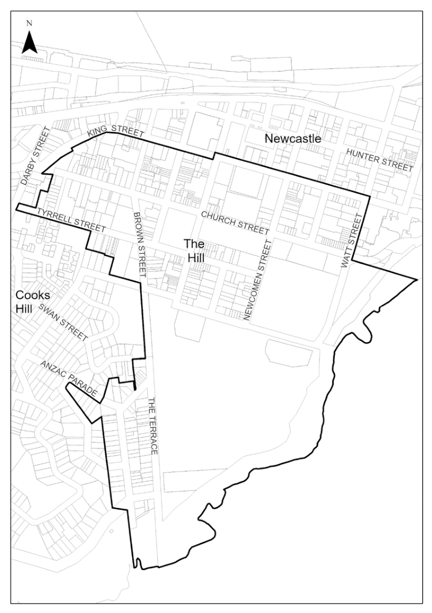

### 14.0 The Hill Heritage Conservation Area

This section applies to land within The Hill Heritage Conservation Area as listed in Schedule 5 and mapped in LEP 2012 - Heritage Maps (HER_004G and HER_004K). The heritage conservation area is in Newcastle and The Hill located between King Street to the north, Watt Street and the Pacific Ocean to the east, the Pacific Ocean, Kitchener Parade and Tyrell Street to the south, and the High Street, Lemnos Parade and Darby Street to the west.

It maps the area for controls provided in Section E1 Built and landscape heritage, and is to be read with that section and the heritage significance and desired future character statements of this section, to understand the heritage requirements.

> [Picture on page 27: a picture, saved as a picture (images/section-e2-heritage-conservation-areas-page-27-10.gif, 150 dpi).]

#### Map E2.09: Land application – The Hill Heritage Conservation Area

#### Key period of significance – circa 1801 to 1940

The Hill is of outstanding local heritage significance on many levels. It is a significant historic landscape containing numerous heritage items, significant trees, views of the ocean and harbour, and a steep topography that gives it a distinctive character. Its history is multi-dimensional as one of the oldest settled areas and as a place of first European settlement.

There are many significant paintings by early colonial artists including Joseph Lycett, Sophia Campbell and others, depicting European use of The Hill area during the first two decades of settlement, and that depict the traditional owners of the area, the Awabakal, living in this area. The Anglican Cathedral and burial ground are situated at the top of The Hill. The first railway in Australia was located in this precinct, starting at the Australian Agricultural Company's (AACo) A Pit, just off Church Street. The flat bench created for the mine is still visible with the "The Boltons" heritage group now sitting over the site. The funicular railway is significant as the first in Australia, and it was manually powered by the convict labour force.

The heritage conservation area is significant historically for its three AACo coal pits, three earliest private coal mines in Australia, the A Pit, off Church Street, the B Pit, off Swan Street, the C Pit, off Bingle Street, and remains including the winding house at No 18 Bingle Street (see Item No. 2173981). These sites are of high heritage significance as they brought profound changes to the economic fortunes of the colony after 1828 because a coal export trade gained great momentum. The Cathedral and its burial ground have the potential to reveal through their archaeology information about the convict settlement, and despite the repositioning of the graves, the human remains survive in their original resting places.

The Hill Heritage Conservation Area has a strong sense of place and contains highly intact streetscapes with houses, terraces and villas dating from the mid-19th Century through to the late 20th century. There are several residences which date as far back as the 1850s and Claremont House in Newcomen Street which was built in the 1840s, and these are of particular importance. A remnant stone wall (the remains of the Parsonage at the corner of Newcomen and Church Street) dates between 1818 -1820. The sandstone retaining walls are an important historical element in The Hill along with mature trees, gardens and early roads.
