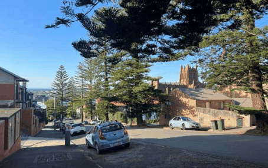
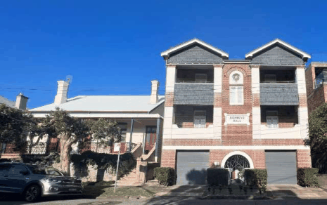
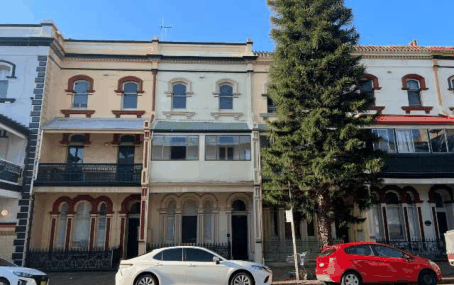
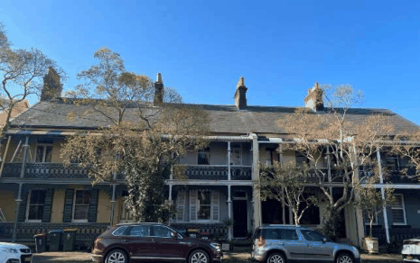
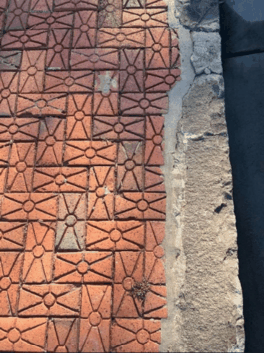

### 14.2 Desired future character statement

The character of The Hill Heritage Conservation Area is made up of a variety of building styles and settlement patterns that date from the late 19th and early decades of the 20th century. The special character of The Hill is to be preserved and maintained through the retention of contributory buildings, open space, the existing subdivision pattern, street trees and elements of visual interest and heritage significance. Such as the many iconic buildings located in The Hill, parks and open space, views and vistas, unique steep topography and street layout, and character of the streetscapes including street trees, buildings and relationship of built elements.

Elements to preserve and/or sensitively restore or reconstruct (based on evidence of original appearance) include:

Range of contributory and historic buildings, particularly intact or historically significant groupings, heritage items, iconic structures, and the appearance and layout of streets. Two storey scale of housing stock that is an original defining feature of the area. Exposed face brick and stone of existing building facades and front fencing. Sandstone retaining walls, street features such as sandstone kerbing and guttering, and other features of historical interest such as coal shutes, public stairs, lanes, parks, views and vistas. Eclectic and organic nature of the urban pattern and varying ages of the building stock that demonstrates the gradual urbanisation during the 19th and 20th century of a once Indigenous landscape. Existing appearance of The Hill, views outwards to the coastline and harbour and views into the area from the City, foreshore and Stockton which reveal a treelined suburb with a steep topography. Views and visual interconnections between significant Aboriginal cultural landscape features including Whibayganba (Nobbys Head), Tahlbihn (Flagstaff Hill / Fort Scratchley), Burrabihngarn (Pirate Point, Stockton), Yohaaba (Port Hunter), Coquun (Hunter River: South Channel), Khanterin (Shepherds Hill), and Cathedral Park. Mature trees in gardens and the public domain.

Public parks and reserves, including the Newcastle Recreation Reserve, Fletcher Park, and Cathedral Park. Existing subdivision pattern and street layout. Items of heritage significance individually listed as heritage items in Schedule 5 of LEP 2012 including retention of the three-dimensional form and adaptive re-use of heritage item buildings. The rich record of relics and archaeological sites beneath the modern city.

The following images demonstrate characteristic features of The Hill Heritage Conservation Area.

> [Picture on page 29: a picture, saved as a picture (images/section-e2-heritage-conservation-areas-page-29-8.gif, 150 dpi).]

> [Picture on page 29: a picture, saved as a picture (images/section-e2-heritage-conservation-areas-page-29-9.gif, 150 dpi).]

Figure E2.36: The steep topography of The Hill provides vistas to the historic site – Christ

#### Church Cathedral, the ocean and harbour.

> [Picture on page 29: a picture, saved as a picture (images/section-e2-heritage-conservation-areas-page-29-13.gif, 150 dpi).]

Figure E2.37: Buildings from the early 19th to Mid- 20th centuries contributing to the eclectic urban form.

> [Picture on page 29: a picture, saved as a picture (images/section-e2-heritage-conservation-areas-page-29-17.gif, 150 dpi).]

Figure E2.39: Two-storey housing stock - the original defining feature of the area, complemented by street trees.

Figure E2.38: Row of three storey terraces with uniform urban form, ornate elements contributing significantly to the historic character of The Hill.

> [Picture on page 29: a picture, saved as a picture (images/section-e2-heritage-conservation-areas-page-29-25.gif, 150 dpi).]

#### Figure E2.40: Heritage road assets such as

sandstone kerbing and restored historic pavements.
