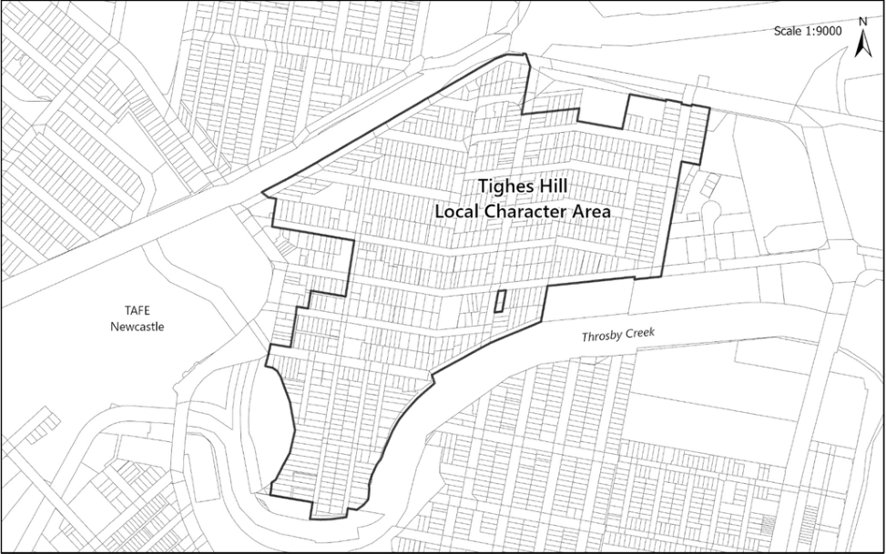

### 2.0 Application

This section applies to residential zoned land in Tighes Hill, referred to as the local character area. Mayfield Renewal Corridor, covered in Section E8 Renewal corridors, applies to the employment zone along Mayfield Road and part of Elizabeth Street.

This section applies to all development consisting of: New buildings or structures Additions or alterations to existing buildings or structures.

This section applies to all land within the heavy line in Figure E3.01.

> [Picture on page 2: a picture, saved as a picture (images/section-e3-tighes-hill-local-character-page-2-15.gif, 150 dpi).]

#### Figure E3.01: Tighes Hill local character area
