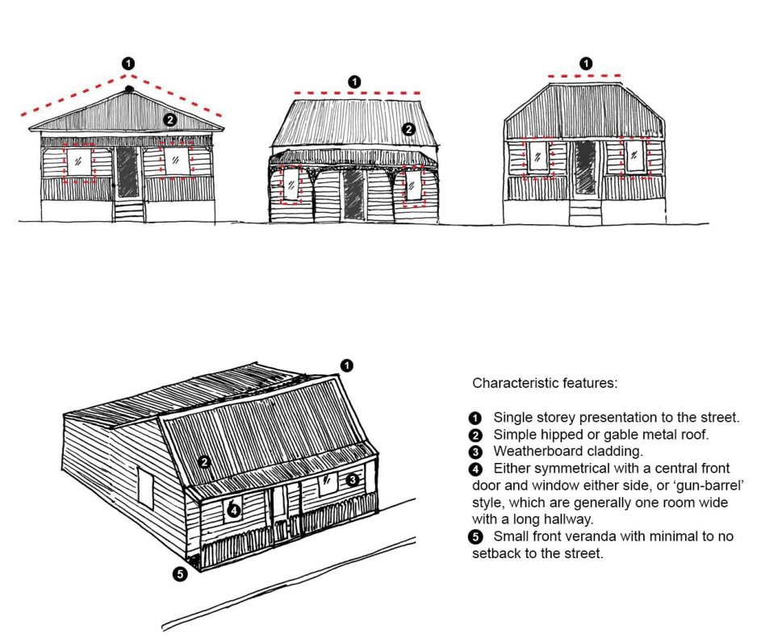
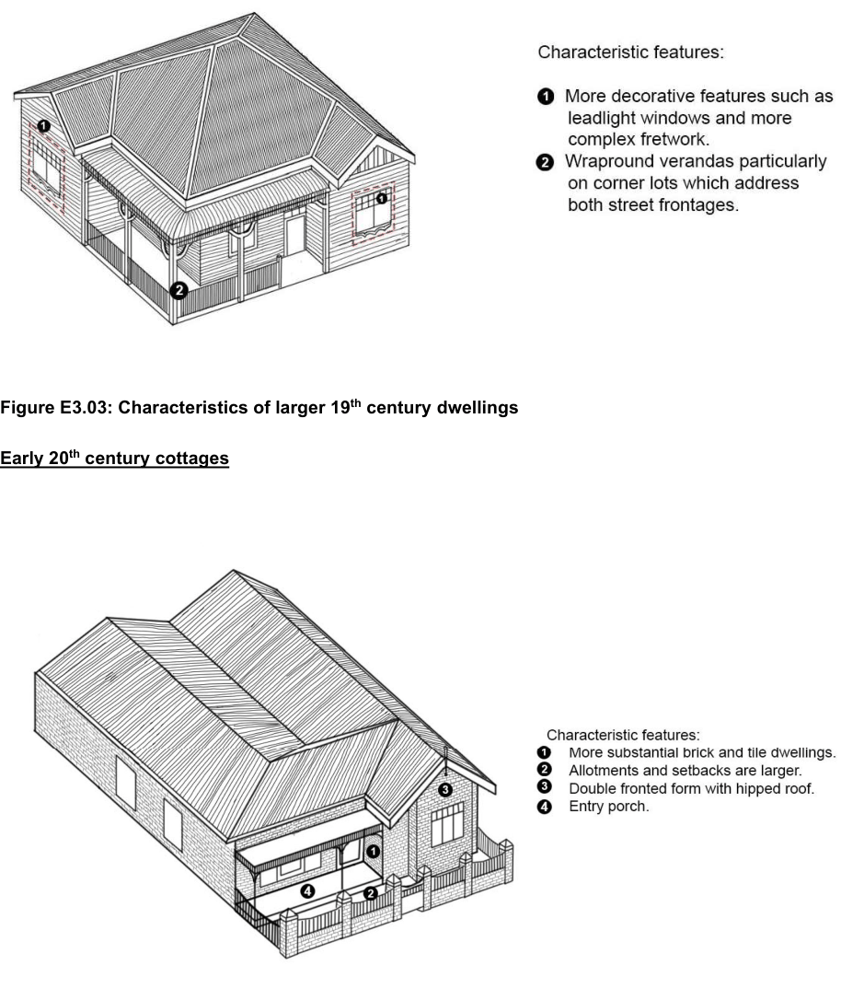

### 8.0 Common building type design

This design information is to guide modifications to existing housing stock, acknowledging the original architectural features of the building style.

#### Worker's cottages

> [Picture on page 5: a picture, saved as a picture (images/section-e3-tighes-hill-local-character-page-5-5.gif, 150 dpi).]

#### Figure E3.02: Characteristics feature of Worker's cottages

#### Larger 19th century dwellings

> [Picture on page 6: a picture, saved as a picture (images/section-e3-tighes-hill-local-character-page-6-2.gif, 150 dpi).]

#### Figure E3.03: Characteristics of larger 19th century dwellings

#### Early 20th century cottages

#### Figure E3.04: Characteristics of early 20th century cottages
