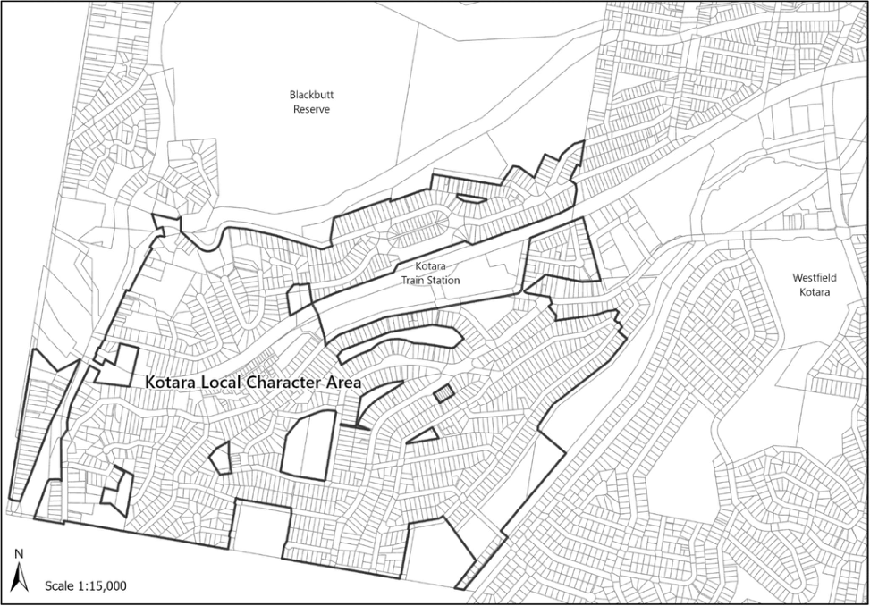

### 2.0 Application

This section applies to residential zoned land in Kotara, referred to as the local character area. Kotara local character area applies to all land within the heavy line in Figure E4.01.

> [Picture on page 2: a picture, saved as a picture (images/section-e4-kotara-local-character-page-2-8.gif, 150 dpi).]

#### Figure E4.01: Kotara local character area
