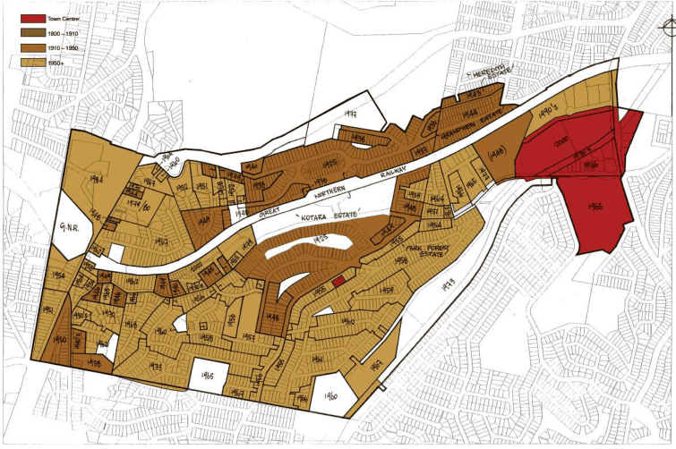

### 6.0 History of Kotara

The subdivision of Kotara was undertaken by the Scottish Australian Mining company in 1925. The subdivision was inspired by the "Garden Suburb" movement which sought to create urban settlements with integrated and accessible transport networks between towns and the central city. The Garden City concept introduced a new way of working in a productive industrial city while being able to enjoy shops, parks, playgrounds and open spaces.

Kotara Estate, comprising the northern and central portions of Kotara was strategically positioned within walking distance to the Great Northern Railway line which would connect future residents to the city centre. The subdivision offered views of the now Blackbutt Reserve to the north and Kotara Park to the south.

While first subdivided in 1925, development in the suburb did not take off until after 1947 when additional housing was required to accommodate the wave of post-war immigration. The subdivision and establishment of Kotara continued well into the mid-1980s and adopted a curvilinear street pattern and long narrow lots in response to the moderate to steep slopes of the area. The continued subdivision of Kotara throughout the twentieth century has resulted in a variety of lot shapes, sizes, housing types and styles. Figure E4.02 below indicates the subdivision dates for the suburb of Kotara.

Interwar and colonial period dwellings are prevalent throughout this area with many dwellings characterised by brick and chamferboard cladding with either corrugated iron or tiled roofs. Many have adopted decorative features such as gable ends, battens, brick piers, awnings and window brackets and recessed verandas. The use of materials, colours and landscaping provides for a varied but consistent streetscape.

Park Forest Estate, subdivided between 1950 and 1980, adopts a significant curvilinear street pattern and long narrow lots consistent with the subdivision pattern of earlier stages. Contemporary style homes reflect traditional housing styles such as veranda piers, detailing and hipped roof forms. Many dwellings display front garages with large setbacks for driveways to the street, due to the increasing popularity of the family car. Manicured front gardens, mature trees, front verandahs are common features between the public and private domain.

> [Picture on page 4: a picture, saved as a picture (images/section-e4-kotara-local-character-page-4-24.gif, 150 dpi).]

Figure E4.02: Kotara subdivision dates (Source: Coomes Consulting, 05 May 2006)
