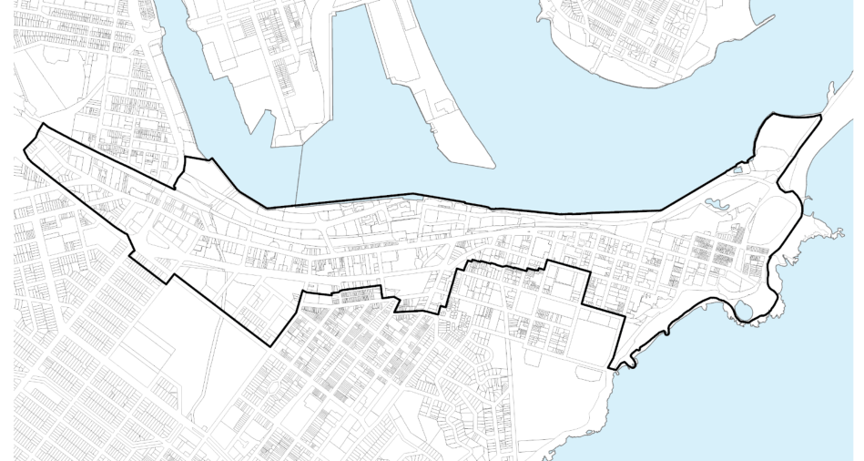

### 2.0 Application

This Section applies to all development within the Newcastle city centre, as is shown in Figure E5.01 or Part 7 of the Newcastle Local Environmental Plan 2012 (LEP 2012).

> [Picture on page 2: a picture, saved as a picture (images/section-e5-newcastle-city-centre-page-2-27.gif, 150 dpi).]

#### Figure E5.01: Newcastle city centre land application

For development involving heritage items or heritage conservation areas identified under the LEP 2012, a merit assessment will be undertaken to ensure the outcomes sought are balanced with heritage conservation outcomes.
