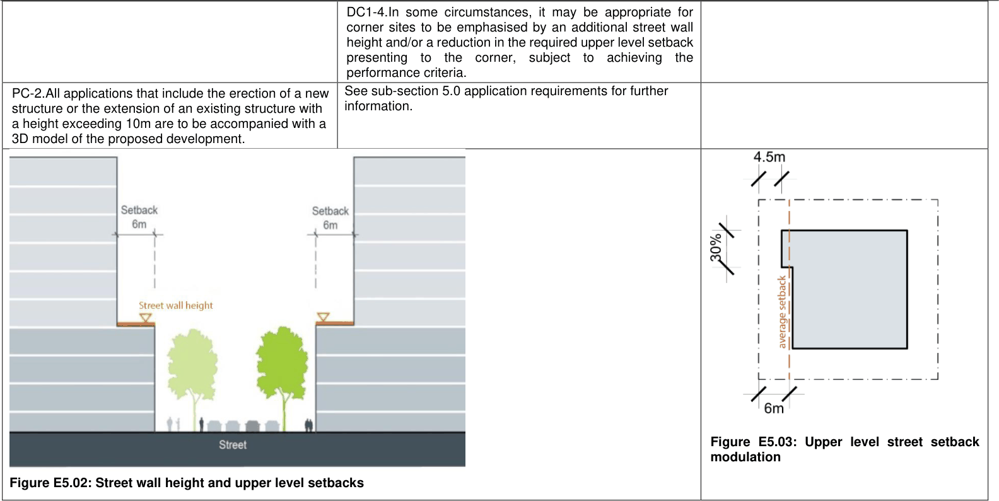

### 6.0 Street wall heights and upper level setbacks

| Street wall heights refer to the height of the building that is built to the public street or lane, measured from the ground level up to the first building setback. The street wall height works in combination with a setback above to balance a sense of enclosure to the street whilst preventing an overbearing sense of confinement. This ‘human scale’ enables sunlight access to the public domain and to adjoining sites and provides for glimpses of surrounding landmark features for wayfinding and a sense of place. Street wall heights typically relate to the street width, often at a ratio of 1:1, and help to provide a consistent building scale in streets that have a mix of uses whilst respecting heritage items and contributory buildings. Objectives 1. Ensure that street wall heights and upper level setbacks contribute to a visually appealing and pedestrian-friendly urban environment, while ensuring that new development is compatible with the existing context of the area. 2. Promote sustainable development that enhances the public realm and supports the health and wellbeing of the community by setting requirements for street wall heights and upper level setbacks that enable adequate sunlight penetration, encourage active street frontages and public spaces, and preserve key view corridors. |  |  |
|---|---|---|
| Performance criteria (PC) | Design criteria (DC) | Explanatory Notes |
| PC-1.Street wall heights and upper level setbacks of new buildings will: a. define the public domain and encourage active street frontages and public spaces b. provide a sense of enclosure and importance to the street without being overbearing to pedestrians c. be compatible with the context including the scale of existing built form, heritage items and contributory buildings d. reinforce the desired future character of the area whilst preserving and protecting desired existing character e. enable adequate sunlight penetration to the street and support a healthy environment for street trees and other landscaping f. allow sunlight access, ventilation, outlook and privacy for existing and future surrounding development, and g. create and/or maintain views and vistas. | DC1-1.The street wall height of new buildings or alterations and additions to existing buildings shall be between 8m and 22m or as specified in the controls for each Character Area. DC1-2.In all circumstances, the street wall height shall be a minimum of 8m allowing for two storeys accommodating ground floor commercial with a minimum floor-to-ceiling of 4m and a first floor with a minimum floor-to-ceiling of 3.3m capable of being adapted for commercial. Greater floor-to- ceiling heights may be required to accommodate some land uses (such as restaurants and cafes) or to respond to the proportions of heritage buildings. DC1-3.Above the street wall height an average setback of 6m from all street frontages shall be provided, as shown in Figure E5.02. This setback may be reduced by 1.5m for up to 30% of the building width measured at the relevant facade, provided that no part of the building structure is less than 4.5m from the street wall alignment as shown in Figure E5.03. Greater setbacks may be appropriate for heritage buildings or to respond favourably to nearby heritage items or contributory buildings. | Refer to Section E1 Built and Landscape Heritage and E2 Heritage conservation areas. Heritage items are identified under Schedule 5 of LEP 2012. Contributory buildings are identified in the Contributory Buildings Maps in the Newcastle Heritage Technical Manual. |

> [Picture on page 9: a picture, saved as a picture (images/section-e5-newcastle-city-centre-page-9-1.gif, 150 dpi).]

DC1-4.In some circumstances, it may be appropriate for corner sites to be emphasised by an additional street wall height and/or a reduction in the required upper level setback presenting to the corner, subject to achieving the performance criteria. See sub-section 5.0 application requirements for further information.

PC-2.All applications that include the erection of a new structure or the extension of an existing structure with a height exceeding 10m are to be accompanied with a 3D model of the proposed development.

#### Figure E5.03: Upper level street setback modulation

#### Figure E5.02: Street wall height and upper level setbacks
