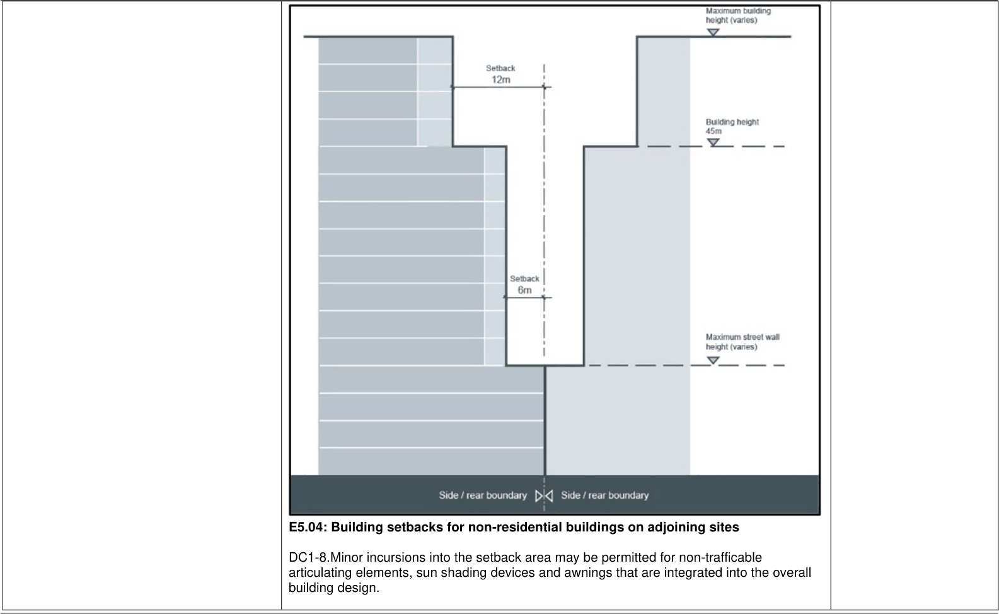
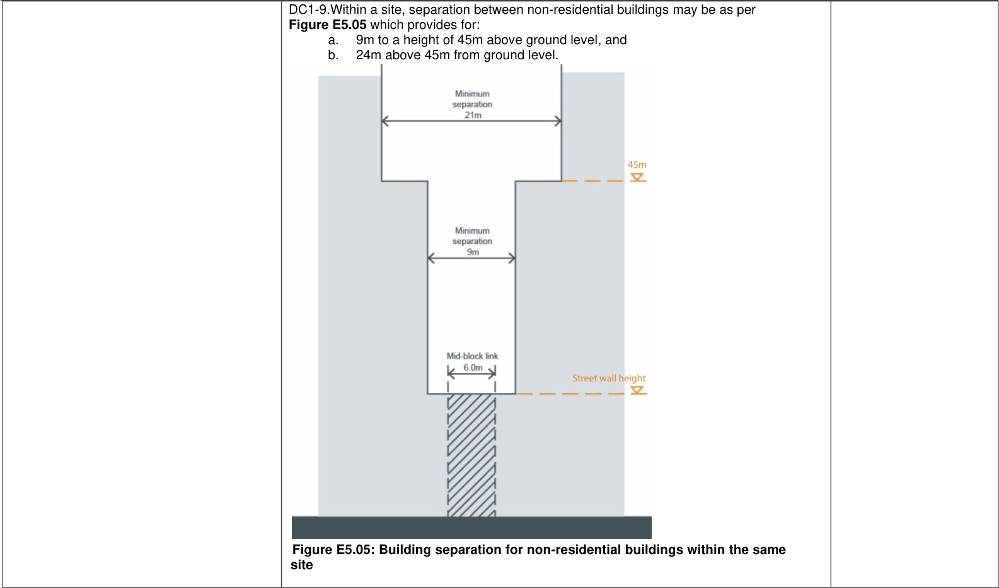

### 7.0 Building setbacks and separation

A building setback is the distance between the boundary of the site and the main building facade or outer edge of projecting elements such as a balcony.

At the ground level, building setbacks help define street edges and create opportunities for defining and interfacing public and private spaces, providing landscaping, and improving pedestrian movements around and between building structures. At upper levels, building setbacks enable sunlight access, ventilation, outlook and privacy for surrounding sites and the public domain and can assist to create or maintain views and vistas.

Building separation is the distance between buildings on the same site or buildings on adjoining sites.  Building separation works in combination with setbacks to provide a consistent rhythm of spaces between built elements enabling daylight penetration to buildings and ground level spaces, views to the sky from the ground level public domain and natural ventilation.

#### Objectives

1\. Ensure that building setbacks create a consistent street edge and interface with the public domain through landscaping, while providing for high-quality building entries that enhance pedestrian mobility and create visual interest.

2\. Set consistent building heights and setbacks that enable solar access, ventilation, outlook, and privacy for both existing and future surrounding development.

3\. Ensure that setbacks provide adequate daylight penetration to the ground level public domain and support a healthy environment for street trees and landscaping, while preserving views to the sky from public spaces.

4\. Protect views and vistas by setting requirements for setbacks that preserve key view corridors and encourage new development to enhance or maintain existing views.

| Performance criteria (PC) | Design criteria (DC) | Explanatory note(s) |
|---|---|---|
| PC-1.Building setbacks and separation will: a. define the street edge and reinforce public and private spaces b. provide opportunities within a site for ground level landscaping that interfaces with the public domain | DC1-1.The ground level shall be built to the street frontage or as otherwise specified in the controls for each Character Area unless: a. it can be demonstrated that it is appropriate to provide a setback to better integrate the ground floor plane with the public domain such as where a colonnade is to be provided b. a full or partial setback will relate more favourably to adjoining buildings. |  |
| c. promote high quality building entries and enhance pedestrian mobility; create a consistent rhythm of spaces between upper levels of buildings enabling solar access, ventilation, | DC1-2.Where a ground level setback is provided, it may contain pedestrian areas, steps, ramps, landscape features and the like but should not contain utility structures or barriers that restrict visual permeability or pedestrian movement or create opportunities for crime or antisocial behaviour. |  |
| outlook and privacy for existing and future surrounding development d. allow adequate daylight penetration | DC1-3.Where a ground level setback is required by this section, basements shall also be setback to provide opportunities for deep soil landscaping within the ground level setback. |  |
| to the ground level public domain and support a healthy environment | DC1-4.Behind the street alignment and up to the street wall height, buildings shall be built to the side and rear boundaries to create a podium, other than: |  |

for street trees and landscaping enable views to the sky from public spaces, and

e. create and/or maintain views and vistas.

a. minor elements to allow solar penetration and natural ventilation to lower levels, or

b. where laneways or through-site links are required as identified in the controls for each Character Area.

DC1-5.Above the street wall height a minimum setback of 6m from all boundaries shall be provided other than permitted.

DC1-6.For mixed-use or residential development, boundary setbacks above the street wall height shall comply with building separation requirements of the Apartment Design Guide. Greater setbacks may be required where existing adjoining development does not provide for half of the building separation required by the Apartment Design Guide and is unlikely to be redeveloped within a reasonable timeframe.

DC1-7.For non-residential development, upper level setbacks above the street wall height shall have regard to existing and potential future buildings on surrounding sites.  Where surrounding buildings contain, or are likely to contain, residential land uses, the building separation requirements of the Apartment Design Guide shall apply.  Where surrounding buildings contain non-residential land uses, side and rear boundary setbacks above the street wall height shall be as per Figure E5.04. which provides for:

a. 6m to a height of 45m above ground level, and

b. 12m above 45m from ground level.

> [Picture on page 12: a picture, saved as a picture (images/section-e5-newcastle-city-centre-page-12-1.gif, 150 dpi).]

#### E5.04: Building setbacks for non-residential buildings on adjoining sites

DC1-8.Minor incursions into the setback area may be permitted for non-trafficable articulating elements, sun shading devices and awnings that are integrated into the overall building design.

> [Picture on page 13: a picture, saved as a picture (images/section-e5-newcastle-city-centre-page-13-1.gif, 150 dpi).]

DC1-9.Within a site, separation between non-residential buildings may be as per Figure E5.05 which provides for:

a. 9m to a height of 45m above ground level, and

b. 24m above 45m from ground level.

Figure E5.05: Building separation for non-residential buildings within the same site
