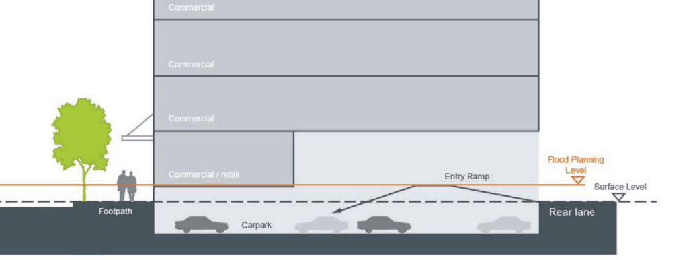
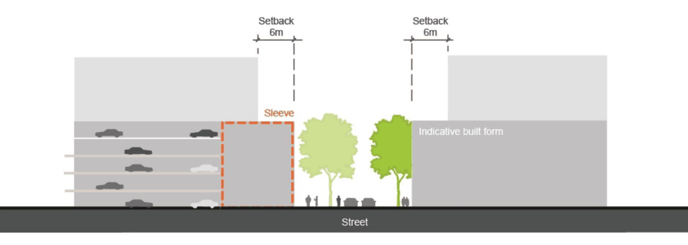

### 11.0 Design of parking structures

| Wherever possible, providing the required car parking within a basement, or below ground level, maximises the opportunities for street activation and most efficiently uses the above ground building envelope for the active component of residential and non-residential land uses. Notwithstanding, environmental constraints such as a high water table, mine subsidence and flooding may dictate that some car parking be provided above ground level. In such circumstances, the aboveground car parking component must be designed in such a way that it does not result in adverse visual impacts and does not detract from the ability of developments to provide active interfaces with and natural surveillance of the public domain. Objectives 1. Prioritise the use of basements or below ground level parking to provide car parking for both residential and non-residential land uses. Where parking is aboveground, it is designed to minimise adverse visual impacts and maintain the ability of developments to provide active interfaces with the public domain. |  |  |
|---|---|---|
| Performance criteria (PC) | Design criteria (DC) | Explanatory note(s) |
| PC-1.Car parking structures are to be well designed in order to: a. maximise the efficient use of above ground building envelope for active purposes b. minimise visual impact c. minimise flood inundation, and d. minimise conflict with pedestrians. | DC1-1.Car parking and loading access points shall be designed to be integrated into the overall building design and shall be recessed into the street facade. The walls of the recess shall be treated with high quality materials in the same manner, or similar to, the main facade. DC1-2.Car parking shall be designed to minimise flood waters from entering car parking levels by: a. orienting access points away from overland flow paths b. designing access points to be above the 1 in 100 year flood level plus freeboard as shown in Figure E5.09 below c. ensuring any aboveground perimeter walls are impermeable up to the 1 in 100 year flood level plus freeboard. DC1-3.Car parking should be contained within the building footprint and preferably within a basement. DC1-4.Where on-site parking cannot be provided within the building footprint it must be located to the side or rear of the building and not be visible from the street frontages. DC1-5.Where environmental constraints such as high water table, mine subsidence or flooding limit the extent of basement car parking, up to 50% of the required car parking may be provided at the ground level or above ground, subject to the Design Criteria within this section. | For further information regarding parking see Section C1 Traffic, Parking and Access. Figure E5.08: Screened car parking |

DC1-6.At-grade or above ground car parking must be screened from view from public spaces by:

solutions

Requirements for review of DAs for aboveground car parking structures by the Urban Design Review Panel should form part of the terms of reference for that group and should be specified as a requirement in the DA Lodgement Guidelines.

a. providing a sleeve of active spaces around the car parking areas as shown in Figure E5.10

b. screening the car parking areas using architecturally designed facade treatments that are integrated into the overall building design and/or include artworks as shown in Figure E5.08

c. screening the car parking areas using green walls and roofs

d. utilising the roof over car parking for communal open spaces.

DC1-7.Car parking provided at or above ground level has horizontal flooring and a minimum floor to ceiling height of 4m with a minimum clearance height of 3.5m. For the next two floors above, the floor to ceiling height is to be 3.3m. This will enable the development to being adapted to an alternative use in future and to provide for service vehicles.

> [Picture on page 20: a picture, saved as a picture (images/section-e5-newcastle-city-centre-page-20-22.gif, 150 dpi).]

#### Figure E5.09: Basement ramp design to minimise flood inundation

> [Picture on page 21: a picture, saved as a picture (images/section-e5-newcastle-city-centre-page-21-1.gif, 150 dpi).]

#### Figure E5.10: Sleeved car parking solution
