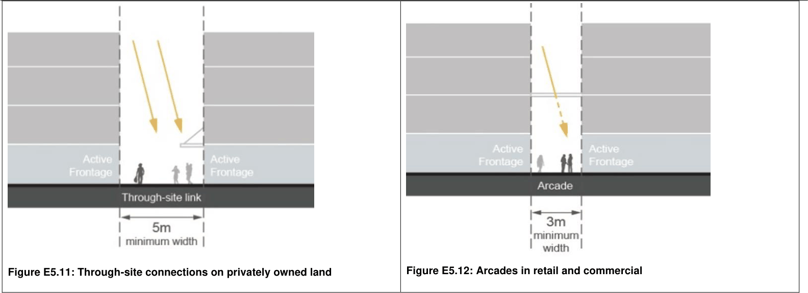

### 15.0 Movement network

The design of the access network determines how people will move about and underpins how the city centre functions. Pedestrian activity can be encouraged by developing a fine grain, connected and legible street and lane network that integrates pedestrians, cycling and public transport.

Encouraging an active transport (walking and cycling) network can improve commercial, social and health outcomes while reducing congestion, noise, pollution, and the dangers of vehicle collisions. Active transport promotes well-being and reduces the environmental impacts of congestion. It is critical that streets and bike networks are safe, attractive and well connected to promote active transport.

#### Objectives

1\. Ensure that the access network prioritises pedestrian, cycling, and public transport use over private vehicle access and movement to support sustainable and active travel behaviour.

2\. Retain, enhance, and ensure the safety of lanes, through-site links, and pedestrian paths to promote access and public use during the day and night.

3\. Ensure that the street and block network is permeable and accessible to promote pedestrian use and encourage sustainable and active travel behaviour.

4\. Ensure that cycling routes are safe, connected, and well-designed to promote cycling as a sustainable and active mode of transportation.

| Performance criteria (PC) | Design criteria (DC) | Explanatory note(s) |
|---|---|---|
| PC-1.The access network | DC1-1.Improved and new pedestrian connections and laneways are to be provided as | All development is expected to incorporate |
| prioritises pedestrian, cycling and public transport uses to | specified in the controls for each Character Area and in accordance with the City Centre Public Domain Technical Manual. | pedestrian connectivity, access and permeability. |
| support sustainable and active travel behaviour over private vehicle access and movement. | DC1-2.Sites with a street frontage shall incorporate footpaths and additional pedestrian connections to improve access and permeability in accordance with C2 Movement Networks. |  |
| PC-2.Lanes, through-site links and pedestrian paths are retained, safe and enhanced to | DC2-1.New pedestrian connections and laneways shall have regard to the location of existing or planned service lanes, pedestrian crossings and public transport nodes. | Lighting within a heritage conservation area and/or within proximity to heritage item/s is designed sympathetically to the heritage |

| promote access and public use during the day and night. | DC2-2.New pedestrian connections and laneways should be connected to avoid dead ends or cul-de-sacs, be legible and clear of obstructions (including columns, stairs and storage) and should incorporate wayfinding measures integrated with the public domain. DC2-3.Streets and lanes are connected to encourage pedestrian use. DC2-4.Pedestrian bridges are avoided over public spaces, including lanes. DC2-5.Development adjacent to a lane or pedestrian path includes: a. active uses at the ground level including outdoor dining b. appropriate lighting c. access for service vehicles if necessary. DC2-6.Streets, lanes and footpaths include lighting and illumination in accordance with the requirements of the City Centre Technical Manual. DC2-7.Blank walls and solid fencing that inhibit natural surveillance and encourage graffiti should be avoided. DC2-8.Laneways, paths and through site links incorporate Crime Prevention Through Environmental Design (CPTED) principles. DC2-9.Laneways should be publicly accessible 24 hours, 7 days per week. DC2-10.Laneways are open to the air above for the majority of their length. City of Newcastle (CN) may consider an ‘arcade style’ walkway where the space has an ‘open feel’ and is well lit. DC2-11.Creative lighting installations within lanes and through-site links are encouraged. | significance and desired future character of the heritage item/s and/or heritage conservation area. Refer to Section E1 Built and Landscape Heritage and Section E2 Heritage conservation areas. |
|---|---|---|
| PC-3.Street and block network is permeable and accessible to promote pedestrian use. | DC3-1.Through-site connections on privately owned land shall be as shown in Figure E5.11. a. have a public character, are easily identified by users, safe, well lit, highly accessible and have a pleasant ambience b. have a minimum width of 5m with no obstructions c. have buildings which address the frontage and/or contain active uses to provide opportunities for natural surveillance d. have clear and direct through-ways e. are partially open to the sky f. are publicly accessible at all times g. are clearly distinguished from vehicle access ways | Easements will be imposed over these areas to ensure public access is maintained in perpetuity. Consideration of CPTED is important when designing the street and block network. Further information can be found in Section C7 Safety and Security, including when a crime risk assessment may be required as part of the submission. |

|  | h. align with breaks between buildings so that view corridors are extended and there is less sense of enclosure i. do not contain structures such as electricity substations, carpark exhaust vents, swimming pools or the like) j. incorporate signage at street entries indicating public accessibility and the street to which the through-block connections ends k. are designed in accordance with the Crime Prevention Through Environmental Design principles l. does not generate unacceptable wind impacts within the site or on surrounding land m. have landscaping incorporated throughout the site. DC3-2.Residential developments with a frontage to a through site link incorporate windows, doors and verandahs facing the through-site link at ground level. DC3-3.Arcades in retail and commercial developments shall be as shown in Figure E5.12. a. are a minimum width of 3m, and b. include ground level active uses, and c. have access to natural light, and d. provide public access during business hours, and e. have clear connections to streets and lanes with a direct line of sight between entrances f. are well illuminated to encourage safe pedestrian movement during the night. |  |
|---|---|---|
| PC-4.Cycle routes are safe, connected and well-designed. | DC4-1.Cycle ways are connected into the network indicated in the latest resource or publication by CN and accessible to public transport stops. DC4-2.Safety is maximised through active street frontages. Buildings that adjoin pedestrian and cycle paths are designed to address the path and provide passive surveillance opportunities. DC4-3.Signage should be provided along cycle routes identifying key destinations, transport stops, bicycle parking, travel times and distances. DC4-4.Commercial development includes end of trip cycling infrastructure. Design solutions include secure bike parking, showers and change room facilities. DC4-5.Cycling routes and cycle parking are coordinated and integrated with the location of public transport stops to enable convenient mode change. | Resources or publications that identify the cycling network may include, but is not limited to, hard copy or digital mapping, adopted strategy, or the like. |

> [Picture on page 28: a picture, saved as a picture (images/section-e5-newcastle-city-centre-page-28-1.gif, 150 dpi).]

#### Figure E5.12: Arcades in retail and commercial

#### Figure E5.11: Through-site connections on privately owned land
