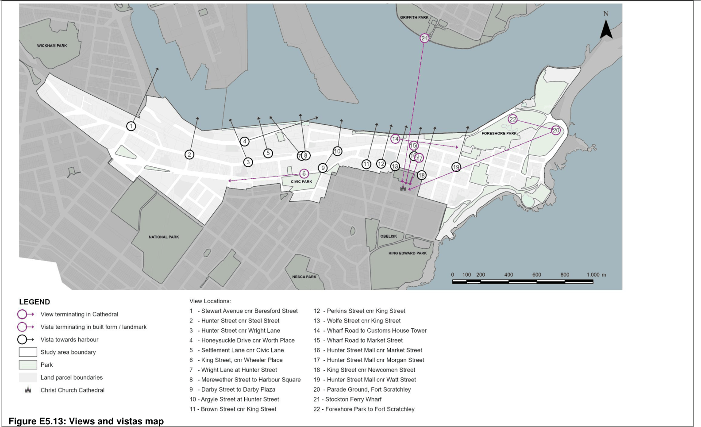

### 16.0 Views and vistas

| Preserving significant views around the city is critical to place-making, wayfinding and for retaining the unique character of Newcastle. Significant views include views from public places towards specific landmarks, heritage items and areas of natural beauty. Some of the most important views in Newcastle are along streets leading to the water or landmark buildings, including Christ Church Cathedral, Fort Scratchley and Nobby's Head. With the redevelopment of the former rail corridor lands, key views and vistas are to be established and will create a visual connection and link the city to the foreshore. Objectives 1. Preserve and enhance public views and sight lines to key public spaces, the waterfront, prominent heritage items, landmarks and landscape features. |  |  |
|---|---|---|
| Performance criteria (PC) | Design criteria (DC) | Explanatory note(s) |
| PC-1.Public views and sight lines to key public spaces, the waterfront, prominent heritage items, landmarks and landscape features are protected. | DC1-1.New development retains and improves the views nominated in Figure E5.13. DC1-2.New development in the vicinity of views to Christ Church Cathedral must ensure that vistas of the Cathedral’s tower, roof-scape and pinnacles of the buttresses are preserved. DC1.-3.Open space, breaks and setbacks in the built form align with existing streets and view corridors to key public spaces, the waterfront, prominent heritage items, landmarks and landscape features including but not limited to those identified in Figure E5.13. DC1-4.The height and bulk of development shall ensure that significant views including those nominated in Figure E5.13 are protected. DC1-5.All development within or adjacent to nominated view corridors (as per Figure E5.13), or that exceeds the street wall height is to be accompanied by a visual impact assessment demonstrating how this performance criteria has been met. See application requirements for further information. DC1-6.Where views are potentially compromised, an assessment of the view loss must be undertaken having regard to ‘Impact on public domain views’ of the NSW Land and Environment Court (presently Rose Bay Marina Pty Limited v Woollahra Municipal Council and anor [2013] NSWLEC 1046). | Examples of viewable landmarks and landscape features worthy of retention include, but are not limited to: • waterbodies • port infrastructure and silos • civic monuments • hill ridgelines • heritage listed items including Cathedral Park and Fort Scratchley • public spaces including parks, plazas and the foreshore • unique building facades including University of Newcastle, Kingsley Hotel (former Council Administration Building) and the Newcastle Courthouse. Refer to Section E2 Heritage conservation areas. A visual impact assessment identifies and analyses the affected views in their existing state, includes photomontages of the view once the proposed development is in place and then assess the impact on that view. |

> [Picture on page 30: a picture, saved as a picture (images/section-e5-newcastle-city-centre-page-30-1.gif, 150 dpi).]

#### Figure E5.13: Views and vistas map

PC-2.New

DC2-1.Align new development to maximise and frame view corridors between buildings, considering topography, vegetation and surrounding development.

DC2-2.Where there are potential impacts on views an assessment of the following principles should be submitted with the application:

development minimises view loss and maximises equitable view sharing.

a. the views to be affected

b. what part of the property the views are obtained

c. the extent of the impact

d. the reasonableness of the proposal that is causing the impact.

DC2-3.Where views are potentially compromised, an assessment of the view loss must be undertaken having regard to ‘Views – General Principles’ of the NSW Land and Environment Court (presently Tenacity Consulting v Warringah Council [2004] NSWLEC 140).
