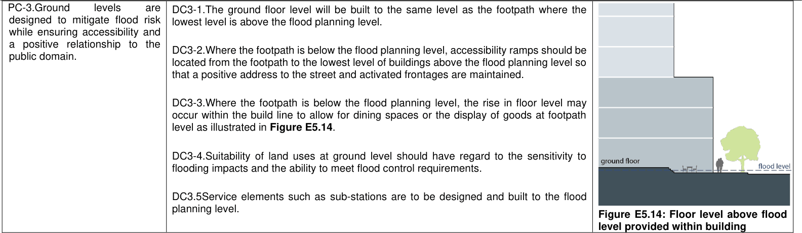

### 18.0 Addressing the street

Activation of the city centre is achieved by providing inviting streets and places that encourage free movement, social interaction and business activity. Addressing the street relates to how development contributes to an engaging, comfortable and safe public realm. The relationship between a building and the street edge determines how accessible and functional a building is. All development adjoining the public domain needs to be well designed, using high quality durable materials.

Active street frontages promote an interesting and safe pedestrian environment. Shops, studios, offices, cafes, recreation and community facilities provide the most active street fronts. Residential buildings can contribute positively to the street by providing a clear street address, direct access from the street and outlook over the street.

#### Objectives

1\. Ensure that ground floor uses contribute to the liveliness and vitality of the street, creating a positive and active environment.

2\. Ensure that buildings are designed and oriented to positively address streets, footpaths, lanes and other public spaces to promote vitality, interaction, and casual surveillance, concentrate and reinforce pedestrian activity, and provide visual interest to the street frontage.

3\. Ensure that ground levels are designed to mitigate flood risk while maintaining accessibility and a positive relationship with the public domain.

| Performance criteria (PC) | Design criteria (DC) | Explanatory note(s) |
|---|---|---|
| PC-1.Ground floor uses add to the liveliness, safety and vitality of the street. | DC1-1.A minimum of 70% of a building’s primary frontage is to be an ‘active frontage’. DC1-2.Active frontages are to be provided on secondary frontages, laneways, through- site links and arcades where practicable. DC1-3.Clear glazing is to be provided to windows and doors. DC1-4.Fire escapes, service doors, substations, car park entries and plant and equipment hatches and grilles, to the street frontage shall be minimised. DC1-5.Ground levels of buildings in commercial core and mixed zones have a minimum 4m floor to ceiling height on the ground floor to ensure flexibility for a variety of active uses. DC1-6.Foyer and lobby spaces are no more than 20% of the street frontage. DC1-7.Shopfronts are enclosed, unless they are food and drink premises. DC1-8.Residential ground floor units are to have individual gates and entrances accessed | An ‘active frontage’ is one with transparent glazing to allow unobstructed views from the adjacent footpath to at least a depth of 6m within the building. Street frontages may most effectively be activated through one or more of the following: a. retail and shop fronts; b. cafés or restaurants; c. active office uses, visible from the street; d. public building or community facilities where activities; inside the building are visible from the street; e. entries and lobbies; f. multiple entries for residential buildings; and g. uses that overlook the street. |

|  | directly from the street. DC1-9.Ground floor residential apartments are to be elevated from the street level by a minimum of 300mm and a maximum of 600mm unless this results in being below flood levels. DC1-10.Ground floor residential fences are to be no more than 1.2m in height with a minimum 50% transparency. Soft landscaping is encouraged. Colourbond must be avoided. DC1-11.Signage, decals and posters on windows on the ground floor are not to cover more than 15% of a window. |
|---|---|
| PC-2.Buildings are designed and oriented to positively address streets, footpaths, lanes and other public spaces to: a. promote vitality, interaction and casual surveillance; b. concentrate and reinforce pedestrian activity; c. avoid opaque facades to provide visual interest to the street frontage. | DC2-1.Development is to avoid blank walls that inhibit natural surveillance and encourage graffiti. DC2-2.Building design shall avoid creating opportunities for personal concealment. DC2-3.Building entrances and shelter from the elements should be provided within recesses behind the building line rather than under porte-cochères. DC2-4.Security grills, where provided, are fitted internally behind the shop front, are fully retractable and at least 50% transparent when closed. DC2-5.Ground floor retail premises and business premises are to integrate lighting and building illumination to improve street presence and safety during the night |

> [Picture on page 35: a picture, saved as a picture (images/section-e5-newcastle-city-centre-page-35-1.gif, 150 dpi).]

PC-3.Ground levels are designed to mitigate flood risk while ensuring accessibility and a positive relationship to the public domain.

DC3-1.The ground floor level will be built to the same level as the footpath where the lowest level is above the flood planning level.

DC3-2.Where the footpath is below the flood planning level, accessibility ramps should be located from the footpath to the lowest level of buildings above the flood planning level so that a positive address to the street and activated frontages are maintained.

DC3-3.Where the footpath is below the flood planning level, the rise in floor level may occur within the build line to allow for dining spaces or the display of goods at footpath level as illustrated in Figure E5.14.

DC3-4.Suitability of land uses at ground level should have regard to the sensitivity to flooding impacts and the ability to meet flood control requirements.

DC3.5Service elements such as sub-stations are to be designed and built to the flood planning level.

#### Figure E5.14: Floor level above flood level provided within building
