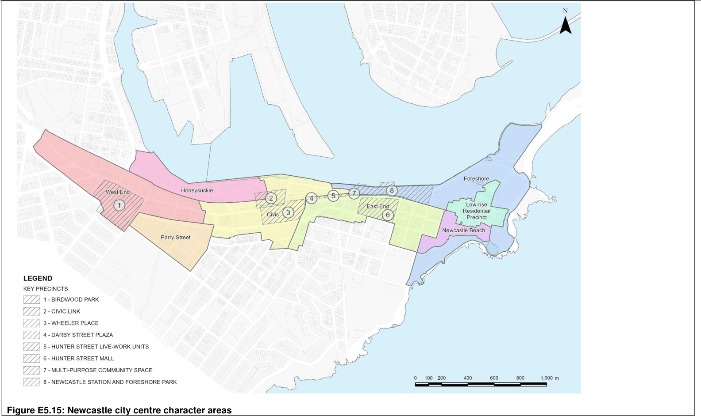

### 21.0 Character areas and key precincts - Introduction

| The Newcastle city centre consists of eight distinct ‘Character Areas’, each with their own distinct character, created by their setting, geography, heritage, built form and functions. Consideration for these elements and implementation of an appropriate design response represents an opportunity for the ongoing renewal and revitalisation of the city centre in line with the desired future character. Within some Character Areas are ‘Key Precincts’ that have particular significance and for which place-specific layout and design elements are identified. The Newcastle city centre Character Areas and Key Precincts are identified in Figure E5.15. |  |  |
|---|---|---|
| Performance criteria (PC) | Design criteria (DC) | Explanatory note(s) |
| PC-1.New development supports and enhances the identified future character and sense of place specific to its location. | DC1-1.Applications for new development are to provide a statement addressing how it will achieve consistency with the Desired Character Statement of the relevant Character Area and Key Precinct as outlined in this subsection. The statement will address, but not be limited to the following considerations: a. scale b. proportion c. street alignment d. materials and finishes e. public domain interface and f. reinforcement of distinctive attributes and qualities of built form and heritage. DC1-2.Development is consistent with the Newcastle Cultural Precinct Concept Master Plan. | The Newcastle city centre encompasses part or all of the ‘C1 Cooks Hill’, ‘C4 Newcastle City Centre’, ‘C5 Newcastle East’ and ‘C6 The Hill’ Heritage Conservation Areas under Schedule 5 of LEP 2012. Accordingly, this section is to be read in conjunction with Section E1 Built and landscape heritage and Section E2 Heritage conservation areas. The Newcastle Cultural Precinct Concept Master Plan provides a range of key moves for the city centre. New development must demonstrate consistency with the master plan. |

> [Picture on page 40: a picture, saved as a picture (images/section-e5-newcastle-city-centre-page-40-1.gif, 150 dpi).]

#### Figure E5.15: Newcastle city centre character areas
