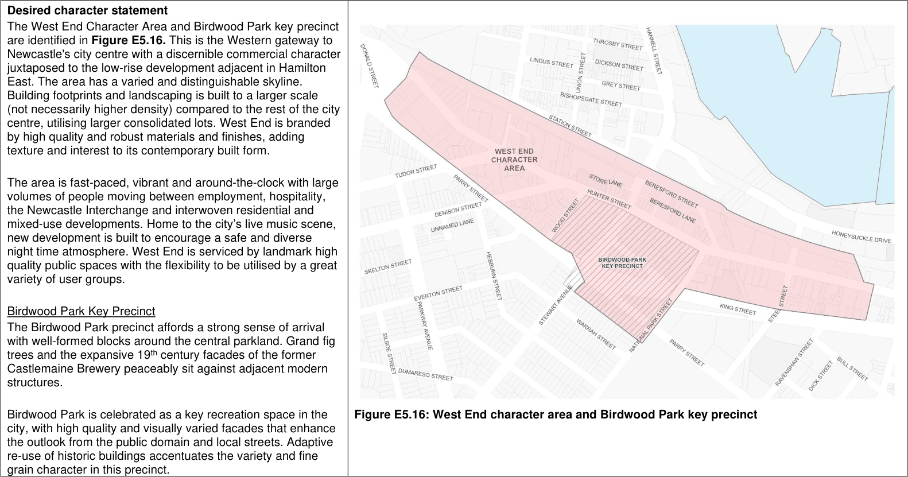
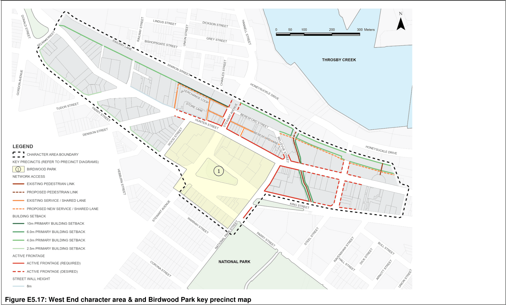
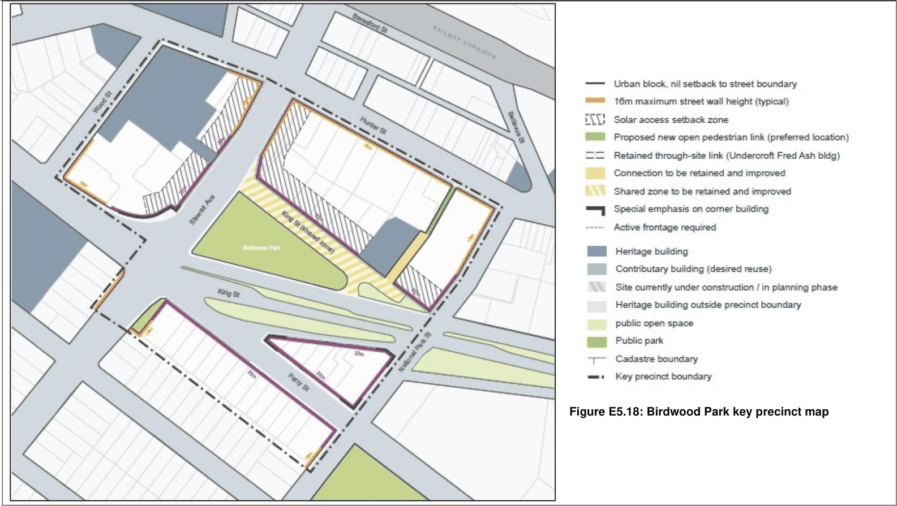

### 22.0 Character areas and key precincts - West End

> [Picture on page 41: a picture, saved as a picture (images/section-e5-newcastle-city-centre-page-41-2.gif, 150 dpi).]

#### Figure E5.16: West End character area and Birdwood Park key precinct

#### Desired character statement

The West End Character Area and Birdwood Park key precinct are identified in Figure E5.16. This is the Western gateway to Newcastle's city centre with a discernible commercial character juxtaposed to the low-rise development adjacent in Hamilton East. The area has a varied and distinguishable skyline. Building footprints and landscaping is built to a larger scale (not necessarily higher density) compared to the rest of the city centre, utilising larger consolidated lots. West End is branded by high quality and robust materials and finishes, adding texture and interest to its contemporary built form.

The area is fast-paced, vibrant and around-the-clock with large volumes of people moving between employment, hospitality, the Newcastle Interchange and interwoven residential and mixed-use developments. Home to the city’s live music scene, new development is built to encourage a safe and diverse night time atmosphere. West End is serviced by landmark high quality public spaces with the flexibility to be utilised by a great variety of user groups.

Birdwood Park Key Precinct The Birdwood Park precinct affords a strong sense of arrival with well-formed blocks around the central parkland. Grand fig trees and the expansive 19th century facades of the former Castlemaine Brewery peaceably sit against adjacent modern structures.

Birdwood Park is celebrated as a key recreation space in the city, with high quality and visually varied facades that enhance the outlook from the public domain and local streets. Adaptive re-use of historic buildings accentuates the variety and fine grain character in this precinct.

Note: The West End Character Area is in the Newcastle City Centre Heritage Conservation Area, which is identified in Schedule 5 of LEP 2012. A Summary Statement of Heritage Significance and Desired Future Character is provided in Section E2 Heritage conservation areas.

| Performance criteria (PC) | Design criteria (DC) | Explanatory note(s) |
|---|---|---|
| PC-1.Development supports the vision articulated in the character statement to deliver an active commercial core. | DC1-1.New development is characterised by large floorplates which have an articulated building form to reduce visual bulk and building massing. |  |
| PC-2.New development that contributes to the night time economy of West End is encouraged. |  |  |
| PC-3.Heritage items and contributory buildings and their setting are protected and conserved, including the Aboriginal cultural heritage and non-Aboriginal archaeology. | DC3-1.Development shall be consistent with Section E1 Built and landscape heritage and Section E2 Heritage conservation areas. DC3-2 .Distinctive early industrial, warehouse and retail buildings that contribute to the character of the area are retained and re-purposed. DC3-3 .Heritage items and contributory buildings are retained and adaptively re-used where suitable. DC3-4.Building form integrates with existing heritage character and echoes historic design elements. | Heritage items are identified under Schedule 5 of LEP 2012. Contributory buildings are identified in the Contributory Buildings Maps in the Newcastle Heritage Technical Manual. Refer to Section B4 Aboriginal Cultural Heritage and Section B5 Historical Archaeology. |
| PC-4.A permeable street network with well-connected easily accessible streets and lanes is promoted, where pedestrian, bicycle and public transport users are prioritised over private vehicles. | DC4-1.Improved and new pedestrian connections and laneways are to be provided in accordance with Figure E5.17 and Figure E5.18 and the City Centre Public Domain Technical Manual. DC4-2.Publicly accessible spaces and connections are created or upgraded to provide high amenity and improved permeability with better connections to the river foreshore, public open space and Hamilton TAFE. DC4-3.Development is consistent with the Newcastle Cultural Precinct Concept Master Plan. |  |

| PC-5.Street wall heights and ground level setbacks complement heritage buildings and contributory items whilst reinforcing the desired future commercial character of West End. | DC5-1.The street wall height of new buildings or alterations and additions to existing buildings shall be in accordance with Figure E5.17 and Figure E5.18 or as per Section E5, Part A. In the event of any inconsistency, the street wall heights in Figure E5.17 and Figure E5.18 will prevail. DC5-2.The ground floor shall be built to the street frontage unless specified otherwise in Figure E5.17 and Figure E5.18. Where a setback is provided, it may contain pedestrian areas, steps, ramps, landscape features and the like but should not contain utility structures or barriers that restrict visual permeability or pedestrian movement. | Heritage items are identified under Schedule 5 of LEP 2012. Contributory buildings are identified in the Contributory Buildings Maps in the Newcastle Heritage Technical Manual. |
|---|---|---|
| PC-6.In identified activity hubs, ground floor uses add to the liveliness and vitality of the street. | DC6-1.Active frontages are to be provided in accordance with Figure E5.17 and Figure E5.18 on through-site links and pedestrian oriented lanes. |  |
| PC-7.Servicing and access minimises conflicts with pedestrians. | DC7-1.Service deliveries are not to be made from Hunter Street or Stewart Avenue for development which has access to another street frontage. DC7-2.For development that has no other frontage than Hunter Street, hours for service deliveries are restricted to minimise potential conflicts with other activities. DC7-3.Vehicle access and servicing is located to minimise conflicts with pedestrians. DC7-4.Loading docks and their access points are not permitted on Hunter Street. |  |
| PC-8.Public space is improved to meet the demands of the future CBD. | DC8-1.Interfaces to the public domain are carefully considered to improve amenity and access. DC8-2.Development around the Interchange, along the former rail corridor, Cottage Creek, lanes or through-site links provide a building address to encourage activity, pedestrian and cycleway movement, and improve safety. DC8-3.Public domain improvements are in accordance with any adopted Public Domain Plan and the City Centre Technical Manual of CN. |  |
| PC-9.Birdwood Park is utilised as a landmark public open space. | DC9-1.Development in the Birdwood Park Key Precinct shall be in accordance with Figure E5.18. DC9-2.New development fronting Birdwood Park addresses the park edge and promotes a sense of enclosure by being built to the street alignment. DC9-3.New development minimises additional overshadowing of Birdwood Park and complies with the design criteria in as per sub-section 20.0. |  |

DC9-4.King Street, along Birdwood Park, is to be reshaped as a shared pedestrian and vehicular street and a place of pedestrian activity by:

a. reducing the road carriageway to minimum widths to maximise space on the footpath for pedestrians, landscaping, public art or outdoor dining

b. raising the level of the carriageway and marking the space with indicators to slow drivers and signal arrival into a shared space

c. incorporating other traffic calming measures such as landscaping and low speed limits

d. restricting service vehicle access at certain times of the day to allow for other activities.

> [Picture on page 45: a picture, saved as a picture (images/section-e5-newcastle-city-centre-page-45-1.gif, 150 dpi).]

#### Figure E5.17: West End character area & and Birdwood Park key precinct map

> [Picture on page 46: a picture, saved as a picture (images/section-e5-newcastle-city-centre-page-46-1.gif, 150 dpi).]

#### Figure E5.18: Birdwood Park key precinct map
