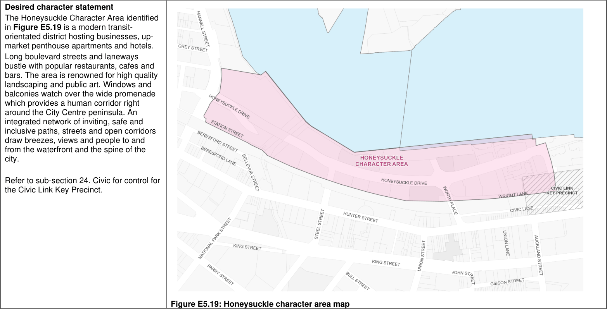
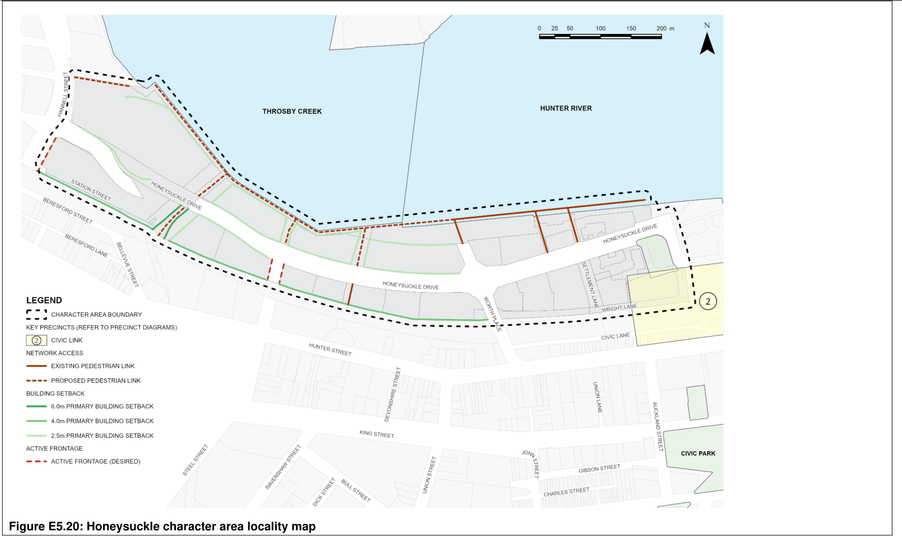

### 23.0 Character areas and key precincts - Honeysuckle

> [Picture on page 47: a picture, saved as a picture (images/section-e5-newcastle-city-centre-page-47-2.gif, 150 dpi).]

#### Desired character statement

The Honeysuckle Character Area identified in Figure E5.19 is a modern transit-orientated district hosting businesses, up-market penthouse apartments and hotels. Long boulevard streets and laneways bustle with popular restaurants, cafes and

bars. The area is renowned for high quality landscaping and public art. Windows and balconies watch over the wide promenade which provides a human corridor right around the City Centre peninsula. An integrated network of inviting, safe and inclusive paths, streets and open corridors draw breezes, views and people to and from the waterfront and the spine of the city.

Refer to sub-section 24. Civic for control for the Civic Link Key Precinct.

#### Figure E5.19: Honeysuckle character area map

Note: Part of the Honeysuckle Character Area is in the Newcastle City Centre Heritage Conservation Area. The Newcastle City Centre Heritage Conservation Area is identified under Schedule 5 of LEP 2012. A Summary Statement of Heritage Significance and Desired Future Character is provided in Section E2 Heritage conservation areas.

| Performance criteria (PC) | Design criteria (DC) | Explanatory note(s) |
|---|---|---|
| PC-1.The foreshore and surrounding access network is activated. | DC1-1.Development between the former rail corridor and Honeysuckle Drive will provide a building address to both frontages. DC1-2.Development along the waterfront, Cottage Creek, lanes or through-site links will provide a building address to encourage activity, pedestrian and cycleway movement, and improve safety. |  |
| PC-2.Heritage items and contributory buildings and their setting are protected and conserved, including the Aboriginal cultural heritage and non-Aboriginal archaeology. | DC2-1.Development shall be consistent with Section E1 Built landscape heritage and Section E2 Heritage conservation areas. DC2-2.Heritage items and contributory buildings are retained and adaptively re-used where suitable. | Heritage items are identified under Schedule 5 of LEP 2012. Contributory buildings are identified in the Contributory Buildings Maps in the Newcastle Heritage Technical Manual. Refer to Section B4 Aboriginal Cultural Heritage and Section B5 Historical Archaeology. |
| PC-3.A permeable street network with well- connected easily accessible streets and lanes is promoted, where pedestrian, bicycle and public transport users are prioritised over private vehicles. | DC3-1.Improved and new pedestrian connections and laneways are to be provided in accordance with Figure E5.20 and the City Centre Public Domain Technical Manual. |  |
| PC-4.Street wall heights and ground level setbacks provide a consistent street edge. | DC4-1.The street wall height of new buildings or alterations and additions to existing buildings shall be in accordance with Figure E5.20 or as per sub-section 6.0. In the event of any inconsistency, the street wall heights in Figure E5.20 will prevail. DC4-2.The ground floor shall be built to the street frontage unless specified otherwise in accordance with Figure E5.20. Where a setback is provided, it may contain pedestrian areas, steps, ramps, landscape features and the like but should not contain utility structures or barriers that restrict visual permeability or pedestrian movement. |  |
| PC-5.In identified activity hubs, ground floor uses add to the liveliness and vitality of the street. | DC5-1.Active frontages are to be provided in accordance with Figure E5.20 on through-site links and pedestrian oriented lanes. |  |

> [Picture on page 49: a picture, saved as a picture (images/section-e5-newcastle-city-centre-page-49-1.gif, 150 dpi).]

#### Figure E5.20: Honeysuckle character area locality map
