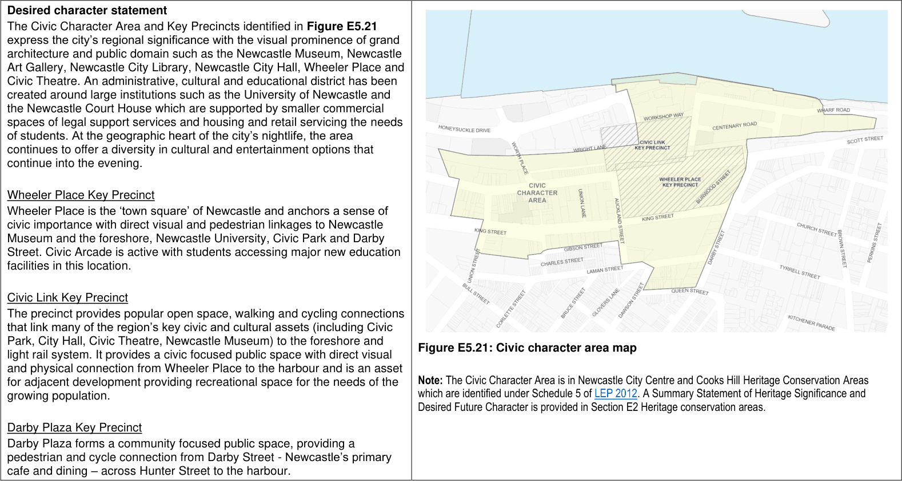
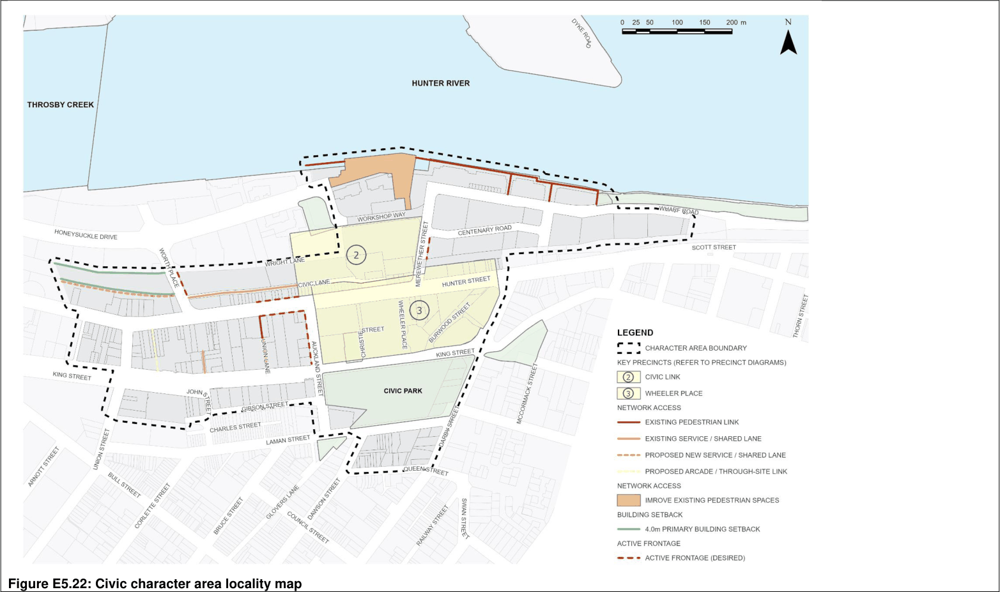
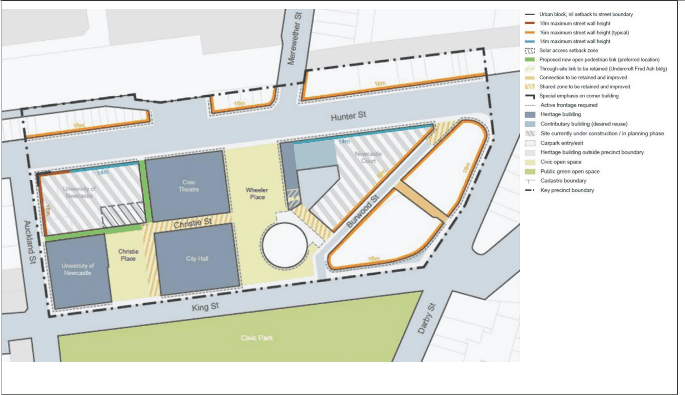
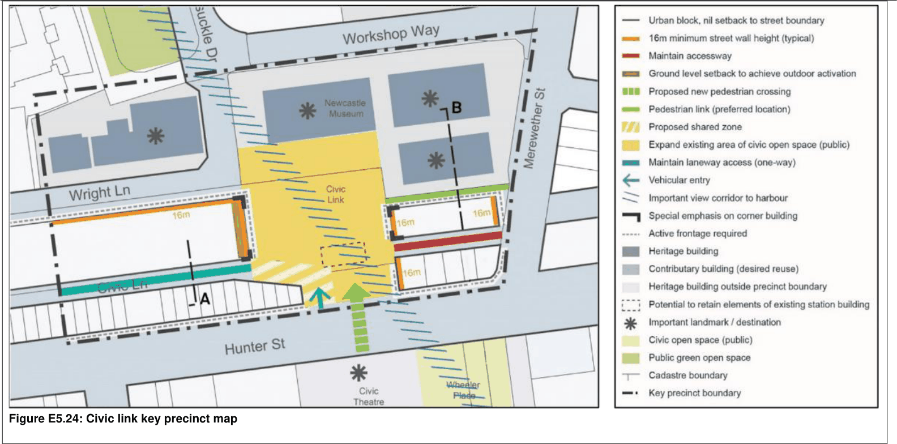
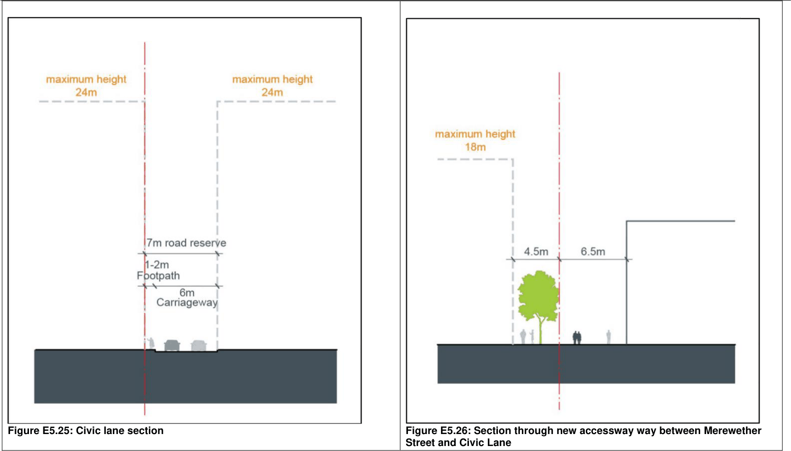
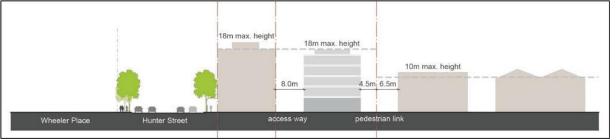
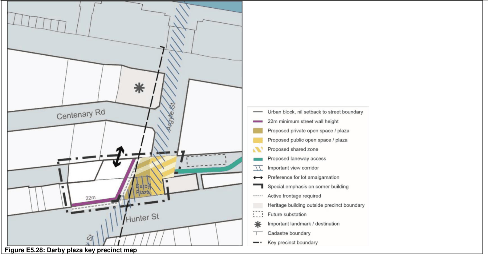

### 24.0 Character areas and key precincts - Civic

> [Picture on page 50: a picture, saved as a picture (images/section-e5-newcastle-city-centre-page-50-2.gif, 150 dpi).]
> Words printed on the picture (title and legend, copied from the PDF):
> Note: The Civic Character Area is in Newcastle City Centre and Cooks Hill Heritage Conservation Areas
> which are identified under Schedule 5 of LEP 2012. A Summary Statement of Heritage Significance and
> Desired Future Character is provided in Section E2 Heritage conservation areas.

#### Figure E5.21: Civic character area map

#### Desired character statement

The Civic Character Area and Key Precincts identified in Figure E5.21 express the city’s regional significance with the visual prominence of grand architecture and public domain such as the Newcastle Museum, Newcastle Art Gallery, Newcastle City Library, Newcastle City Hall, Wheeler Place and Civic Theatre. An administrative, cultural and educational district has been created around large institutions such as the University of Newcastle and the Newcastle Court House which are supported by smaller commercial spaces of legal support services and housing and retail servicing the needs of students. At the geographic heart of the city’s nightlife, the area continues to offer a diversity in cultural and entertainment options that continue into the evening.

Wheeler Place Key Precinct Wheeler Place is the ‘town square’ of Newcastle and anchors a sense of civic importance with direct visual and pedestrian linkages to Newcastle Museum and the foreshore, Newcastle University, Civic Park and Darby Street. Civic Arcade is active with students accessing major new education facilities in this location.

Civic Link Key Precinct The precinct provides popular open space, walking and cycling connections that link many of the region’s key civic and cultural assets (including Civic Park, City Hall, Civic Theatre, Newcastle Museum) to the foreshore and light rail system. It provides a civic focused public space with direct visual and physical connection from Wheeler Place to the harbour and is an asset for adjacent development providing recreational space for the needs of the growing population.

Darby Plaza Key Precinct Darby Plaza forms a community focused public space, providing a pedestrian and cycle connection from Darby Street - Newcastle’s primary cafe and dining – across Hunter Street to the harbour.

| Performance criteria (PC) | Design criteria (DC) | Explanatory note(s) |
|---|---|---|
| PC-1.Support the administrative presence and regional significance of the city | DC1-1.Pedestrian connections between the city’s cultural buildings and spaces and to the foreshore are reinforced. DC1-2.Provide visual and physical connections through the Area to the Hunter River foreshore. |  |
| PC-2.Heritage items and contributory buildings and their setting are protected and conserved, including the Aboriginal cultural heritage and non-Aboriginal archaeology. | DC2-1.Development shall be consistent with Section E1 Built landscape heritage and Section E2 Heritage conservation areas. DC2-2.Distinctive early industrial, warehouse and retail buildings that contribute to the character of the area are retained and re-purposed. DC2-3.Heritage items and contributory buildings are retained and adaptively re-used where suitable. DC2-4.Building form integrates with existing heritage character and echoes historic design elements. | Heritage items are identified under Schedule 5 of LEP 2012. Contributory buildings are identified in the Contributory Buildings Maps in the Newcastle Heritage Technical Manual. Refer to Section B4 Aboriginal Cultural Heritage and Section B5 Historical Archaeology. |
| PC-3.A permeable street network with well-connected easily accessible streets and lanes is promoted, where pedestrian, bicycle and public transport users are prioritised over private vehicles. | DC3-1.Improved and new pedestrian connections and laneways are to be provided in accordance with Figure E5.22 and the City Centre Public Domain Technical Manual. |  |
| PC-4 .Street wall heights and ground level setbacks complement heritage buildings and contributory items whilst reinforcing the desired future character of Civic. | DC4-1.The street wall height of new buildings or alterations and additions to existing buildings shall be in accordance with Figure E5.22 or as per subsection 6.0. In the event of any inconsistency, the street wall heights in Figure E5.22 will prevail. DC4-2.The ground floor shall be built to the street frontage unless specified otherwise in Figure E5.22, Figure E5.23, Figure E5.24 and Figure E5.28. Where a setback is provided, it may contain pedestrian areas, steps, ramps, landscape features and the like but should not contain utility structures or barriers that restrict visual permeability or pedestrian movement. | Heritage items are identified under Schedule 5 of LEP 2012. Contributory buildings are identified in the Contributory Buildings Maps in the Newcastle Heritage Technical Manual. |

| PC-5.In identified activity hubs, ground floor uses add to the liveliness and vitality of the street. | DC5-1.Active frontages are to be provided in accordance with Figure E5.22, on through-site links and pedestrian oriented lanes. DC5-2.New development between the former rail corridor and Hunter Street will provide building addresses to both frontages. DC 5-3.Improve and expand public open space in the heart of Civic to complement and enhance Wheeler Place. DC5-4.Development along publicly accessible spaces, lanes or through-site links will provide a building address to encourage activity, pedestrian and cycleway movement, and improve safety. DC5-5.New development protects sunlight access to the footpath on the south side of Hunter Street and to Wheeler Place, Civic Link, Civic Park and Christie Place between 12 noon and 2pm at midwinter and complies with the design criteria in sub-section 20.0. |
|---|---|
| PC-6.Promote Wheeler Place Key Precinct as the civic, administrative, education and cultural heart of Newcastle. | DC6-1.Development in the Wheeler Place Key Precinct shall be in accordance with Figure E5.23. DC6-2.A new through site-link or arcade from Christie Place to Hunter Street is provided. DC6-3.A new through-site link or arcade is provided from Christie Street to Auckland Street. DC6-4.New development provides an address to Christie Place with active frontages. DC6-5.New development near the corner of Hunter and Auckland Streets will have a slender form, no wider than University House (former Nesca House). DC6-6.New development will ensure the clock tower of City Hall retains its prominence. DC6-7.An appropriate curtilage, as defined by a relevant conservation management plan and/or heritage impact statement, must be provided to Civic Theatre. DC6-8.Sunlight access to Christie Place is maintained. DC6-9.The upper setback to Civic Theatre and University House (former Nesca House) will be at least 6m. |

> [Picture on page 53: a picture, saved as a picture (images/section-e5-newcastle-city-centre-page-53-1.gif, 150 dpi).]

#### Figure E5.22: Civic character area locality map

> [Picture on page 54: a picture, saved as a picture (images/section-e5-newcastle-city-centre-page-54-1.gif, 150 dpi).]

#### Figure E5.23: Wheeler Place key precinct map

PC-7.Deliver development surrounding the new Civic Link and along Civic Lane that contributes to the realisation of the area as the civic heart of Newcastle.

DC7-1.Development in the Civic Link Key Precinct shall be in accordance with Figure: E5.24.

DC7-2.Civic Lane will provide vehicular access to properties on the northern side of Hunter Street and the new developments between Civic Lane and Wright Lane.

DC7-3.Civic Lane will provide one-way vehicular movement in an east to west direction with an entry via a shared way through Civic Link onto Hunter Street.

DC7-4.Consolidated access points will be provided to building lots along Civic Lane to reduce the dominance of driveways.

DC7-5.A minimum 1.2m wide footpath will be provided on the southern side of Civic Lane see Figure E5.25.

DC7-6.Pedestrian access along the northern side of Civic Lane will be integrated within the building setback of the associated development which may be in the form of a colonnade.

DC7-7.A minimum 4.5m wide pedestrian only link will be provided on the northern side of the former railway corridor between Civic Link and Merewether Street see Figure E5.26.

DC7-8.A minimum 8m wide vehicular accessway will be provided adjoining the southern boundary of the former railway corridor accessed from Merewether Street see Figure E5.27.

DC7-9.Vehicle access and servicing to the sites adjoining Civic Lane will be provided from Civic Lane to minimise conflicts with pedestrians.

DC7-10. Service deliveries and garbage collection hours will be restricted to minimise potential conflict with pedestrians and other activities within the shared zone of the Civic Link open space.

> [Picture on page 56: a picture, saved as a picture (images/section-e5-newcastle-city-centre-page-56-1.gif, 150 dpi).]

#### Figure E5.24: Civic link key precinct map

> [Picture on page 57: a picture, saved as a picture (images/section-e5-newcastle-city-centre-page-57-1.gif, 150 dpi).]

#### Figure E5.25: Civic lane section

#### Figure E5.26: Section through new accessway way between Merewether

#### Street and Civic Lane

> [Picture on page 58: a picture, saved as a picture (images/section-e5-newcastle-city-centre-page-58-1.gif, 150 dpi).]

| Figure E5.27: Section through the | civic link key precinct (Wheeler Place to Newcastle Museum) |  |
|---|---|---|
| PC-8.The bulk of building form in the Civic Link precinct achieves | DC8-1.New development is articulated so that large expanses of building form are broken down into smaller elements. | Heritage items are identified under Schedule 5 of LEP |
| good amenity for pedestrians and neighbouring buildings, and respects and integrates well with nearby heritage items and | DC8-2.Taller buildings are set back from Civic Link, to provide a gradual increase in scale along the former railway corridor from Civic Link to the east and from Civic Link to the west. | 2012. Contributory buildings are identified in the Contributory Buildings Maps in the Newcastle Heritage |
| contributory buildings | DC8-3.Buildings facing Civic Link will include prominent architectural or design features on corners to create landmarks and points of interest. DC8-4.Buildings with a secondary frontage to a laneway will incorporate setbacks that enable ground floor active uses, vehicular access and off-street loading zones. DC8-5.A reduced setback above the street wall height of 3m may be provided within sites bounded by Civic Link and Merewether Street. | Technical Manual. |

PC-9.Development supports Darby Plaza as an active mixed use precinct.

DC9-1.Development in the Darby Plaza Key Precinct shall be in accordance with Figure E5.28.

DC9-2.Pedestrian permeability and amenity is improved with safe public movement provided from Darby Street and Argyle Street to the waterfront.

DC9-3.Mixed use development provides active frontages to both Hunter Street and Darby Plaza with active ground floor uses and natural surveillance from floors above.

DC9-4.View corridors and sight lines are improved from the eastern side of Darby Street and Argyle Street to enhance safety and wayfinding.

DC9-5.Buildings adjoining Darby Plaza complement the view corridor through Darby Plaza.

DC9-6.Buildings adjoining Darby Plaza are designed to integrate into the public open space see Figure 28.

DC9-7.Vehicular access and servicing is from Argyle Street via a shared way within Darby Plaza and located so as to minimise and manage potential conflicts with pedestrians.

DC9-8.Service deliveries and garbage collection hours will be restricted to minimise potential conflict with pedestrians and other activities within the Plaza.

> [Picture on page 60: a picture, saved as a picture (images/section-e5-newcastle-city-centre-page-60-1.gif, 150 dpi).]

#### Figure E5.28: Darby plaza key precinct map
