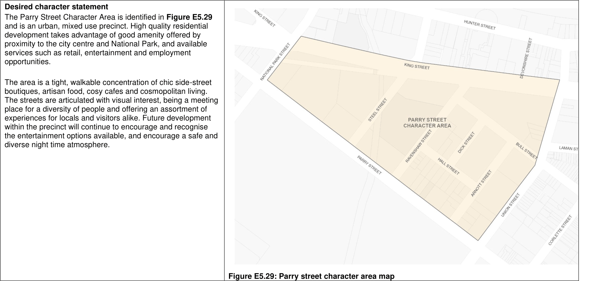
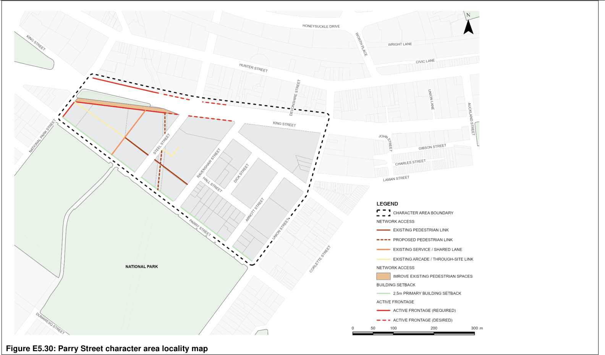

### 25.0 Character areas and key precincts - Parry Street

> [Picture on page 61: a picture, saved as a picture (images/section-e5-newcastle-city-centre-page-61-2.gif, 150 dpi).]

#### Desired character statement

The Parry Street Character Area is identified in Figure E5.29 and is an urban, mixed use precinct. High quality residential development takes advantage of good amenity offered by proximity to the city centre and National Park, and available services such as retail, entertainment and employment opportunities.

The area is a tight, walkable concentration of chic side-street boutiques, artisan food, cosy cafes and cosmopolitan living. The streets are articulated with visual interest, being a meeting place for a diversity of people and offering an assortment of experiences for locals and visitors alike. Future development within the precinct will continue to encourage and recognise the entertainment options available, and encourage a safe and diverse night time atmosphere.

#### Figure E5.29: Parry street character area map

Note: The Parry Street Character Area is in Newcastle City Centre Heritage Conservation Area that is identified under Schedule 5 of LEP 2012. A Summary Statement of Heritage Significance and Desired Future Character is provided in Section E2 Heritage conservation areas.

| Performance criteria (PC) | Design criteria (DC) | Explanatory note(s) |
|---|---|---|
| PC-1.Public domain is improved to support the evolving character of the area. | DC1-1.Development adjacent to National Park will maximise visual and physical connections to the park to provide surveillance and activation across Parry Street. DC1-2.Development along Cottage Creek will provide a building address to encourage activity, pedestrian and cycleway movement, and improve safety. |  |
| PC-2.Heritage items and contributory buildings and their setting are protected and conserved, including the Aboriginal cultural heritage and non-Aboriginal archaeology. | DC2-1.Development shall be consistent with Section E1 Built landscape heritage and Section E2 Heritage conservation areas. DC2-2.Distinctive early industrial, warehouse and retail buildings that contribute to the character of the area are retained and re-purposed. DC2-3.Heritage items and contributory buildings are retained and adaptively re-used where suitable. | Heritage items are identified under Schedule 5 of LEP 2012. Contributory buildings are identified in the Contributory Buildings Maps in the Newcastle Heritage Technical Manual. Refer to Section B4 Aboriginal Cultural Heritage and Section B5 Historical Archaeology. |
| PC-3.A permeable street network with well-connected easily accessible streets and lanes is promoted, where pedestrian, bicycle and public transport users are prioritised over private vehicles. | DC3-1.Improved and new pedestrian connections and laneways are to be provided in accordance with Figure E5.30 and the City Centre Public Domain Technical Manual. |  |
| PC-4.Street wall heights and ground level setbacks complement heritage items and contributory buildings whilst reinforcing the desired future character of Civic. | DC4-1.The street wall height of new buildings or alterations and additions to existing buildings shall be in accordance with sub-section 6.0. DC4-2.The ground floor shall be built to the street frontage unless specified otherwise in Figure E5.30. Where a setback is provided, it may contain pedestrian areas, steps, ramps, landscape features and the like but should not contain utility structures or barriers that restrict visual permeability or pedestrian movement. | Heritage items are identified under Schedule 5 of LEP 2012. Contributory buildings are identified in the Contributory Buildings Maps in the Newcastle Heritage Technical Manual. |
| PC-5.In identified activity hubs, ground floor uses add to the liveliness and vitality of the street. | DC5-1.Active frontages are to be provided in accordance with Figure E5.30, on through-site links and pedestrian oriented lanes. |  |

> [Picture on page 63: a picture, saved as a picture (images/section-e5-newcastle-city-centre-page-63-1.gif, 150 dpi).]

PC-6.New development that contributes to the night time economy of Parry Street is encouraged.

> [Picture on page 64: a picture, saved as a picture (images/section-e5-newcastle-city-centre-page-64-1.gif, 150 dpi).]

#### Figure E5.30: Parry Street character area locality map
