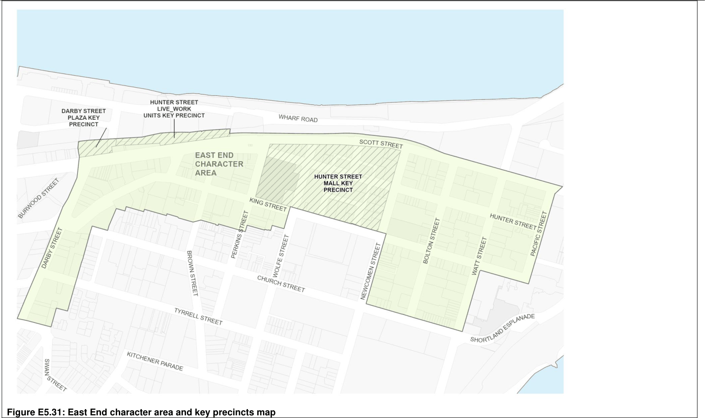
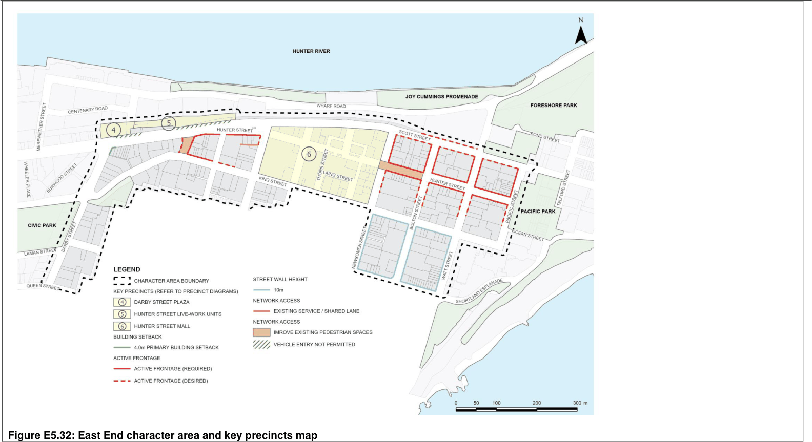
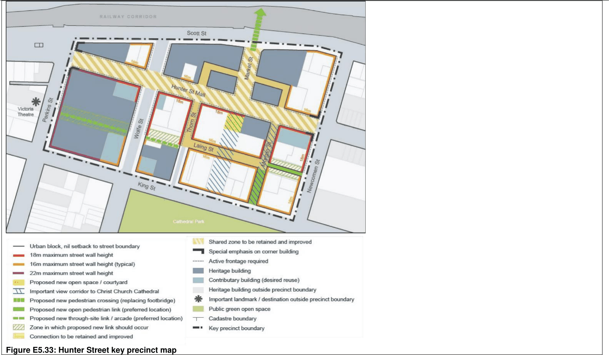
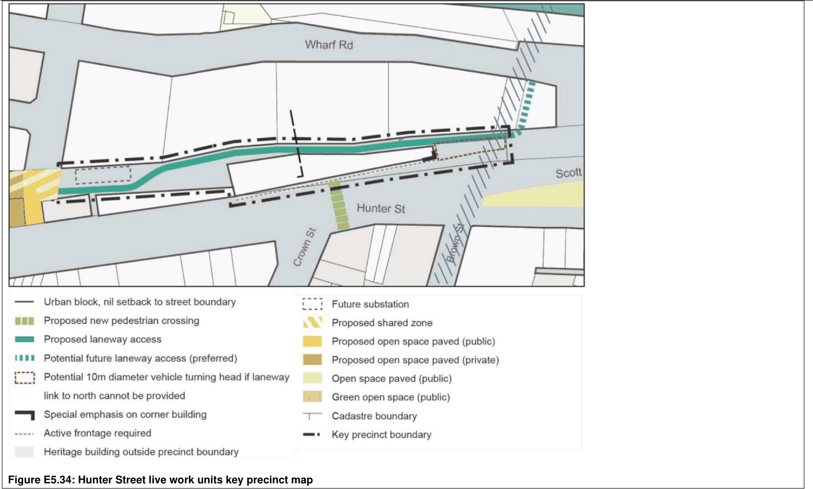
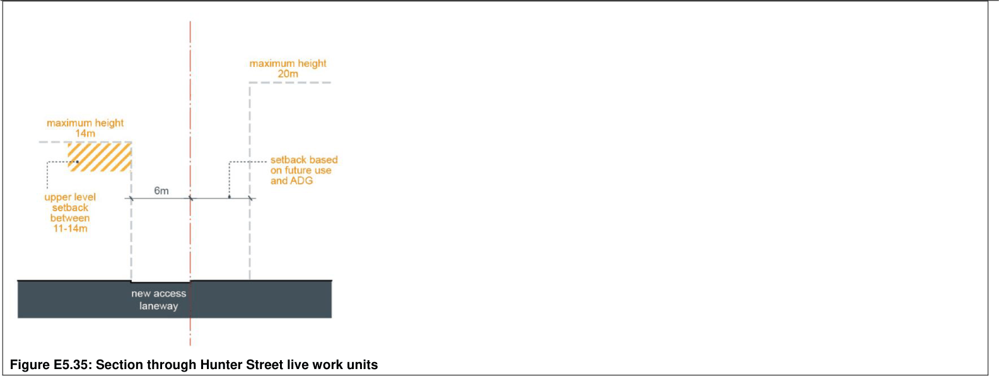

### 26.0 Character areas and key precincts - East End

#### Desired character statement

The East End Character Area is identified in Figure E5.31 and is draped across an undulating landscape overlooking the retail and entertainment spine of Hunter Street Mall. The subdivision pattern is fine grained with distinctly varied and interesting facades. A mix of historic buildings (both listed and unlisted) give the area rich character and eclectic streetscapes. Infill development and adaptive reuse of historic buildings breathe fresh excitement into the area, including unique offerings from small bars and other complementary late night venues.

Streets and open spaces are cooled by dappled canopies of trees while outdoor diners and live performers fill the air with sounds of chatter and music. Access to the foreshore has been opened with safe and inviting connections through the area.

The East End Character Area is in Newcastle City Centre, The Hill and Cooks Hill Heritage Conservation Areas. All heritage conservation areas are identified under Schedule 5 of LEP 2012. A Summary Statement of Heritage Significance and Desired Future Character is provided in Section E2 Heritage conservation areas.

Hunter Street Mall Key Precinct Hunter Street Mall (located between Perkins and Newcomen Streets) is a safe and attractive shared street for pedestrians and vehicles servicing a diversity of land uses and building types. The mall is activated by endless choice of retail, dining, entertainment, nightlife and event options. The precinct respects and leverages its rich cultural heritage with views of Christ Church Cathedral, and many well-kept heritage facades and contributory buildings.

The mall is a boutique pedestrian-scaled thoroughfare which encourages activity on the street through unbroken active frontages, high quality facades and generous public art.

Hunter Street Key Precinct Hunter Street features some of Newcastle’s most valued heritage buildings and offers a mix of shops, cafes, restaurants, and other local businesses. Removal of the former rail line which ran directly to the northern edge of Hunter / Scott Streets between Crown and Newcomen Streets has reactivated this interface. New development provides great amenity to the former rail land, reorientating itself to the corridor and improving solar access rather than turning its back to the corridor as older development fronting Wharf Road once did.

New mixed use development, greater pedestrian priority and transport improvements have made Hunter Street and Scott Street a real focus of life in the Newcastle city centre. Infill development on the northern side of Hunter Street between the alignments with Crown and Brown Streets has promoted activity with a strong pedestrian interface and street edge definition. New built form at this location has been sensitively scaled to allow for the maintenance of significant view lines from the adjoining residential apartments to the north. The precinct provides unique key worker or live-work style units fronting Hunter Street with ground floor commercial retail or office uses.

> [Picture on page 66: a picture, saved as a picture (images/section-e5-newcastle-city-centre-page-66-1.gif, 150 dpi).]

#### Figure E5.31: East End character area and key precincts map

| Performance criteria (PC) | Design criteria (DC) | Explanatory note(s) |
|---|---|---|
| PC-1.Hunter Street is enforced as the main retail spine of the area, activated as a key pedestrian path and meeting place, supported by a range of complementary uses. | DC1-1.Development in the Hunter Street Key Precinct shall be in accordance with Figure E5.33. DC1-2.Large scale new development is articulated to break down expanses of building form into smaller elements to relate to the fine grain of the precinct. DC1-3.Development incorporates active uses at ground level along Hunter Street to support small office or retail uses. DC1-4.Built form is scaled to maintain a comfortable, human scaled streetscape. DC1-5.New development protects sunlight access to the footpath on the south side of Hunter Street between 12 noon and 2pm at midwinter and complies with the design criteria in sub-section 20.0. DC1-6.Pedestrian amenity and walkability is enhanced by the provision of wide footpaths. DC1-7.Windows and balconies overlook Hunter Street to provide natural surveillance and sense of safety. DC1-8.Development provides individual pedestrian entries off Hunter Street. DC1-9.Development is of good quality contemporary design that complements nearby terrace development. DC1-10.Development avoids monotonous design by incorporating articulation and a variety of materials and colours. DC1-11.Development between Thorn and Morgan Street provides an opening on the Market Street alignment to preserve views of Christ Church Cathedral. |  |

DC1-12.Views to Hunter River are protected and framed along Market Street, Watt Street and Newcomen Street.

DC1-13.First floor verandahs are permitted where they are designed to be sympathetic with the overall form, proportion and division of bays of the buildings to which they are attached.

> [Picture on page 69: a picture, saved as a picture (images/section-e5-newcastle-city-centre-page-69-1.gif, 150 dpi).]

#### Figure E5.32: East End character area and key precincts map

> [Picture on page 70: a picture, saved as a picture (images/section-e5-newcastle-city-centre-page-70-1.gif, 150 dpi).]

#### Figure E5.33: Hunter Street key precinct map

| PC-2.Heritage items and contributory buildings and their setting are protected and conserved, including the Aboriginal cultural heritage and non- Aboriginal archaeology. | DC2-1.Development shall be consistent with Section E1 Built landscape heritage and Section E2 Heritage conservation areas. DC2-2.Distinctive early industrial, warehouse and retail buildings that contribute to the character of the area are retained and re-purposed, including prominent corner buildings. DC2-3.Heritage items and contributory buildings are retained and adaptively re-used where suitable. DC2-4.Building form integrates with existing heritage character and echoes historic design elements. DC2-5.In-fill buildings, additions and alterations will respond to the height, massing and predominant horizontal and vertical proportions of existing buildings. DC2-6.New development will incorporate sufficient setbacks from the AA Company Bridge abutment (Heritage Item I415 under LEP 2012) so that it is conserved and retained in situ for permanent public display. | Heritage items are identified under Schedule 5 of LEP 2012. Contributory buildings are identified in the Contributory Buildings Maps in the Newcastle Heritage Technical Manual. Refer to Section B4 Aboriginal Cultural Heritage and Section B5 Historical Archaeology. |
|---|---|---|
| PC-3.A permeable street network with well-connected easily accessible streets and lanes is promoted, where pedestrian, bicycle and public transport users are prioritised over private vehicles. | DC3-1.Improved and new pedestrian connections and laneways are to be provided in accordance with Figure E5.32 and Figure E5.33 and the City Centre Public Domain Technical Manual. |  |
| PC-4.Street wall heights and ground level setbacks complement heritage buildings and contributory items whilst reinforcing the desired future character East End. | DC4-1.The street wall height of new buildings or alterations and additions to existing buildings shall be in accordance with Figures E5.32 and Figure E5.33 or as per sub-section 6.0. In the event of any inconsistency, the street wall heights in Figure E5.32 and Figure E5.32 will prevail. DC4-2.The ground floor shall be built to the street frontage unless specified otherwise in Figure E5.32 and Figure E5.33. Where a setback is provided, it may contain pedestrian areas, steps, ramps, landscape features and the like but should not contain utility structures or barriers that restrict visual permeability or pedestrian movement. | Heritage items are identified under Schedule 5 of LEP 2012. Contributory buildings are identified in the Contributory Buildings Maps in the Newcastle Heritage Technical Manual. |
| PC-5.In identified activity hubs, ground floor uses add to the liveliness and vitality of the street. | DC5-1.Active frontages are to be provided in accordance with Figure E5.32 and Figure E5.33, on through-site links and pedestrian oriented lanes. |  |

| PC-6.Servicing and access minimises conflicts with pedestrians. | DC6-1.Service deliveries are not to be made from Hunter Street for development which has access to another street frontage. DC6-2.For development that has no other frontage than Hunter Street, hours for service deliveries are restricted to minimise potential conflicts with other activities. DC6-3.Vehicle access and servicing is located to minimise conflicts with pedestrians. DC6-4.Loading docks and their access points are not permitted on Hunter Street. |
|---|---|
| PC-7.Existing laneways and pedestrian connections are enhanced. | DC7-1.A highly permeable street and laneway network in the Hunter Street Mall precinct is provided which is safe, comfortable and welcoming for pedestrians in accordance with Figures E5.32 and Figure E5.33. DC7-2.Recreational opportunities are created by establishing public space and pedestrian connections from Scott Street to the Hunter River foreshore. DC7-3.A pedestrian only link at least 3m in width is provided between Newcomen and Laing Streets, connected to Laing Street. DC7-4.Vehicle access and car parking is provided via a rear laneway from Argyle Street. DC7-5 .A 10m vehicle turning head is provided at the eastern end of the rear access lane to allow vehicles to exit the site to Argyle Street. DC7-6.Development in the Hunter Street Live-Work Key Precinct shall be in accordance with Figure E5.34. DC7-7.The heritage significance of item 'Remains of AA Company, bridge and fence' (LEP item I415) shall be maintained and conserved. DC7-8.Live work units provide adequate parking accessed from the laneway. Required car parking may be provided within the access laneway (Hunter Street Live-Work Units only), rather than individual lots. |

DC7-9.Upper level setbacks to the Live-Work units access laneway will be provided in accordance with Figure E5.35.

> [Picture on page 74: a picture, saved as a picture (images/section-e5-newcastle-city-centre-page-74-1.gif, 150 dpi).]

#### Figure E5.34: Hunter Street live work units key precinct map

> [Picture on page 75: a picture, saved as a picture (images/section-e5-newcastle-city-centre-page-75-1.gif, 150 dpi).]

#### Figure E5.35: Section through Hunter Street live work units

PC-8.Diversify the role of Hunter Street Mall precinct as a destination for many activities including retail, dining, entertainment, nightlife and events.

DC8-1.Provide a centrally located one way share-way for vehicles with threshold treatments between Perkins and Newcomen Streets.

DC8-2.Provide additional street trees, new street furniture, new lighting, bike rings and way finding signage.

DC8-3.Provide limited short stay car parking with priority given to accessible parking spaces.

DC8-4.Provide a centrally located space that is relatively clear of obstructions that can be used for special events.

DC8-5.Define clear pedestrian spaces along the fronts of buildings.

DC8-6.Integrate Market Street into the mall using common public domain materials and treatments.

DC8-7.Remove existing lightweight and concrete freestanding awnings structures.
