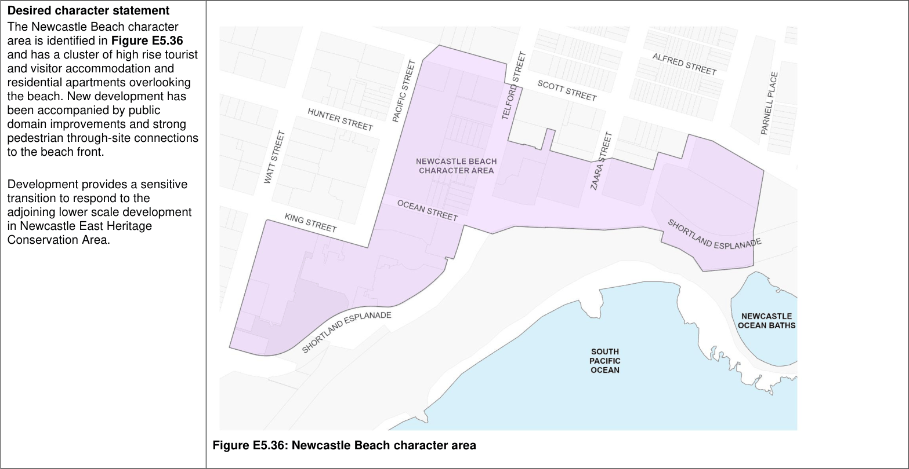
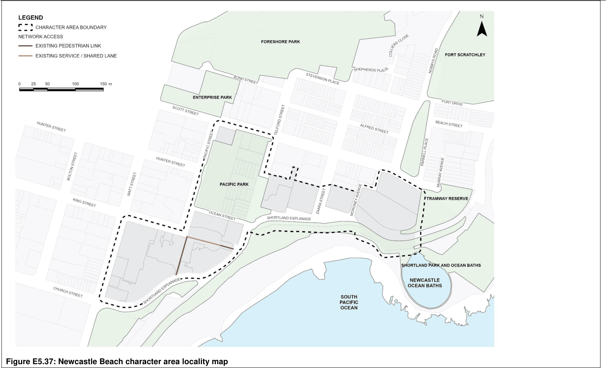

### 27.0 Character areas and key precincts - Newcastle Beach

> [Picture on page 77: a picture, saved as a picture (images/section-e5-newcastle-city-centre-page-77-2.gif, 150 dpi).]

#### Desired character statement

The Newcastle Beach character area is identified in Figure E5.36 and has a cluster of high rise tourist and visitor accommodation and residential apartments overlooking the beach. New development has been accompanied by public domain improvements and strong pedestrian through-site connections to the beach front.

Development provides a sensitive transition to respond to the adjoining lower scale development in Newcastle East Heritage Conservation Area.

#### Figure E5.36: Newcastle Beach character area

Note: The Newcastle Beach Character Area is in Newcastle East Heritage Conservation Area. Newcastle East Heritage Conservation Area is identified under Schedule 5 of LEP 2012. A Summary Statement of Heritage Significance and Desired Future Character is provided in Section E2 Heritage conservation areas.

| Performance criteria (PC) | Design criteria (DC) | Explanatory note(s) |
|---|---|---|
| PC-1.The high environmental quality of the area is maintained. | DC1-1.New development addresses the street to provide a good interface with the public domain. DC1-2.Development adjoining Newcastle East Heritage Conservation Area creates a transition in scale by aligning the scale, proportion, form and finishes of the associated buildings. DC1-3.The public domain and amenity is enhanced. DC1-4.Pedestrian access to Newcastle Beach is improved. |  |
| PC-2.Heritage items and contributory buildings and their setting are protected and conserved, including the Aboriginal cultural heritage and non-Aboriginal archaeology. | DC2-1.Development shall be consistent with Section E1 Built landscape heritage and Section E2 Heritage conservation areas. DC2-2.Heritage items and contributory buildings are retained and adaptively re-used where suitable. | Heritage items are identified under Schedule 5 of LEP 2012. Contributory buildings are identified in the Contributory Buildings Maps in the Newcastle Heritage Technical Manual. Refer to Section B4 Aboriginal Cultural Heritage and Section B5 Historical Archaeology. |
| PC-3 .A permeable street network with well-connected easily accessible streets and lanes is promoted, where pedestrian, bicycle and public transport users are prioritised over private vehicles. | DC3-1.Improved and new pedestrian connections and laneways are to be provided in accordance with Figure E5.37 and the City Centre Public Domain Technical Manual. |  |

> [Picture on page 79: a picture, saved as a picture (images/section-e5-newcastle-city-centre-page-79-1.gif, 150 dpi).]

#### Figure E5.37: Newcastle Beach character area locality map
