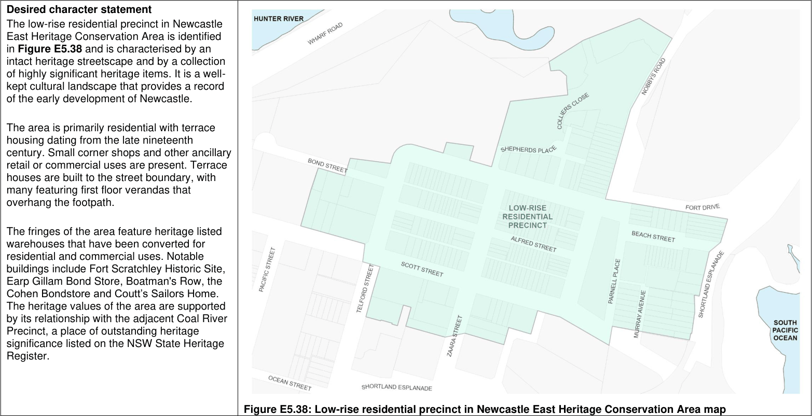
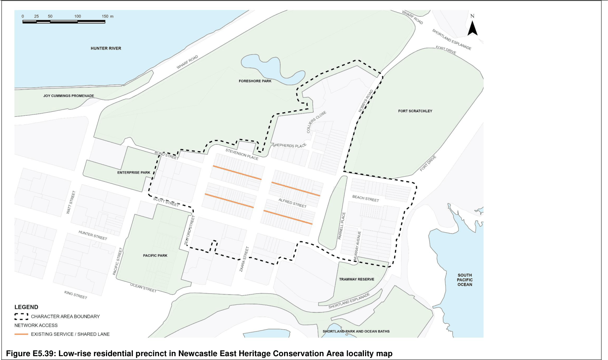

### 28.0 Character areas and key precincts - Low-rise Residential Precinct

> [Picture on page 80: a picture, saved as a picture (images/section-e5-newcastle-city-centre-page-80-2.gif, 150 dpi).]

#### Desired character statement

The low-rise residential precinct in Newcastle East Heritage Conservation Area is identified in Figure E5.38 and is characterised by an intact heritage streetscape and by a collection of highly significant heritage items. It is a well-kept cultural landscape that provides a record of the early development of Newcastle.

The area is primarily residential with terrace housing dating from the late nineteenth century. Small corner shops and other ancillary retail or commercial uses are present. Terrace houses are built to the street boundary, with many featuring first floor verandas that overhang the footpath.

The fringes of the area feature heritage listed warehouses that have been converted for residential and commercial uses. Notable buildings include Fort Scratchley Historic Site, Earp Gillam Bond Store, Boatman's Row, the Cohen Bondstore and Coutt’s Sailors Home. The heritage values of the area are supported by its relationship with the adjacent Coal River Precinct, a place of outstanding heritage significance listed on the NSW State Heritage Register.

Figure E5.38: Low-rise residential precinct in Newcastle East Heritage Conservation Area map

Note: The character area is in Newcastle Heritage Conservation Area. Newcastle East Heritage Conservation Area is identified under Schedule 5 of LEP 2012. A Summary Statement of Heritage Significance and Desired Future Character is provided in Section E2 Heritage conservation areas.

| Performance criteria (PC) | Design criteria (DC) | Explanatory note(s) |
|---|---|---|
| PC-1.The heritage significance of Newcastle East Heritage Conservation Area is retained and conserved, including the Aboriginal cultural heritage and non- Aboriginal archaeology. | DC1-1.Development shall be consistent with Section E1 Built landscape heritage and Section E2 Heritage conservation areas. DC1-2.Development responds to and complements heritage items and contributory buildings within the heritage conservation area, including streetscapes and lanes. DC1-3.New development respects the scale, character and significance of existing buildings. DC1-4.Existing views and vistas are maintained in and out of the area to the water and the foreshore parkland. DC1-5.The continuity of Newcastle East's significant heritage places are retained and conserved, the diverse social mix of the area is maintained. DC1-6.Contributory and historic buildings, particularly intact or historically significant groupings, heritage items, iconic structures, and the appearance and layout of streets are maintained. DC1-7.Sandstone retaining walls, street features such as sandstone kerbing and guttering, and other features of historical interest such as coal shutes, public stairs, lanes, parks, views and vistas are maintained. DC1-8.The eclectic and organic nature of the urban pattern and varying ages of the building stock that demonstrates the gradual urbanisation during the 19th and 20th century of a once indigenous landscape are maintained. DC1-9.The existing appearance of the Hill, views outwards to the coastline and harbour and views into the area from the City, foreshore and Stockton which reveal a tree-lined suburb with a steep topography are maintained. | Heritage items are identified under Schedule 5 of LEP 2012. Contributory buildings are identified in the Contributory Buildings Maps in the Newcastle Heritage Technical Manual. Refer to Section B4 Aboriginal Cultural Heritage and Section B5 Historical Archaeology. |

|  | DC1-10.Gardens, street trees and public open space and existing subdivision pattern and street layout are maintained. DC1-11.First floor verandahs are permitted where they are designed to be sympathetic with the overall form, proportion and division of bays of the buildings to which they are attached. |
|---|---|
| PC-2.A permeable street network with well-connected easily accessible streets and lanes is promoted, where pedestrian, bicycle and public transport users are prioritised over private vehicles. | DC2-1.Pedestrian connections and laneways are to be provided in accordance with Figure E5.39 and the City Centre Public Domain Technical Manual. |

> [Picture on page 83: a picture, saved as a picture (images/section-e5-newcastle-city-centre-page-83-1.gif, 150 dpi).]

Figure E5.39: Low-rise residential precinct in Newcastle East Heritage Conservation Area locality map
