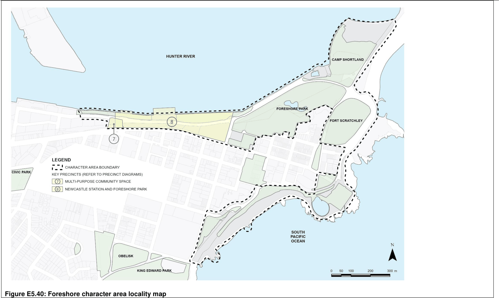
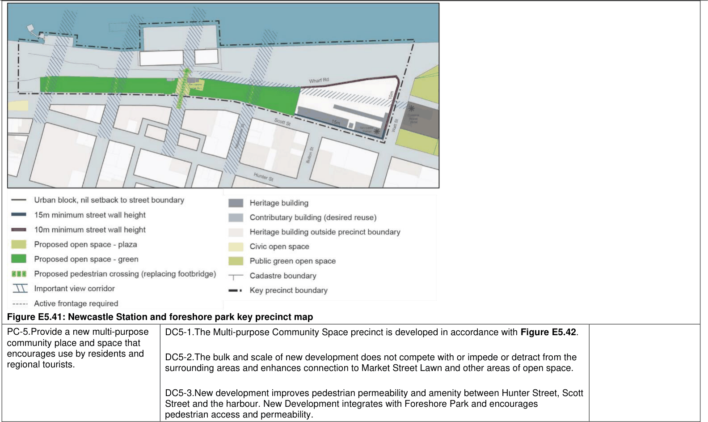
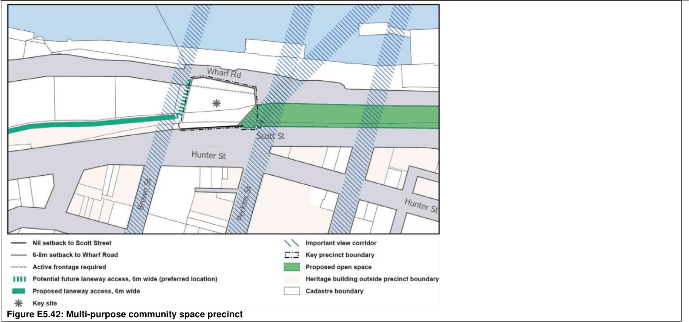

### 29.0 Character areas and key precincts - Foreshore

#### Desired character statement

The Foreshore Character Area is identified in Figure E5.40 and is an extensive primary open space asset for the Newcastle's city centre and broader local government

area. It showcases the city’s unique natural setting, between the Hunter River and the Pacific Ocean. The foreshore provides public access linking the river and ocean waterfronts and is also the location of many significant heritage places such as Newcastle Railway Station buildings, Fort Scratchley, Customs House, the Ocean Baths and Nobbys Point Lighthouse. Development is interwoven in the landscape and complements the leisure, recreation and heritage uses of the Foreshore area including Nobbys Beach, Newcastle Beach, Queens Wharf, Nobbys Beach Surf Pavilion, and the foreshore cycleway and promenade.

The Foreshore Character Area is in Newcastle East Heritage Conservation Area that is identified under Schedule 5 of LEP 2012. A Summary Statement of Heritage Significance and Desired Future Character is provided in Section E2 Heritage conservation areas.

Newcastle Station and Foreshore Park Key Precinct The State listed Newcastle Railway Station is a central focal point for the area. It contributes greatly to the urban environment including views of the building itself and influence on key built forms in its surrounds.

Newcastle Railway Station is repurposed into a hallmark destination, retaining and adapting the heritage character with a mix of uses and providing a focal point for the East End. It accommodates enterprises and activities that attract visitors, activate the area and stimulate the economy.

The new uses of the station are supported and enhanced by the expansion of the Foreshore Park to the west of the station which provides vast and flexible open space for passive and active recreation, community uses and event spaces.

The character of Newcastle Station and Foreshore Park Key Precinct respects and celebrates the heritage integrity of the Station, while accommodating a range of different activities including community, tourism, retail, leisure and commercial uses.

Multi-purpose Community Space Key Precinct The precinct is a multi-purpose community civic space, incorporating a community facility and public domain space. Activating the western end of this public space with a multi-purpose building provides important casual surveillance of the open space area. Active frontages improve the streetscape at Wharf Road and Scott Street. Important views and foreshore access are retained. The precinct is popular with residents, visitors and workers.

The site is identified as a key site under LEP 2012. This ensures that future development exhibits design excellence and complements the wider Foreshore Character Area.

> [Picture on page 85: a picture, saved as a picture (images/section-e5-newcastle-city-centre-page-85-1.gif, 150 dpi).]

#### Figure E5.40: Foreshore character area locality map

| Performance criteria (PC) | Design criteria (DC) | Explanatory note(s) |
|---|---|---|
| PC-1.The area is enhanced and continues to be the city's major recreational open space for Newcastle’s workers, residents and visitors. | DC1-1.New development promotes and facilitates the continuity of public access to the whole foreshore. DC1-2.Recreational opportunities are created by new public open space and key access links to the foreshore. |  |
| PC-2.Heritage items and contributory buildings and their setting are protected and conserved, including the Aboriginal cultural heritage and non-Aboriginal archaeology. | DC2-1.Development shall be consistent with Section E1 Built landscape heritage and Section E2 Heritage conservation areas. DC2-2.New development respects the scale, character and significance of existing buildings, especially heritage items and contributory buildings. DC2-3.The adaptive re-use of the Newcastle Railway Station maximises the long-term potential of the site as a major visitor and community focal point. DC2-4.The heritage and history of the Newcastle Station is preserved through its adaptive re-use. DC2-5.Pedestrian movement networks are developed around, and through, the heritage buildings. DC2-6.Heritage items located adjacent to public open space integrate with the public domain. | Heritage items are identified under Schedule 5 of LEP 2012. Contributory buildings are identified in the Contributory Buildings Maps in the Newcastle Heritage Technical Manual. Refer to Section B4 Aboriginal Cultural Heritage and Section B5 Historical Archaeology. |

| PC-3.Vistas from public spaces to the waterfront, prominent heritage items and landmarks are protected and reinforced. | DC3-1.View corridors are maintained along Brown Street and Perkins Street through to the harbour. DC3-2.Views of Newcastle Station along Scott Street, particularly the main building and the Western Wing are maintained. DC3-3.The view corridor from the harbour front to the roof elements on the main building and Western wing from a pedestrian level is maintained. DC3-4.The view corridor from the west to Customs House is maintained. The bulk of new structures does not obscure views to and from the clock element on Customs House, beyond what has already been established. DC3-5.Vegetation and vertical elements in open space are sited to ensure existing visual corridors between the harbour and Perkins Street are maintained. DC3-6.Views to Nobbys Headland from Scott Street and the precinct are enhanced. New development takes advantage of the views to the harbour and Nobbys Headland. |
|---|---|
| PC-4.Newcastle Station and Foreshore Park is developed as a regional tourist and leisure destination for both residents and tourists. | DC4-1.Newcastle Station and Foreshore Park is developed in accordance with Figure E5.41. DC4-2.The general bulk of any new development on the site does not compete with, impede or detract from the current tiered elevation and depth created by the built form in its current configuration. DC4-3.The form, massing, scale and bulk of new development are complementary to the existing built form of the Newcastle Railway Station. |

> [Picture on page 88: a picture, saved as a picture (images/section-e5-newcastle-city-centre-page-88-1.gif, 150 dpi).]

| Figure E5.41: Newcastle Station and foreshore park key precinct map |  |
|---|---|
| PC-5.Provide a new multi-purpose | DC5-1.The Multi-purpose Community Space precinct is developed in accordance with Figure E5.42. |
| community place and space that encourages use by residents and regional tourists. | DC5-2.The bulk and scale of new development does not compete with or impede or detract from the surrounding areas and enhances connection to Market Street Lawn and other areas of open space. DC5-3.New development improves pedestrian permeability and amenity between Hunter Street, Scott Street and the harbour. New Development integrates with Foreshore Park and encourages pedestrian access and permeability. |

DC5-4.New built form addresses Scott Street and Wharf Road and has frontage and activation to Market Street Lawn.

DC5-5.New Development provides for the minimum 6m wide lane access.

DC5-6.Trees are retained on site where possible. If trees cannot be retained, then replacement of trees on site are in accordance with Section C3 Vegetation preservation and care.

DC5-7.Any future works on this site require geotechnical assessment of mine subsidence risk to ensure that the site is not impacted by convict-era workings.

DC5-8.Landscape works adjacent to the public domain of Wharf Road will be consistent with the Foreshore Precinct Public Domain Plan.

> [Picture on page 90: a picture, saved as a picture (images/section-e5-newcastle-city-centre-page-90-1.gif, 150 dpi).]

#### Figure E5.42: Multi-purpose community space precinct
