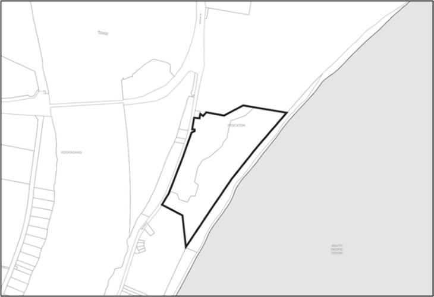

### 3.0 Objectives

1\. Ensure that Fort Wallace is developed in a manner generally consistent with the Urban Design and Landscape Report – Fort Wallace, Stockton (Architectus, 2018) for the site. Refer to guideline for objectives and controls.

#### Land to which this section applies

This section applies to land identified in Figure E6.01.

> [Picture on page 3: a picture, saved as a picture (images/section-e6-fort-wallace-page-3-3.gif, 150 dpi).]

#### Figure E6.01: Fort Wallace

#### Development (type/s) to which this section applies

This section applies to all development within Fort Wallace.

#### Applicable environmental planning instruments and legislation

The provisions to the following listed environmental planning instrument/s also apply to development applications

> [Picture text on page 4 is stored in the PDF without readable letters (no character map), so it could not be copied; see the original PDF.]

to which this section applies: Newcastle Local Environmental Plan 2012 (LEP 2012) State Environmental Planning Policy (Resilience and Hazards) 2021 State Environmentally Planning Policy No 65 – Design Quality of Residential Apartment Development State Environmental Planning Policy (Sustainable Buildings) 2022

In the event of any inconsistency between this section and the above listed environmental planning instrument, the environmental planning instrument will prevail to the extent of the inconsistency.

Note 1:  Additional environmental planning instruments may also apply in addition to those listed above.

Note 2: The Environmental Planning and Assessment 1979 enables an environmental planning instrument to exclude or modify the application in whole or part.

#### Related sections

The following sections will apply to development.

C2 Movement networks

The following sections may also apply to development:

B1 Flood management

B2 Bush fire protection

B4 Aboriginal cultural heritage

B5 Historical archaeology

B6 Urban heat

B7 Land contamination

C1 Traffic, parking and access

C3 Vegetation preservation and care

C4 Stormwater

C5 Soil management

C6 Waste management

C7 Safety & security

C8 Social impact

C9 Advertising and signage

C10 Street awnings and balconies

C11 Development adjoining laneways

C12 Open space and landscaping

C13 Liveable housing

E1 Built and landscape heritage

In the event of any inconsistency between this section and the above listed sections, this section prevails to the extent of the inconsistency.

#### Associated technical manual/s

Austroads Publications and Guides Standard Drawings, Newcastle City Council

#### Additional information

The Urban Design and Landscape Report - Fort Wallace, Stockton (Architectus, 2018).

This section has performance criteria that explain the planning outcomes to be achieved. These have been guided by the Urban Design and Landscape Report. Accompanying the performance criteria are acceptable solutions that illustrate the preferred way of complying with the corresponding performance criterion.  There may be other ways of complying with performance criteria and it is up to the applicant to demonstrate how an alternative solution achieves this.

#### Definitions

A word or expression has the same meaning as it has in LEP 2012, unless otherwise defined. Other words and expressions include:

'Fonzie flat' – is a self – contained flat above a garage.

#### Vision

Fort Wallace will be a sensitively designed place. It will contain diverse housing forms that are of best practice design and well-connected open spaces. Areas with special ecological, heritage or cultural values will be protected, managed and restored.

#### Aims of this section

1\. Provide appropriate development controls for the sensitive and responsive development of the site and ensure best practice design.

2\. Ensure development of the site embraces heritage and conserves ecological significance.

3\. Guide delivery of diverse housing forms on the site to serve the needs of the community.

4\. Protect important views through building design and location of building footprints.

5\. Provide well-connected and high amenity open spaces that celebrate the sites unique and special history.

#### Site history

Fort Wallace is located within a large dune formation known as Stockton Bight. The landscape contains a number of diverse Aboriginal sites that predate the arrival of European settlers and are of extreme significance to the traditional custodians of the land, the Worimi People.

A series of Aboriginal archaeological and cultural sites are situated along the Stockton Peninsula, and are known as the 'Fern Bay Complex'. The coastal location, unique landform and diversity of environments have provided rich marine, estuarine and forest resources to the Worimi People.

Traditional knowledge records the presence of ceremonial and traditional burials sites as well as evidence of traditional Aboriginal hunting, fishing, and cultural activities. Further artefacts are likely to be present throughout Stockton Bight. The sites provide important information about the relationship and special connection Worimi people have with Stockton Bight.

Fort Wallace currently accommodates a range of disused defence buildings and infrastructure.  The original fort was constructed in 1912.  Two 6” guns were installed in 1915.  These guns were replaced by 9” guns in 1939/40. In 1967, 130 Squadron moved to Fort Wallace, followed by the construction of new barracks in 1974.  Additional construction took place on the site in 1982 to support 130 Squadron, including stores, workshop, administration, training and amenities buildings.  130 Squadron continued to use the site until the end of 1993.

The most recent use of the site was accommodation for the Australian Navy. The buildings were re-fitted as accommodation in 1996.

Defence ceased activity on the site in 2003.  Fort Wallace formed part of the Commonwealth Heritage List in June

2006\.  The site is currently vacant, non-operational and secured.
