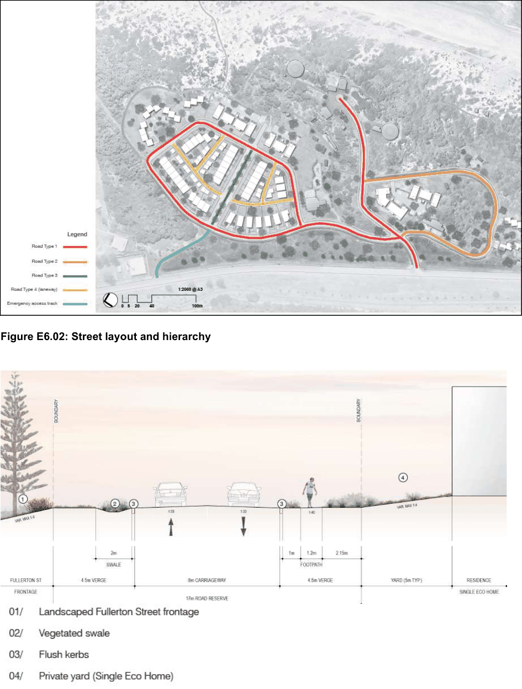
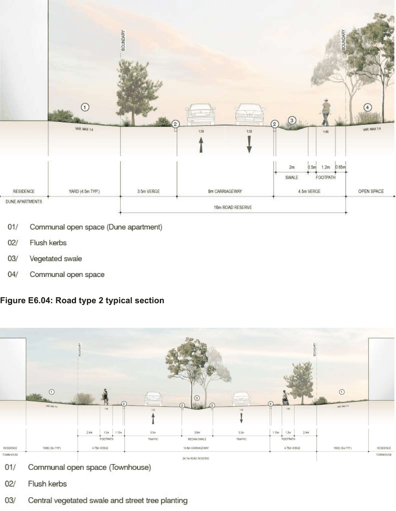
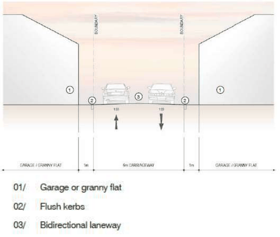
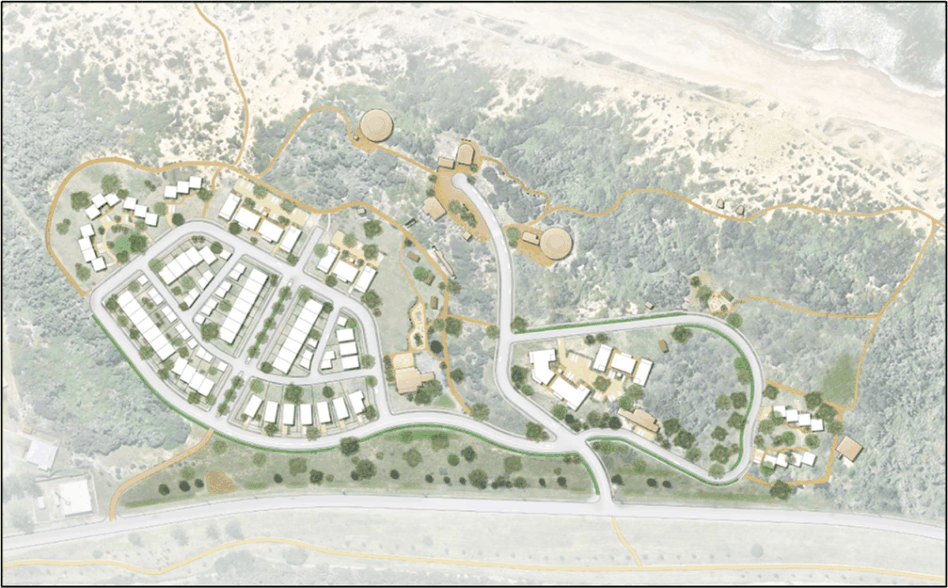

### 4.0 Urban structure

This section guides overall development of the site.

#### A. Street layout and hierarchy

#### Performance criteria

1\. Street layout and hierarchy are clearly legible and intuitive to users and encourage ease of use and access for pedestrians, cyclists and vehicles.

2\. Streets and parking arrangements are to be informal with no kerb and gutter or formal avenue trees.

3\. Adequate access is provided for emergency and maintenance vehicles.

4\. Streets incorporate opportunities for Water Sensitive Urban Design and landscape planting of a variety of sizes and types.

5\. Wayfinding signage (including street names) is clearly visible and legible.

6\. Development of the site makes use of existing street infrastructure, including street layout to minimise disturbance of soil and vegetation.

7\. Street layout incorporates varied edge conditions to ensure a sensitive transition to coastal bushland areas.  Excessive lengths of perimeter roads are avoided.

#### Acceptable solutions

1\. The street layout and hierarchy is provided as shown in Figure E6.02.

2\. All streets and lanes are designed in accordance with the street sections shown in Figure E6.03 to Figure E6.06.

> [Picture on page 8: a picture, saved as a picture (images/section-e6-fort-wallace-page-8-1.gif, 150 dpi).]

#### Figure E6.02: Street layout and hierarchy

#### Figure E6.03: Road type 1 typical section

> [Picture on page 9: a picture, saved as a picture (images/section-e6-fort-wallace-page-9-1.gif, 150 dpi).]

#### Figure E6.04: Road type 2 typical section

#### Figure E6.05: Road type 3 typical section

> [Picture on page 10: a picture, saved as a picture (images/section-e6-fort-wallace-page-10-1.gif, 150 dpi).]

#### Figure E6.06: Road type 4 typical section

#### B. Land use and development

#### Performance criteria

1\. Development respects areas of high ecological and heritage significance.

2\. Development responds to the risks associated with coastal erosion and provides appropriate setbacks for development and infrastructure.

3\. A transition in dwelling form and density from the central development area to the bushland to the north and south is achieved.

4\. Buildings respond to site topography and step with the land form to minimise earthworks and overall scale and massing.

5\. Significant heritage structures are retained and development reflects a collective understanding and interpretation of the items as a group.

6\. A landscaped frontage is provided to Fullerton Street that complements the coastal mangroves on the opposing bank and is able to accommodate landscaped drainage features.

7\. The bulk and massing of buildings responds to the lot size with appropriately scaled buildings and setbacks.

8\. Buildings are articulated through the use of windows, balconies, materials and finishes to minimise visual bulk.

#### Acceptable solutions

1\. The development layout and building typology is provided as shown in Figure E6.07.

> [Picture on page 12: a picture, saved as a picture (images/section-e6-fort-wallace-page-12-3.gif, 150 dpi).]

#### Figure E6.07: Land use and development area
