### 5.0 Built form and character

This section guides development within the precincts and overall character.

#### A. All Character areas

#### Performance criteria

1\. Significant heritage items are positively integrated and carefully managed.

2\. Development provides an appropriate interface and transition to environmentally sensitive areas.

3\. Development incorporates a managed bushland edge to reinforce coastal character.

4\. Buildings are designed to touch lightly on the land and sit sensitively within the natural landscape.

5\. Earthworks and areas of hard surface (slab on ground construction) are minimised.

6\. A mix of building typologies, including smaller lot housing are provided to allow for housing choice.

7\. Development utilises interesting architectural forms through staggered building heights, natural materials and finishes, articulated facades, vaulted and skillion roofs and varied street setbacks where appropriate.

8\. Character areas respond appropriately to their unique setting.

#### B. Building setbacks

#### Performance criteria

1\. Sufficient setbacks are to be provided to lot boundaries to allow for building separation, create a landscaped setting for buildings, reduce the visual bulk and scale of buildings and provide reasonable sharing of views.

2\. Delivery of consistent setbacks to ensure a high visual quality streetscape with a prevailing sense of openness.

3\. Development is to maintain a visual continuity and pattern to buildings and landscape elements.

4\. Ensure that each dwelling is afforded a degree of visual privacy through appropriate setbacks which minimise the extent of overlooking.

#### Acceptable solutions

1\. Built form and character of areas are established as shown in Figure E6.08.

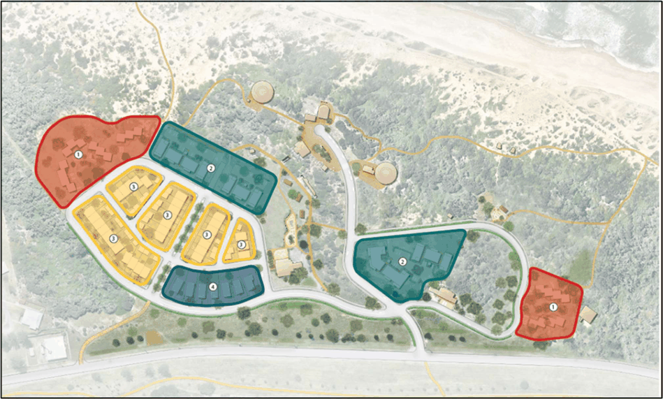

> [Picture on page 13: a picture, saved as a picture (images/section-e6-fort-wallace-page-13-16.gif, 150 dpi).]

#### Figure E6.08: Character areas

#### C. Area 1 - dune edge cluster housing

The precinct manages the transition between urban living and lands with environmental sensitivities.  The housing form is typically multi-dwelling housing that reinforces the coastal character of the site with clustered dwellings that minimise building footprint, smaller, defined private open spaces, and larger, communal areas blending seamlessly with the bushland.  This area should utilise low impact fencing and native landscaping.

Housing will be in accordance with the following guidelines, unless an alternative proposal can demonstrate an improved outcome in line with the key design outcomes of this section.

#### Key design outcomes

Description:  This dwelling typology provides an alternative to traditional townhouses or attached houses.  By breaking down the layout into clusters of two, three and four they provide views through the development to the bush and increase the sense of a connection with the surrounding landscape.

Indicative dwelling yield:  21-25 dwellings.

Maximum site coverage:  60% (all areas under the roof, including secondary dwellings and garages and all impermeable surfaces).

Minimum landscaped area:  40%.

Front setback:  5m.

Construction:  Steel or timber frame with suspended composite concrete slab and skillion/vaulted roof.

External materials:  Combination of corrugated metal sheet and timber panel cladding.

Sustainability:  Passive solar design, locally sourced materials, natural ventilation, high thermal performance, rain water harvesting, solar PV cells, minimise cut and fill, native drought tolerant species.

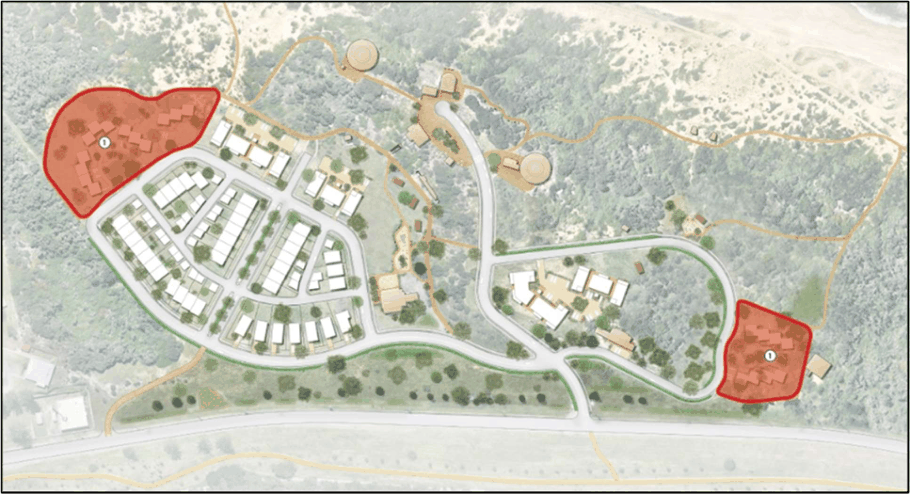

> [Picture on page 14: a picture, saved as a picture (images/section-e6-fort-wallace-page-14-21.gif, 150 dpi).]

#### Figure E6.09: Dune edge cluster housing character areas

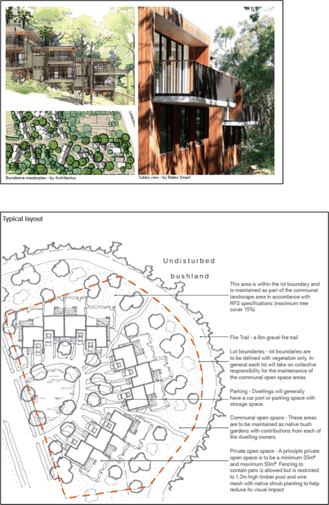

> [Picture on page 15: a picture, saved as a picture (images/section-e6-fort-wallace-page-15-1.gif, 150 dpi).]

#### Figure E6.10: Area 1 Dune edge cluster housing typology

#### D. Area 2 - low-scale coastal apartment living

Low-scale apartment precinct with predominately three storey apartment buildings with a coastal character, utilising natural materials, open air balconies and staggered building forms. Built form works with the site topography to minimise the appearance of building height and maintain key views to and from heritage items, particularly the Observation Tower.

Housing will generally be in accordance with the following precedent and guideline, unless an alternative proposal can demonstrate an improved outcome in line with the key design outcomes of this section.

#### Key design outcomes

Description:  The apartments are designed to minimise overall building footprint and bulk and maximise visual connections with the surrounding landscape.  Small footprints allow for up to four units per floor with the potential to allow for open undercroft spaces at ground floor and open stairwells and vertical circulation.

Indicative dwelling yield:  42 dwellings.

Maximum site coverage:  65%.

Minimum landscaped area:  35%.

Front setback:  3m.

Construction:  Steel frame concrete slab, skillion/vaulted roofs.

External materials:  Combination of corrugated metal sheet, timber panel cladding.

Sustainability:  Passive solar design, locally sourced materials, naturally ventilated, high thermal performance, rain water harvesting, solar PV cells, minimise cut and fill, native drought tolerant species.

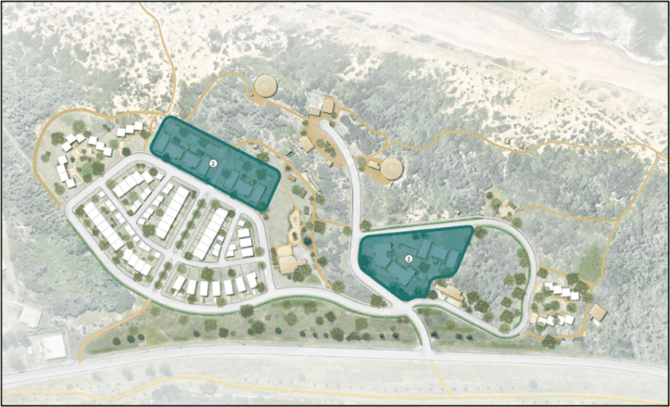

> [Picture on page 16: a picture, saved as a picture (images/section-e6-fort-wallace-page-16-20.gif, 150 dpi).]

#### Figure E6.11: Low scale coastal apartment living character areas

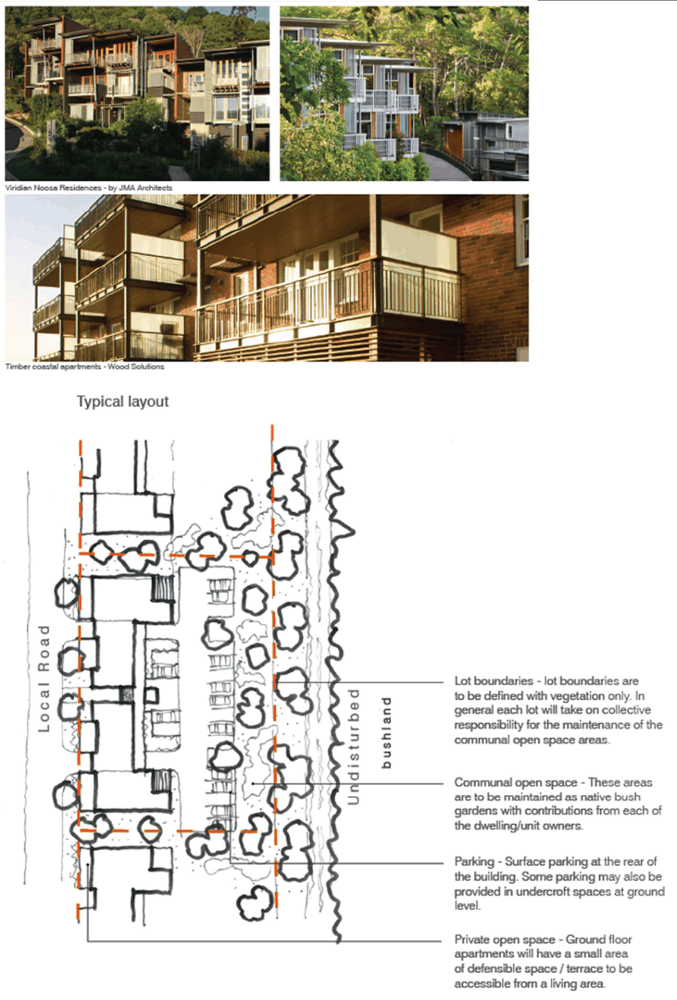

> [Picture on page 17: a picture, saved as a picture (images/section-e6-fort-wallace-page-17-1.gif, 150 dpi).]

#### Figure E6.12: Area 2 low scale coastal apartment living typology

#### E. Area 3 - courtyard and attached housing

This precinct has a denser urban character in the central development area with a more traditional subdivision and street layout. This precinct will provide attached and semi-detached housing with high quality, well designed private areas that make the most efficient and effective use of space, serviced by rear lanes. Housing should be a mix of courtyard housing and attached housing.

Housing will generally be in accordance with the following precedent and guideline, unless an alternative proposal can demonstrate an improved outcome in line with the key design outcomes of this section.

Indicative dwelling yield: 33 dwellings

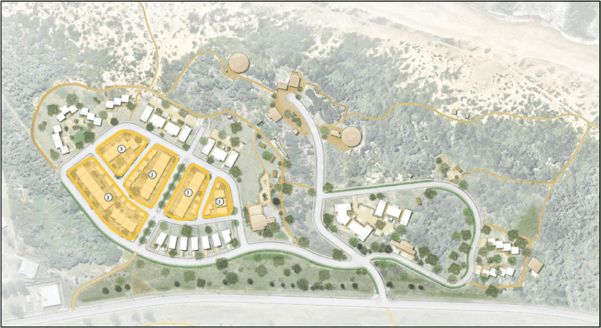

> [Picture on page 18: a picture, saved as a picture (images/section-e6-fort-wallace-page-18-9.gif, 150 dpi).]

#### Figure E6.13: Courtyard and attached housing character areas

#### Key design outcomes - courtyard housing

Description:  This typology provides for a large family home including four bedrooms, three bathrooms, open plan living space, single garage and an ample rear garden.  Dwellings are to be constructed on a zero lot line always on the same side with a 1.5m setback along the opposite boundary.  This allows for a side pathway to access the rear garden and improves natural light and ventilation.

Maximum site coverage:  60% (all areas under the roof, including secondary dwellings and garages and all impermeable surfaces).

Minimum landscaped area:  40%.

Front setback:  3m.

Construction:  Steel or timber frame on concrete slab, skillion/vaulted roof.

External materials:  Combination of corrugated metal sheet, timber panel cladding and rendered masonry.

Sustainability:  Passive solar design, locally sourced materials, naturally ventilated, high thermal performance, rain water harvesting, solar PV cells, minimise cut and fill, native drought tolerant planting.

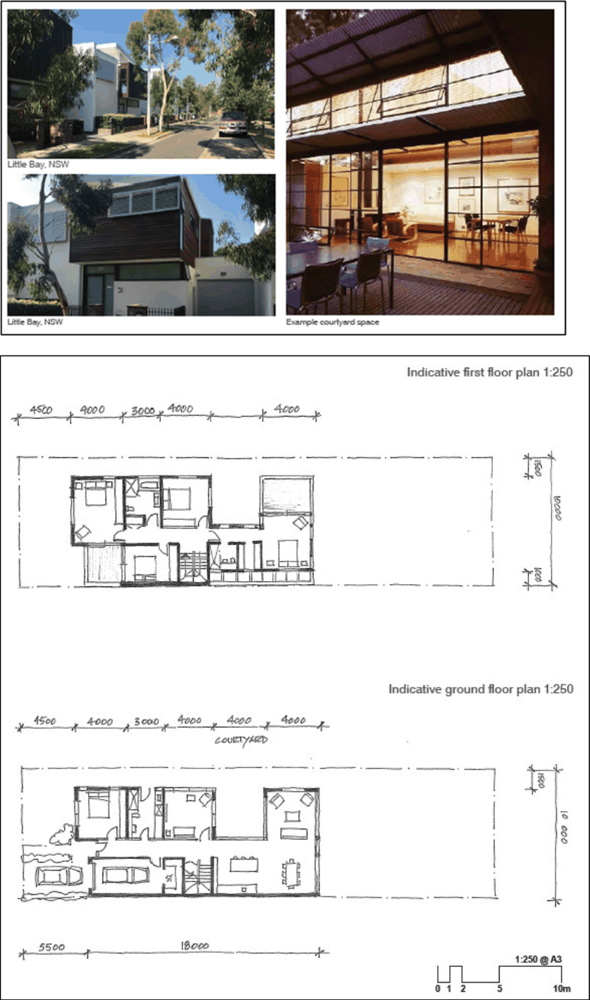

> [Picture on page 19: a picture, saved as a picture (images/section-e6-fort-wallace-page-19-1.gif, 150 dpi).]

#### Figure E6.14: Courtyard housing typology

#### Key design outcomes - attached housing

Description:  These 3 bedroom homes provide compact attached dwellings in locations where increased densities are appropriate.  The rear lane access allows the front elevation of the house to be free from garage doors and parked cars which promotes good natural surveillance and an attractive street frontage.  Above the rear double garage it is possible to have a secondary dwelling or ‘fonzie flat’ that provides a self-contained studio apartment that can provide additional family or guest accommodation, home occupation or rental return. The ‘fonzie flat’ also activates the laneway increasing safety and security through natural surveillance.

Maximum site coverage:  65% (all areas under the roof, including secondary dwellings and garages and all impermeable surfaces).

Minimum landscaped area:  35%.

Front setback:  3m.

Construction:  Steel or timber frame on concrete slab, skillion/vaulted roof.

External materials:  Combination of corrugated metal sheet, timber panel cladding and rendered masonry.

Sustainability:  Locally sourced materials, naturally ventilated, high thermal performance, rain water harvesting, solar PV cells, minimise cut and fill, native drought tolerant planting.

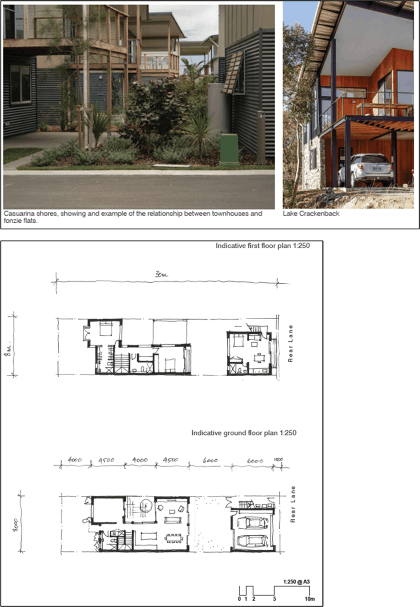

> [Picture on page 21: a picture, saved as a picture (images/section-e6-fort-wallace-page-21-1.gif, 150 dpi).]

#### Figure E6.15: Attached housing typology

#### F. Area 4 - single detached eco-living

Single, low scale detached dwelling houses with a focus on sustainable living and integration with the natural environment.

Housing will generally be in accordance with the following precedent and guideline, unless an alternative proposal can demonstrate an improved outcome in line with the key design outcomes of this section.

#### Key design outcomes

Description:  These homes are intended to be lightweight, climate responsive individual homes set within generous lots that are managed and maintained to contribute to the overall natural characteristics of the estate.

Indicative dwelling yield:  Seven dwellings.

Maximum site coverage:  50% (all areas under the roof, including secondary dwellings and garages and all impermeable surfaces).

Minimum landscaped area:  50%.

Front setback:  5m.

Construction:  Steel or timber frame with suspended composite concrete slab, skillion/vaulted roof.

External materials:  Combination of corrugated metal sheet, timber panel cladding.

Sustainability:  Passive solar design, locally sourced materials, naturally ventilated, high thermal performance, rain water harvesting, solar PV cells, minimise cut and fill, native drought tolerant species.

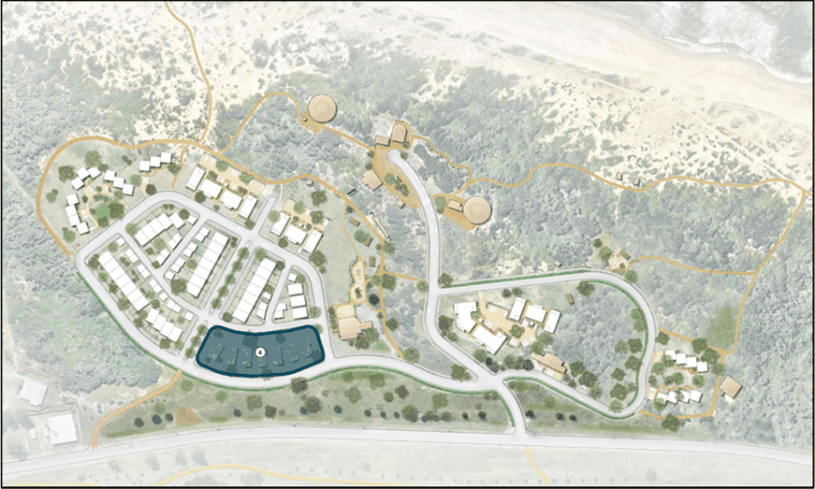

> [Picture on page 22: a picture, saved as a picture (images/section-e6-fort-wallace-page-22-18.gif, 150 dpi).]

#### Figure E6.16: Single detached eco-living character areas

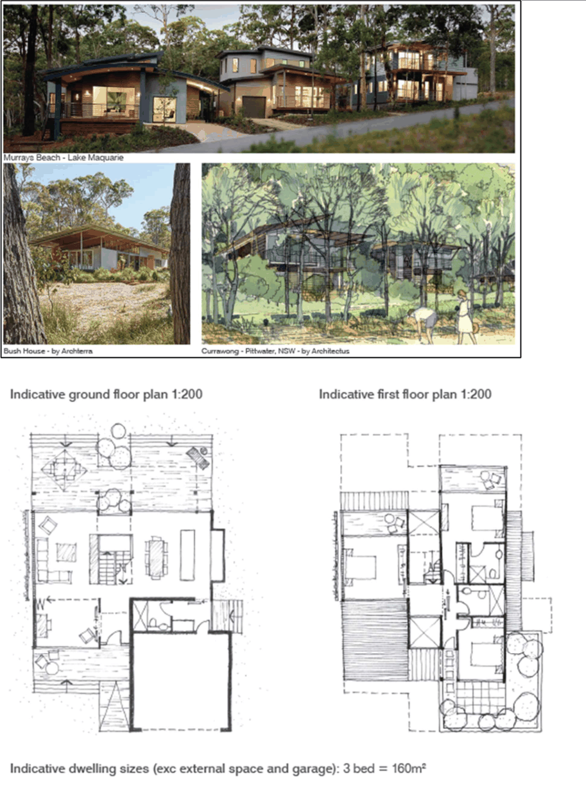

> [Picture on page 23: a picture, saved as a picture (images/section-e6-fort-wallace-page-23-1.gif, 150 dpi).]

#### Figure E6.17: Single detached eco-living typology

#### G. Open spaces

#### Performance criteria

1\. The amenity of residential development and wellbeing of the Fort Wallace community is supported by both high quality and appropriate open spaces.

2\. Open spaces are well designed, consider safety and provide opportunities for a range of activities.

3\. Open spaces are to be well connected and have potential to further connect with open space networks along the peninsula.

4\. Open spaces protect and celebrate the heritage of Fort Wallace by interpretation and appropriate landscape buffers between heritage items and development.

#### Acceptable solutions

1\. The location and design of new open space is provided in accordance with Figure E6.18.

2\. Access and connections will be provided in accordance with Figure E6.22.

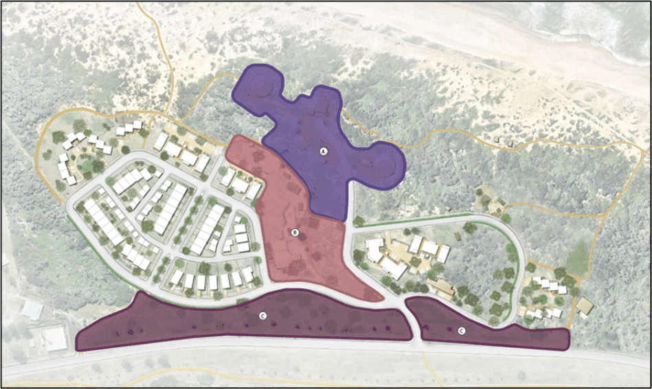

> [Picture on page 24: a picture, saved as a picture (images/section-e6-fort-wallace-page-24-13.gif, 150 dpi).]

#### Figure E6.18: Landscape and open space hierarchy

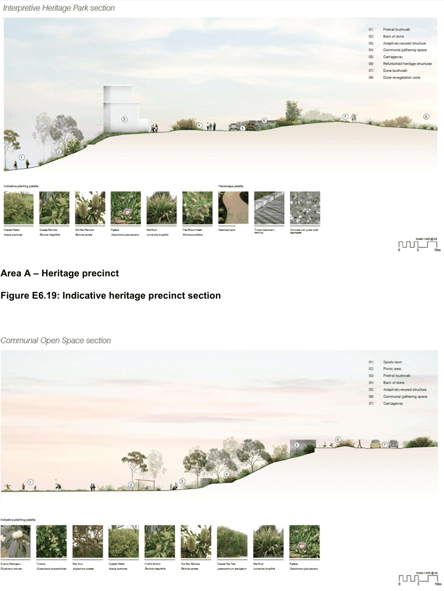

> [Picture on page 25: a picture, saved as a picture (images/section-e6-fort-wallace-page-25-1.gif, 150 dpi).]

#### Area A – Heritage precinct Figure E6.19: Indicative heritage precinct section

#### Area B – Park Figure E6.20: Indicative park section

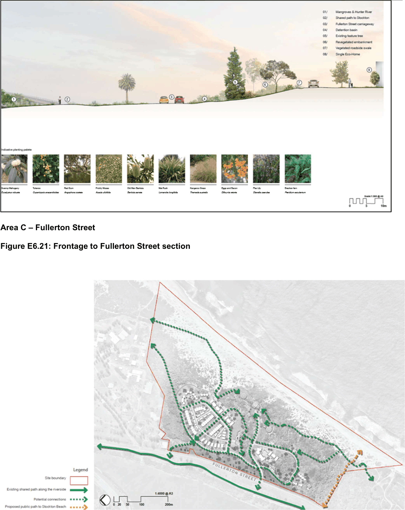

> [Picture on page 26: a picture, saved as a picture (images/section-e6-fort-wallace-page-26-1.gif, 150 dpi).]

#### Area C – Fullerton Street Figure E6.21: Frontage to Fullerton Street section

#### Figure E6.22: Access and connections
