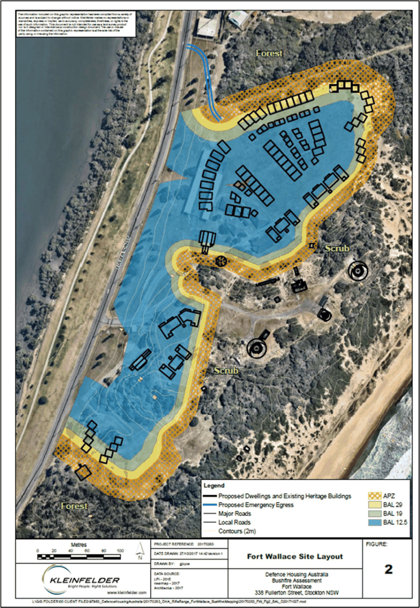
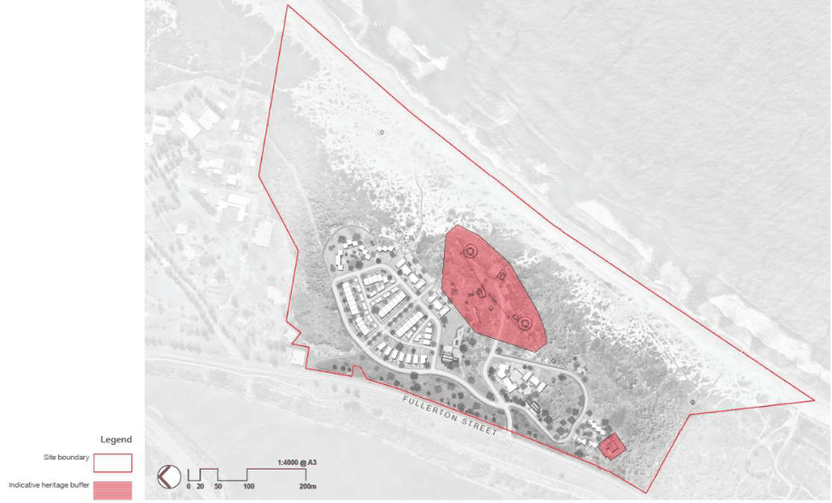
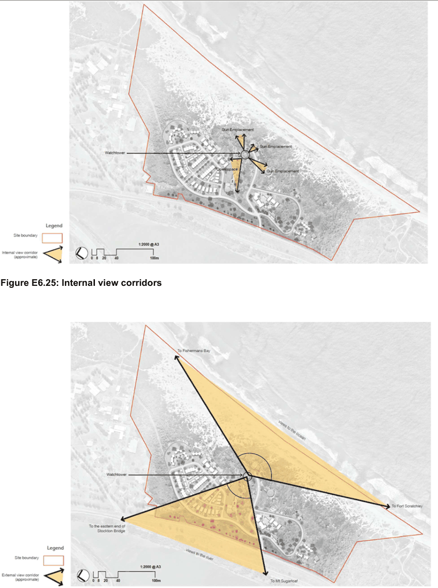

### 6.0 Site planning

This section refers to bushfire risk, future connections, heritage, important views and off street car parking.

#### A. Asset Protection Zones

#### Performance criteria

1\. The location and design of dwellings respond to bushfire risk.

2\. Asset protection zones are designed and maintained to balance fuel reduction, a landscaped setting for dwellings and biodiversity.

3\. Clear and equitable management of asset protection zones.

#### Acceptable solutions

1\. Asset protection zones are provided in accordance with Figure E6.23.

2\. Timber or timber-look products treated to meet Australian Standards for the relevant bushfire attack level (BAL rating) are used.

3\. Asset protection zones are designed to manage fuel loads and maintain structure of an open, non-connected tree canopy, spaced large trees, with shrub gardens as islands.

> [Picture on page 28: a picture, saved as a picture (images/section-e6-fort-wallace-page-28-1.gif, 150 dpi).]

#### Figure E6.23: Asset protection zone

#### B. Heritage

#### Performance criteria

1\. Development appropriately responds to heritage items on the site.

2\. Development facilitates an appreciation of the heritage items individually and as a whole.

3\. Development facilitates the appropriate management of the site’s heritage values into the future.

4\. To identify and manage any potential impacts on Aboriginal cultural heritage.

#### Acceptable solutions

1\. A built form development buffer is maintained to heritage items as shown in Figure E6.24.

2\. Consideration is given to views to and from heritage items on the site from open spaces (see Figure

E6.25 and Figure E6.26) in the massing and design of buildings and landscaping.

3\. Heritage items form part of an integrated open space plan for the site.

4\. Development of the site is undertaken in accordance with recommendations of an Aboriginal Cultural Heritage Management Plan prepared for the site accompanying a Stage 1 DA.

> [Picture on page 29: a picture, saved as a picture (images/section-e6-fort-wallace-page-29-14.gif, 150 dpi).]

#### Figure E6.24: Development buffer to heritage items

> [Picture on page 30: a picture, saved as a picture (images/section-e6-fort-wallace-page-30-1.gif, 150 dpi).]

#### Figure E6.25: Internal view corridors

#### Figure E6.26: External view corridors

#### C. Car parking

#### Performance criteria

1\. Car parking associated with development has a low visual impact.

2\. Earthworks and disruption to the site ecology are minimised.

#### Acceptable solutions

1\. Car parking is provided at grade.

2\. Car parking is located to the rear of properties.

3\. Basement car parking is not provided.

#### D. Fencing and domestic pets

#### Performance criteria

1\. Fencing is minimised across the site.

2\. Fencing has low visual impact.

3\. Pet ownership is to be controlled within the development.

#### Acceptable solutions

1\. Landscaping is used to delineate the boundary between private and communal spaces as an alternative to fencing.

2\. Where fences are needed for adequate management of land and pets or safety, fencing is a maximum 1.2m high timber post and wire mesh with native shrub planting.
