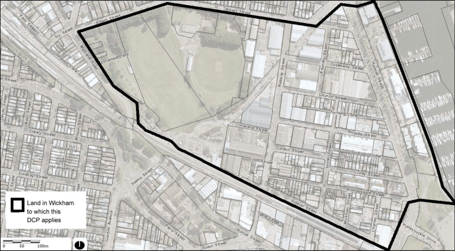

### 2.0 Application

This section applies to all development consisting of: New buildings or structures Additions or alterations to existing buildings or structures Subdivision.

This section applies to all land within the heavy line marked up on Figure E7.01.

> [Picture on page 2: a picture, saved as a picture (images/section-e7-wickham-page-2-17.gif, 150 dpi).]

#### Figure E7.01: Wickham
