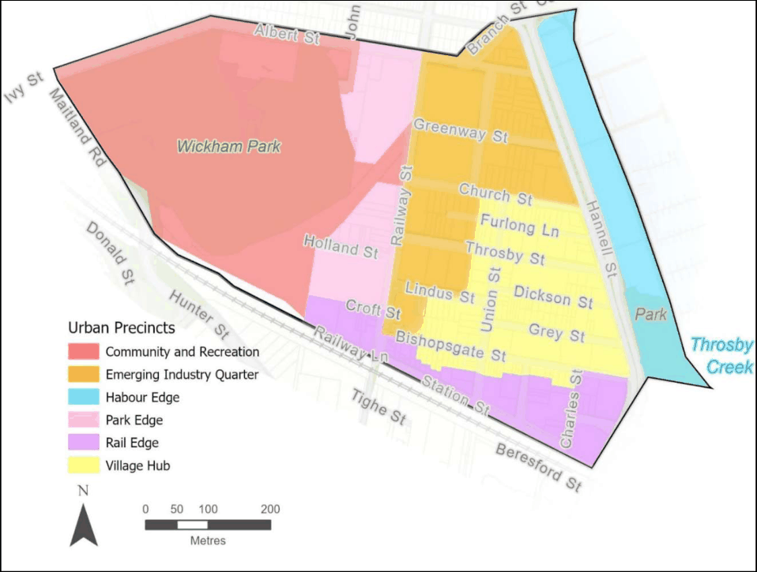
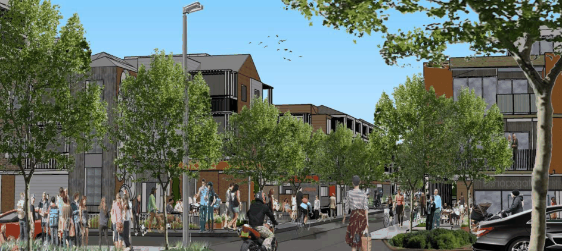

### 6.0  Urban character

Wickham will continue to evolve from a semi-industrial area at the outer fringe of Newcastle City Centre into a mixed use urban neighbourhood supporting the emerging commercial core within Newcastle West. Urban renewal is envisaged to build on the existing urban structure to deliver greater connectivity, improved public domain amenity and built form which reflects the function and character of the area.

#### Urban precincts

The controls applying to this section are based on achieving the intended future character of each urban precinct, as identified in Figure E7.02, consistent with the vision of the Wickham Masterplan (2021 Update). Any variation to the 'acceptable solutions' proposed as an alternative means of meeting the specific 'performance criteria,' will need to be justified having regard to achieving the future character of the relevant precinct.

> [Picture on page 4: a picture, saved as a picture (images/section-e7-wickham-page-4-11.gif, 150 dpi).]

#### Figure E7.02: Urban precincts

#### A. Rail edge

#### Existing character

The majority of this precinct has already been redeveloped given the proximity to the Transport Interchange and the already generous development standards. The Rail Edge precinct is predominantly characterised by higher density residential development with a mix of uses at street level. The larger podium tower building types reflect the precinct's location at the interface to the emerging commercial core of Newcastle West.

#### Future character

The precinct is envisaged to support high density residential development that capitalises on its location adjacent to Newcastle Transport Interchange and provides ground level commercial uses with neighbourhood level retail and services activating street corners. Building scale and form transitions down to integrate with the lower scale Village Hub precinct fronting Bishopsgate Street.

#### B. Village hub

#### Existing character

The Village Hub retains much of the original residential subdivision patterns established in the 1800s, characterised by narrow streets and a mix of lower scale residential building typologies. Buildings are set back from the front boundary and the front setback typically contains landscaping and forecourts. The existing scale of the precinct allows for three storey buildings. The building height along the southern side of Bishopsgate Street is currently 24m.

#### Future character

Redevelopment and infill development is envisaged to continue to include terrace style housing, shop top housing and smaller residential apartment buildings. A street wall height is anticipated to be up to three storeys along each street fronting setback, incorporating design elements that complement that of existing housing stock. Redevelopment of small residual sites for infill housing will also enable urban renewal where amalgamation of sites is not possible or unlikely to result in increased residential densities. Modifications to existing dwellings in the Village Hub should be sympathetic to the original architectural features of the building style. Opportunities for onsite car parking and driveway access are limited to ensure priority to pedestrian amenity and safety. Union Street provides the main north-south pedestrian connection with wide footpaths and street trees, linking the predominantly residential precinct to the Newcastle Transport Interchange. Retail and commercial activity are focused on corner sites along Union Street while the east-west orientated streets maintain a residential focus, except for Throsby Street, which continues to support a mix of business uses at street level. The interface to the adjoining Emerging Industry Quarter precinct mid-block along Bishopsgate, Church, Lindus and Throsby Streets focuses on creating a consistent character along the street edge by continuation of identified front setbacks, landscape provision, use of design elements that emphasise the lower levels, with upper levels setback from the street. Where additional building height is permissible in this precinct, the use of upper-level setbacks and design elements will ensure development presents at a consistent scale and character when viewed from street level. Tree planting and other landscape elements within urban activation areas of the public domain will also help to soften the visual dominance of larger development and improve the visual amenity for pedestrians.

> [Picture on page 6: a picture, saved as a picture (images/section-e7-wickham-page-6-1.gif, 150 dpi).]

Figure E7.03: Envisaged character of the Village Hub based on permissible scale and densities

#### C. Harbour edge

#### Existing character

The precinct is characterised by predominately three storey buildings with uses that reflect the mixed residential, maritime, tourism and entertainment activities along Throsby Creek.

#### Future character

The Harbour Edge Precinct will continue to build on the recreational and economic opportunities in this prime waterfront location. This will be through intensification of uses that respect the Port of Newcastle's operational function and allowing for vistas and connections between Hannell Street and Throsby Creek. The parkland at the southern end of this precinct will connect to the public domain areas of the final stage of the Honeysuckle redevelopment area.

#### D. Emerging industry quarter

#### Existing character

The Emerging Industry Quarter to the east of Railway Street extends to land north of Church Street due to its characteristically larger sites that accommodate a range of remnant light industrial buildings with high occupancy rates of employment uses including service industries, small scale niche manufacturing, research and development technologies. Redevelopment within this precinct is likely to occur on land unrestricted by mine subsidence, based on the feasibility and availability of land for current businesses to relocate, particularly where owner-occupied.

#### Future character

Redevelopment is envisaged to foster business and employment generation, particularly on sites less conducive to residential amenity, such as Hannell Street and where residential densities are restricted by mine subsidence risk. Where residential uses are accommodated within the precinct as part of a mixed-use development, the challenge is to ensure these provide genuine economic generating uses on ground level, rather than provision of a token commercial space sleeving at grade car parking. Ground level floor areas are of an area and dimensions conducive to supporting a range of low impact and clean business uses, including high technology industries, manufacturing and creative industries. Development on land within this precinct adjoining the Village Hub, will be designed to address the scale and

character it presents along the streetscape, using architectural elements, articulation of setbacks and upper levels set further back from the street. CN will seek to acquire the former rail corridor passing through this precinct to deliver a public space incorporating active transport that links to adjoining areas.

#### E. Park edge

#### Existing character

The Park Edge precinct is characterised by large sites containing commercial, light industrial, storage and warehouse uses backing onto the eastern side of Wickham Park. Land within this Precinct is likely to redevelop within the next development cycle when market demand increases, particularly if the former rail corridor land is transformed into a useable public space with active transport links.

#### Future character

The Park Edge precinct is envisaged to transform into a mixed-use area including medium to high density residential development with building scales reflective of mine subsidence restrictions. The precinct will activate the eastern edge of Wickham Park and provide natural surveillance to the active transport corridor diagonally dissecting the precinct. There are opportunities to improve public access through to Wickham Park with a key connection for pedestrians and cyclists being proposed through a widened Holland Street, the extension of Croft Street, the end of railway lane and a wide opening to the former Bullock Island rail corridor and through to Wickham Park on land opposite from Church Street along the western side of Railway Street.

#### F. Community and recreation

#### Existing character

This precinct combines land previously identified in WMP as ‘Wickham Park’ with part of the adjacent ‘Park Edge’, being the land known as the former Wickham to Bullock Island Railway Corridor. This land continues to act as a physical barrier between the City Centre and Wickham Park. The land contains some rail infrastructure along its southern extent, is partly leased to adjoining landowners along Railway Street but has otherwise remained vacant since it was last used as a works depot during the construction of the Newcastle Transport Interchange. CN intends to acquire the majority of the former rail corridor land from its current owner, through its inclusion on the Land Reservation Acquisition (LRA) map in Newcastle Local Environmental Plan 2012 (LEP 2012). Wickham Park continues to cater for the recreational and social needs of both local residents and the wider Newcastle community. CN will prepare a comprehensive plan of management for Wickham Park to improve amenity, connectivity, and surveillance, as identified in the WMP and reiterated within the Newcastle Strategic Sports Plan 2020.

#### Future character

The precinct will continue to cater for sporting, community events and festivals, which will benefit from improved pedestrian and cycle links to public transport and adjoining areas. The former rail corridor will support active transport including shared pedestrian and cycleways extending from Maitland Road along a new roadway at the southern boundary of the precinct, to existing cycleways east of the intersection of Cowper and Hannell Streets at Throsby Creek, as shown in Map 4 - Traffic and Transport, Wickham Masterplan (2021 Update). The rail corridor will include appropriate interpretive treatments acknowledging its local heritage listing within LEP 2012 and lined by distinctive planting to differentiate it from other street tree planting within the area. Redevelopment of the larger triangle shaped part of the former railway corridor lands is significantly restricted due to former mine workings. If acquired by CN, this land will provide a vital role in supporting the precinct through provision of community facilities, formalised parking areas that can cater for both commuters and city workers during the week and park users on weekends, as well as infrastructure that supports a range of events and activities.
