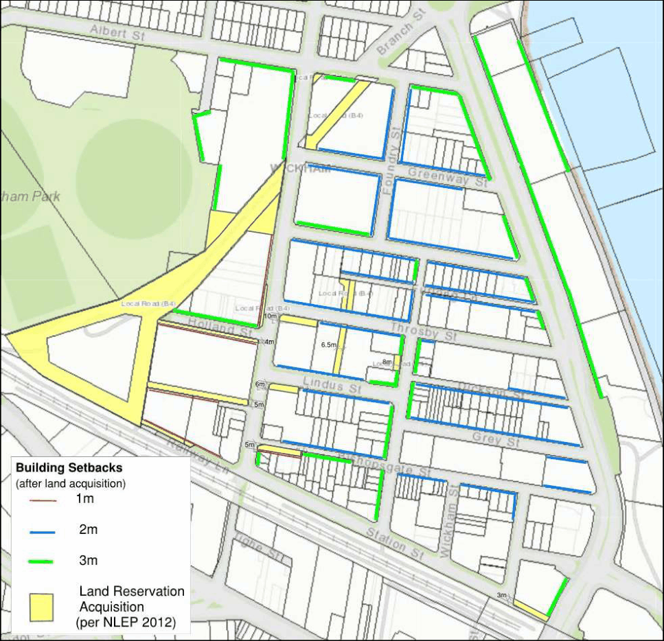
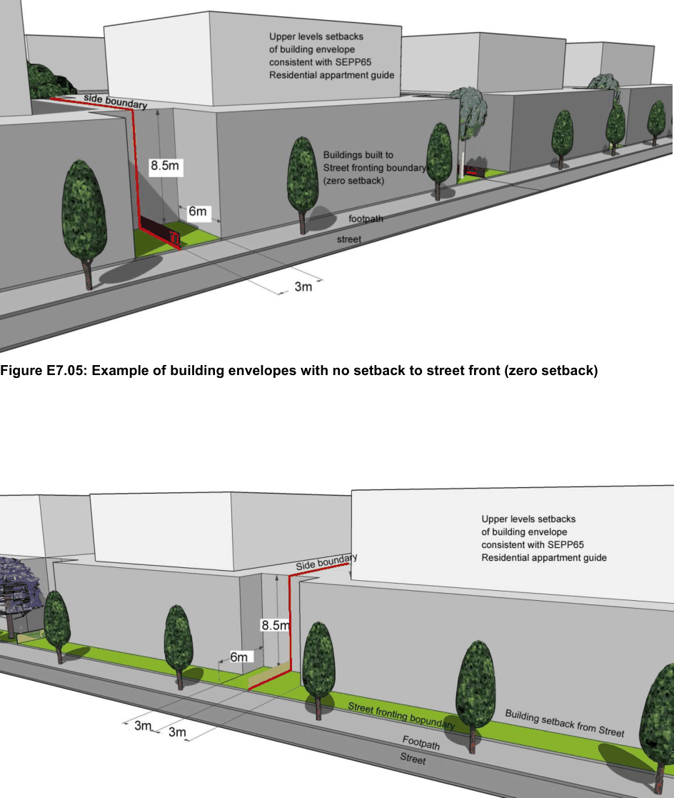

### 7.0  Building envelopes

#### A. Setbacks to streets

#### Performance criteria

P1. Buildings setbacks define the street edge and public domain and reinforce the envisaged character of each precinct.

#### Acceptable solutions

A1. Ground level building setbacks to street boundaries are consistent with Figure E7.04.

A2. Where land is identified for acquisition by Council, in Figure E7.04, the minimum setback includes the land to be acquired plus any additional identified setback.

A3. Where building setbacks are not specified in Figure E7.04, buildings may be built to the street edge (zero setback) at ground level but only for:

a. non-residential uses where the street facing facade has a minimum of 50% windows and /or other openings, or

b. residential uses consisting of the covered private open space (outdoor living) component and where screened and/or elevated from the adjacent footpath/public domain area.

Note: Further design criteria for development interface to the public domain are provided in sub-section 8.0 Urban Design.

A4. The upper levels for any development in an identified Urban Precinct (Column 1), which is located at a height above that described in Column 2, is setback at the minimum distance identified in Column 3 from the street front boundary (measured along the horizontal) as identified in Table E7.01, below:

| Urban precinct | Upper-level setback applies to any part of the building above the following height: | Minimum setback to street front (for the upper-level setback) |
|---|---|---|
| Rail edge | 12m | 6m |
| Village hub | 10m | 6m* |
| Harbour edge | 12m | N/A |
| Emerging industry quarter | 12m | 6m |
| Park edge | 12m | 6m |

\*Refer to A7 for land at 29 Bishopsgate Street.

#### Table E7.01: Upper level setbacks

Note: Where the requirements of SEPP 65 and/or the Department of Planning and Environment's 'Apartment Design Guide' apply to development proposals subject to this section, any inconsistencies in minimum setbacks will be resolved by the greater of the two setbacks applying.

Additional acceptable solutions applying to development within the Village Hub Precinct

A5. Within the Village Hub precinct development may encroach into the minimum street setback at the first level (i.e. second storey) for 50% of the frontage but only where the encroachment is for private open space such as a veranda, balcony, pergola or deck.

A6.  Large scale development incorporates building articulation such that the building form is broken into smaller elements that relate to the fine grain pattern of development along Bishopsgate Street.

A7. Notwithstanding the upper level setbacks identified in A4, development on land at 29 Bishopsgate Street has an upper level setback of 15m from the street boundary for parts of the building above 10m.

> [Picture on page 10: a picture, saved as a picture (images/section-e7-wickham-page-10-3.gif, 150 dpi).]

#### Figure E7.04: Ground level building setbacks to street boundaries

#### B. Setbacks to neighbouring sites

#### Performance criteria

P1. Side setbacks provide opportunity for landscaping and protect amenity to adjoining sites.

P2. Development provides natural surveillance to side and rear setback areas.

P3. Redevelopment within the Harbour Edge precinct provides for public access and views to Throsby Creek.

#### Acceptable solutions for all precincts, except the Village Hub

A1. Development may be built to the side boundary (zero setback) for a height up to 8.5m where a landscaped setback of at least 3m from the side boundary is provided within the first 6m from any street fronting boundary, as shown in Figures E7.05 and E7.06.

A2. The landscaped side setback (described above):

a. consists of deep root planting with suitable trees, shrubs and groundcovers; and

b. is visible from adjoining uses (within the site) through the placement of windows and open space areas.

A3. Development adjoining the Village Hub precinct has an upper level setback for any part of the development above 12m, of 8m to the side or rear boundary that adjoins the Village Hub precinct.

#### Additional acceptable solutions for the Harbour Edge precinct

A4. Development provides pedestrian and cycling links between Hannell Street and Throsby Creek.

A5. Built form within the Harbour Edge precinct enables view lines to Throsby Creek from the east-west orientated streets to the west of Hannell Street.

Note: Applicants for development within the Harbour Edge precinct are advised to engage with Port of Newcastle prior to lodgement regarding the location and requirements for maintaining navigation aids in this locality to ensure the safe and efficient operation of the Port.

#### Additional acceptable solutions for the Village Hub precinct

A6. Development within the Village Hub that has a building height greater than 10m, has an upper level setback for any part of the development above 10m of 8m to the side or rear boundary of any land that is also within the Village Hub precinct.

> [Picture on page 12: a picture, saved as a picture (images/section-e7-wickham-page-12-1.gif, 150 dpi).]

Figure E7.05: Example of building envelopes with no setback to street front (zero setback)

Figure E7.06: Example of building envelopes with front setback to street boundary

#### C. 3D model application requirement

#### Performance criteria

P1. All applications that include the erection of a new structure or the extension of an existing structure with a height exceeding 8.5m are to be accompanied with a 3D model of the proposed development.

#### Acceptable solutions

A1.  See sub-section 5.0 application requirements for further information.

#### D. Isolated sites

#### Performance criteria

P1. Development:

a. enables suitable development of existing isolated sites in a matter which responds to the site context and constraints and maintains a high level of amenity for future occupants and neighbours.

b. avoids the creation of isolated sites as a result of the development of adjoining lots.

#### Acceptable solutions

A1. Development is not to result in the creation of an isolated site that could have been developed in compliance with the relevant planning controls. Appropriate documentary evidence to demonstrate that a genuine and reasonable attempt has been made to purchase an isolated site based on a fair market value.

A2. Where amalgamation of the isolated site is not feasible, applicants will be required to demonstrate that an orderly and economic use and development of the separate sites can be achieved.

A3. The development of existing isolated sites is not to detract from the character of the streetscape and is to achieve a satisfactory level of amenity including solar access, visual and acoustic privacy. Development of existing isolated sites may not achieve the maximum potential, particularly height and floor space ratio, and will be assessed on merit.

Note: Reasonable offers to purchase a site that is to be isolated are to be made at an early stage before DA lodgement. However, where an applicant has failed to negotiate before a DA was lodged, it is not necessarily too late to do so after lodgement. Documentation is required to demonstrate in writing that an offer to purchase has been made to the owner(s) of the isolated lot and the owner has refused to negotiate. A licensed valuer must base the offer on at least one recent independent valuation.

Note: Development that would result in the creation of an isolated lot must comply with the planning principles established by the Land and Environment Court in Melissa Grech v Auburn Council [2004] NSWLEC 40, Cornerstone Property Group Pty Ltd v Warringah Council [2004] NSWLEC 189; Karavellas v Sutherland Shire Council [2004] NSWLEC 251; provide for a future extension incorporating the isolated lot, or demonstrate that the isolated lot can be developed independently.
