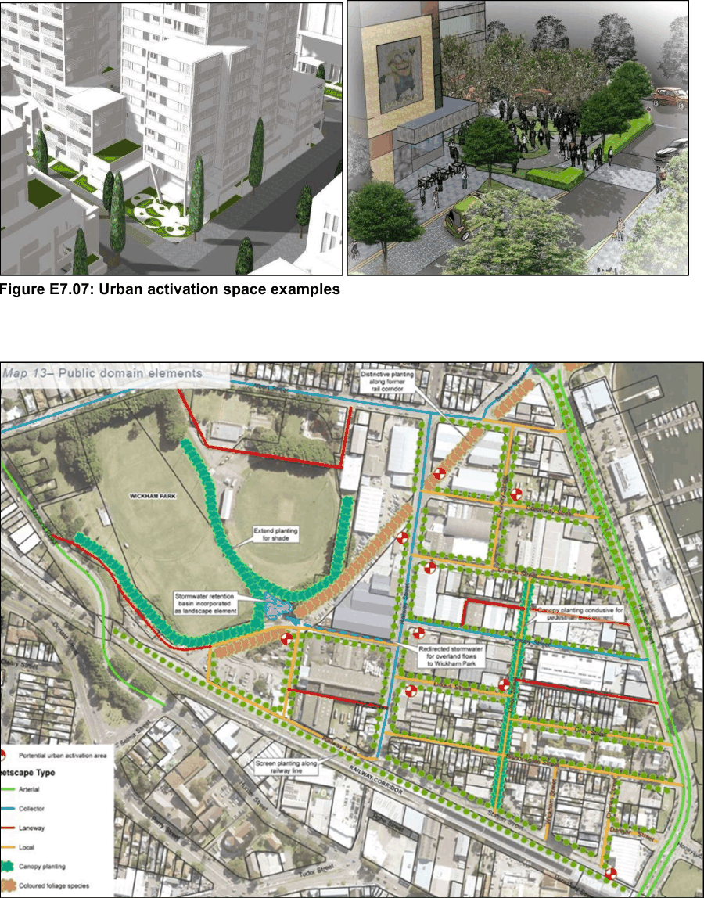
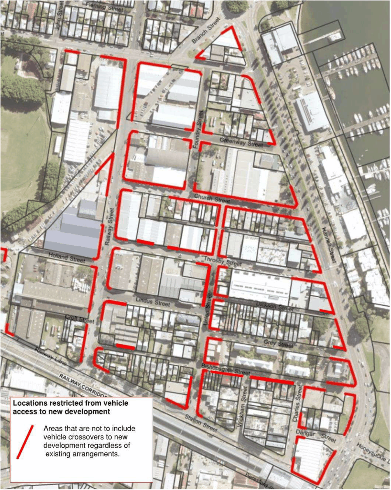

### 8.0 Urban design

#### A. Public domain

#### Performance criteria

P1. Enhance public domain amenity and maximise opportunities for movement, walking and cycling.

#### Acceptable solutions

A1. All development must upgrade the public domain for the full width of all site frontage to CN specifications. Where the proposed works will adjoin and connect into existing or approved works on an adjoining site, then suitable transitions are required beyond the property frontage.

#### Explanatory note

E1. When determining the requirement for public domain works, considerations by CN may include, but are not limited to the following:

a. the development type, scale and density

b. planned or likely intensification of an area

c. adjoining or surrounding footpath infrastructure and surface treatments

d. condition of any existing footpath and need for replacement

e. CN forecasted infrastructure and asset projects or capital works programs

f. topography of the road reserve along subject site frontage

g. the presence of any utilities, services, assets, street trees, street furniture or the like

h. CN public domain plans and standard drawings for footpaths

i. consideration of heritage conservation principles.

#### B. Interface to the street

#### Performance criteria

P1. Ground level uses promote pedestrian activation of the public domain.

P2. Development facilitates natural surveillance of the public domain.

P3. Building form reflects the envisaged precinct character and takes design cues from existing built elements within the streetscape.

#### Acceptable solutions

A1. The following design elements are incorporated in development facing a street or public domain area:

a. building name and/or street number signage are easily identifiable

b. building entries are well-lit

c. individual ground floor uses have direct pedestrian access to the footpath

d. universal access is provided to non-residential ground floor uses where the finished floor level is above or below the footpath

e. non-residential ground floor uses are visible from the street

f. the floor level of residential ground floor uses may be elevated not more than 1m above the footpath

g. building street setbacks incorporate gardens and/or landscaped forecourts, and

h. green walls and/or street art (e.g., murals) are provided to reduce and/or break up non active building facades (i.e., blank walls, screened areas, services and utility cabinets, and/or garage doors).

i. Ground floor residential fences are to be no more than 1.2m in height with a minimum 50% transparency. Soft landscaping is encouraged. Colourbond must be avoided.

j. Avoid hardstand in the front setback, instead provide landscaping.

A2. Development on corner sites activate at least 50% of each facade.

A3. Residential development at ground level has a minimum 4m ceiling height and is designed to enable change of use in the future.

#### C. Urban activation spaces

#### Performance criteria

P1. Development incorporates space that provides relief from the hard surfaces of the urban environment and for residents and the local community to gather or participate in activities.

#### Acceptable solutions

A1. Urban activation spaces are located:

a. in central locations along identified pedestrian and cycle routes and at street corners as identified in

#### Figure E7.10

b. within the front setback of larger development sites and partly incorporated into the road reserve

c. adjoining supporting retail or community activities that provide natural surveillance, but do not commercialise the space for their own business.

A2. Urban activation spaces incorporate landscape elements or facilities as identified in the Wickham Community Infrastructure Plan.

> [Picture on page 16: a picture, saved as a picture (images/section-e7-wickham-page-16-1.gif, 150 dpi).]

#### Figure E7.07: Urban activation space examples

#### Figure E7.08: Location of urban activation spaces

#### D. Vehicle access to land

#### Performance criteria

P1. Vehicle and service entries ensure the safety and amenity of pedestrians.

#### Acceptable solutions

A1. Vehicle access and service entries are located consistent with Figure E7.09.

A2. Driveway crossings are consolidated or eliminated along the primary frontage of new developments.

#### Acceptable solutions - Village Hub

A3. For development consisting of two or more dwellings, on-site car parking is consolidated to minimise the number of driveways.

A4. Driveway access is single vehicle width at the footpath crossover.

> [Picture on page 18: a picture, saved as a picture (images/section-e7-wickham-page-18-1.gif, 150 dpi).]

#### Figure E7.09: Vehicle access restrictions to new development
