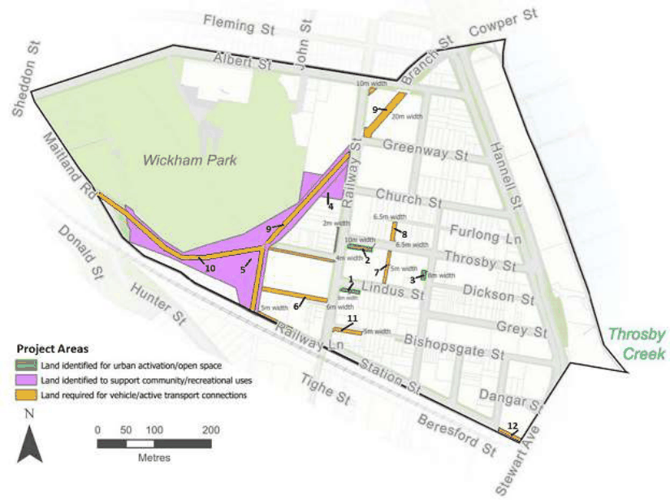

### 10.0 Community infrastructure incentives in Wickham

#### Performance criteria

P1. In accordance with Clause 7.11 of LEP 2012 an incentive height of building and floor space ratio may be achievable on land where CN and an applicant have agreed to or entered into a planning agreement on the basis of providing identified community infrastructure.

P2.  Community infrastructure may be provided to CN in the form of land, capital works, cash contribution, or a combination of these that will deliver the nominated community infrastructure projects identified in the Wickham Community Infrastructure Plan.

P3.  Applicants will obtain in-principle agreement from CN to the provision of community infrastructure being offered prior to lodging a formal DA.

#### Explanatory note

E1. Community infrastructure is identified in the Wickham Community Infrastructure Plan. It includes development for the purpose of community facilities, recreation areas, recreation facilities (outdoor) or public roads.

E2. The 'Incentive GFA Rate for Wickham' is identified in the Wickham Community Infrastructure Plan and is subject to indexation.

E3. A planning agreement is the means by which identified community infrastructure will be delivered on a given site. This community infrastructure is provided in addition to infrastructure contributions payable under Section 7.11 and Section 7.12 of the Environmental Planning and Assessment Act 1979.

> [Picture on page 20: a picture, saved as a picture (images/section-e7-wickham-page-20-20.gif, 150 dpi).]

#### Figure E7.10: Location of community infrastructure projects in Wickham
