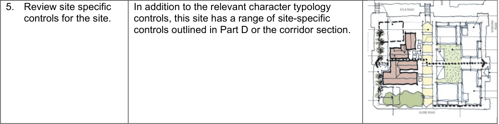
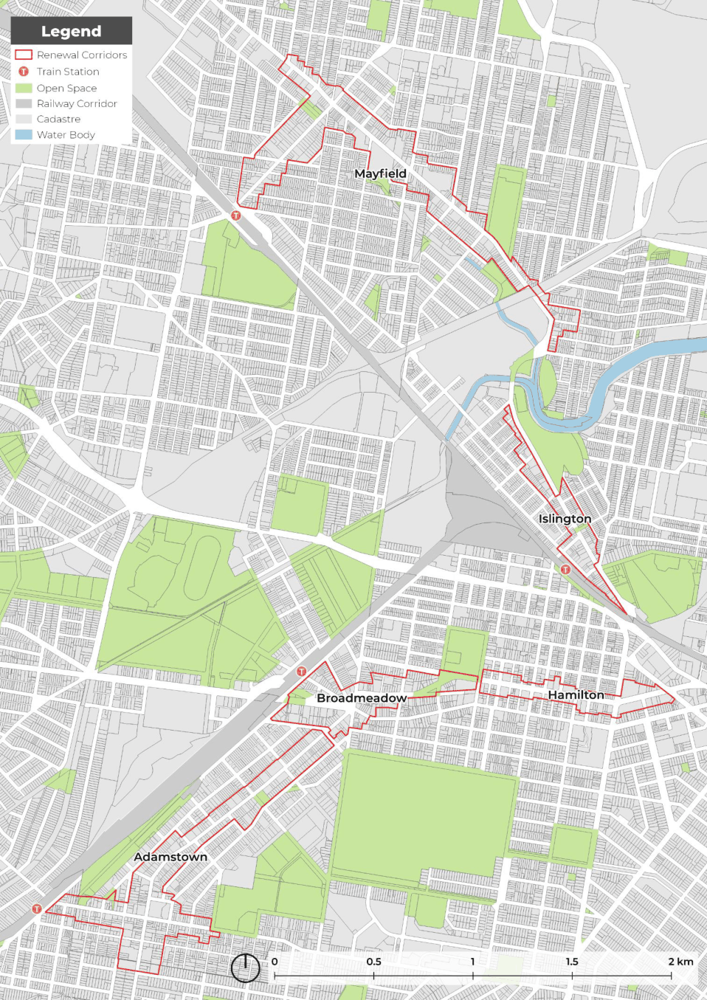

#### Section E8 Renewal corridors

#### Table of Contents

Development (type/s) to which this control applies ............................................................................................ 4 Applicable environmental planning instruments .................................................................................................. 4 Related sections ................................................................................................................................................. 4 Savings provisions .............................................................................................................................................. 5 Design excellence: Urban Design Review Panel ............................................................................................... 5 Introduction .............................................................................................................................................................. 6 Structure ............................................................................................................................................................. 6 Using this section ............................................................................................................................................... 7 Objectives ....................................................................................................................................................... 10 Controls .......................................................................................................................................................... 10 Application requirements .................................................................................................................................. 11

1.0 Adamstown renewal corridor ......................................................................................................................... 13 Land to which this section applies .................................................................................................................... 13 A. Building Setbacks ........................................................................................................................................ 14 Objectives ....................................................................................................................................................... 14 Controls .......................................................................................................................................................... 14 B. Awnings and street trees ............................................................................................................................. 16 Objectives ....................................................................................................................................................... 16 Controls .......................................................................................................................................................... 16 C. Traffic and transport .................................................................................................................................... 19 Objectives ....................................................................................................................................................... 19 Controls .......................................................................................................................................................... 19 D. Site specific provisions ................................................................................................................................ 21 Objectives ....................................................................................................................................................... 21 Controls .......................................................................................................................................................... 21 E. Art in publicly accessible places .................................................................................................................. 23 Objectives ....................................................................................................................................................... 23 Controls .......................................................................................................................................................... 24

2.0 Broadmeadow renewal corridor ..................................................................................................................... 25 Land to which this section applies .................................................................................................................... 25 A. Building setbacks......................................................................................................................................... 26 Objectives ....................................................................................................................................................... 26 Controls .......................................................................................................................................................... 26 B. Awnings and street trees ............................................................................................................................. 28 Objectives ....................................................................................................................................................... 28

Controls .......................................................................................................................................................... 28 C. Traffic and transport .................................................................................................................................... 31 Objectives ....................................................................................................................................................... 31 Controls .......................................................................................................................................................... 31 D. Art in publicly accessible places .................................................................................................................. 31 Objectives ....................................................................................................................................................... 31 Controls .......................................................................................................................................................... 32

3.0 Hamilton renewal corridor .............................................................................................................................. 34 Land to which this section applies .................................................................................................................... 34 A. Building setbacks......................................................................................................................................... 35 Objectives ....................................................................................................................................................... 35 Controls .......................................................................................................................................................... 35 B. Awnings and street trees ............................................................................................................................. 37 Objectives ....................................................................................................................................................... 37 Controls .......................................................................................................................................................... 37 C. Traffic and transport .................................................................................................................................... 40 Objectives ....................................................................................................................................................... 40 Controls .......................................................................................................................................................... 40 D. Site specific provisions ................................................................................................................................ 42 Objectives ....................................................................................................................................................... 42 Controls .......................................................................................................................................................... 42 E. Art in publicly accessible places .................................................................................................................. 43 Objectives ....................................................................................................................................................... 43 Controls .......................................................................................................................................................... 43

4.0 Mayfield renewal corridor ............................................................................................................................... 45 Land to which this section applies .................................................................................................................... 45 A. Building setbacks......................................................................................................................................... 46 Objectives ....................................................................................................................................................... 46 Controls .......................................................................................................................................................... 46 B. Awnings and street trees ............................................................................................................................. 48 Objectives ....................................................................................................................................................... 48 Controls .......................................................................................................................................................... 48 C. Traffic and transport .................................................................................................................................... 51 Objectives ....................................................................................................................................................... 51 Controls .......................................................................................................................................................... 51 D. Site specific provisions ................................................................................................................................ 54 Objectives ....................................................................................................................................................... 54 Controls .......................................................................................................................................................... 54 E. Art in publicly accessible places .................................................................................................................. 58 Objectives ....................................................................................................................................................... 58

Controls .......................................................................................................................................................... 58

5.0 Islington renewal corridor ............................................................................................................................... 60 Land to which this section applies .................................................................................................................... 60 A. Building setbacks......................................................................................................................................... 61 Objectives ....................................................................................................................................................... 61 Controls .......................................................................................................................................................... 61 B. Awnings and street trees ............................................................................................................................. 63 Objectives ....................................................................................................................................................... 63 Controls .......................................................................................................................................................... 63 C. Traffic and transport .................................................................................................................................... 66 Objectives ....................................................................................................................................................... 66 Controls .......................................................................................................................................................... 66 D. Site specific provisions ................................................................................................................................ 68 Objectives ....................................................................................................................................................... 68 Controls .......................................................................................................................................................... 68 E. Art in publicly accessible places .................................................................................................................. 70 Objectives ....................................................................................................................................................... 70 Controls .......................................................................................................................................................... 70

6.0 Character typologies ...................................................................................................................................... 72 A. Village Centre .............................................................................................................................................. 72 Character Statement ...................................................................................................................................... 72 Objectives ....................................................................................................................................................... 72 Controls .......................................................................................................................................................... 72 B. Active-residential ......................................................................................................................................... 78 Character statement ....................................................................................................................................... 78 Objectives ....................................................................................................................................................... 78 Controls .......................................................................................................................................................... 78 C. Apartments .................................................................................................................................................. 85 Character statement ....................................................................................................................................... 85 Objectives ....................................................................................................................................................... 85 Controls .......................................................................................................................................................... 86 D. Auto-business .............................................................................................................................................. 92 Character statement ....................................................................................................................................... 92 Objectives ....................................................................................................................................................... 92 Controls .......................................................................................................................................................... 92 E. Transition-residential ................................................................................................................................... 99 Character statement ....................................................................................................................................... 99 Objectives ....................................................................................................................................................... 99 Controls .......................................................................................................................................................... 99

#### Development (type/s) to which this control applies

This section applies to all development consisting of:

• new buildings or structures

• additions or alterations to existing buildings or structures.

#### Applicable environmental planning instruments

• Newcastle Local Environmental Plan 2012 (LEP 2012)

• State Environmental Planning Policy No 65—Design Quality of Residential Flat Development

In the event of any inconsistency between this section and the above listed environmental planning instruments, the environmental planning instrument will prevail to the extent of the inconsistency. Note 1: Additional environmental planning instruments may also apply in addition to those listed above. Note 2: The Environmental Planning and Assessment Act 1979 enables an environmental planning instrument to exclude or modify the application in whole or part.

#### Related sections

The following section will also apply to development:

• Any applicable land use specific provision under Part D Development controls by land use. Note: Any inconsistency between the locality specific provision and a land use specific provision, the locality specific provision will prevail to the extent of the inconsistency.

• B6 Urban heat

• C1 Traffic, parking and access

• C4 Stormwater

• C6 Waste management

• C7 Safety & security

• C12 Open space and landscaping.

The following sections may also apply to development:

• B1 Flood management

• B2 Bush fire protection

• B3 Mine subsidence

• B4 Aboriginal cultural heritage

• B5 Historical archaeology

• B7 Land contamination

• C1 Traffic, parking and access

• C2 Movement networks

• C3 Vegetation preservation and care

• C4 Stormwater

• C5 Soil management

• C6 Waste management

• C7 Safety & security

• C8 Social impact

• C9 Advertising and signage

• C10 Street awnings and balconies

• C11 Development adjoining laneways

• C13 Liveable housing

• D1 Subdivision and lot consolidation

• E1 Built and landscape heritage

• E2 Heritage conservation areas.

#### Savings provisions

Any development application (DA) lodged but not determined prior to this section coming into effect will be determined taking into consideration the provisions of the plan that applied at the date of lodgement of the application.

#### Design excellence: Urban Design Review Panel

The Urban Design Review Panel (UDRP) provides independent, expert advice to City of Newcastle (CN) and applicants about the quality of the urban design and amenity of developments. Some types of development must be referred to the UDRP. These include:

• Residential flat buildings

• Shop top housing

• Mixed-use development with residential accommodation component

• Strata subdivision of serviced apartments Within the renewal corridors, other types of development may be referred to the UDRP due to their nature, location or scale, and likely impact upon the surrounding locality. These include:

• Boarding houses

• Education establishments

• Hospitals

• Multi dwelling and attached dwelling developments comprising ten or more dwellings,

• Place of public worship

• Seniors housings

• Serviced apartment

• Tourist and visitor accommodation

• Modification applications where the development consent to be modified was subject to UDRP advice and the modifications are not minor

• Any other development referred at the discretion of the Manager The UDRP is an advisory panel only and the advice provided by the panel is to inform the assessment process. It is not the purpose of the UDRP to have any role in the determination of DAs, nor are its recommendations binding on CN’s determination of an application.

#### Introduction

This section provides development objectives and controls for infill and urban renewal development in the five renewal corridors. The LEP 2012 is Council's principal planning document. It provides objectives, zones and development standards such as lot sizes, floor space ratios and building heights. The existing urban renewal corridors were identified by CN within the Newcastle Urban Strategy, which underpinned the preparation of Newcastle LEP 2003. Good design is important to achieve a scale, bulk and height appropriate to the desired character of the street and surrounding buildings. It achieves an appropriate built form that defines the public domain, provides internal amenity and considers neighbours’ amenity. Good design also recognises that together landscape and buildings operate as an integrated and sustainable system, resulting in attractive development with good amenity. Good landscape design enhances the development’s environmental performance by retaining positive natural features which contribute to the local context, and providing deep soil zones for vegetation and urban heat/water management.

#### Structure

This section provides a set of overarching objectives for the corridors supported by five ‘Character typologies’, which provide development controls for all the corridors and relate to the desired future character of that area. Each corridor contains site specific controls which are located in the corresponding corridor section. Each corridor area is assigned a character typology, which has related built form controls.

> [Picture on page 6: a picture, saved as a picture (images/section-e8-renewal-corridors-page-6-20.gif, 150 dpi).]

### Overarching

### Corridor specific

### objectives

### controls

### Character

### typologies

This section covers five renewal corridors identified in the map following. These corridors are:

• Adamstown (Section 1.0)

• Broadmeadow (Section 2.0)

• Hamilton (Section 3.0)

• Mayfield (Section 4.0)

• Islington (Section 5.0) Site specific information relative to each corridor is contained in the respective sections.

#### Using this section

An example of how to apply the controls is provided below.

| Table E8.01: Example development control application |  |  |
|---|---|---|
| Step | Description | Image |
| 1. Identify relevant character typology for site on the corridor overview map. | In this example, the eastern portion of the former Adamstown Public School is identified in the purple ‘Active-Residential’ character typology. The built form controls contained in the ‘Active- Residential’ character typology apply to this site. The site also is identified as having site specific controls. |  |
| 2. Identify the relevant setback for the site on the setback map. | The subject site has two ‘Active Residential’ setbacks that apply: • AR1 (zero setback with a 2m articulation zone); and • AR2 (4m ground floor setback, zero setback above 2m articulation zone). Refer to relevant character typology section setbacks for further detail. |  |
| 3. Identify the relevant awning and street tree requirements for the site on the awning map. | The subject site is identified as requiring an awning on the primary street. Relevant awning controls apply. New street trees are also identified. Proposals must consider how these additional plantings can be provided, and design accordingly. |  |
| 4. Identify the relevant vehicle access requirements. | The site is identified with two type of vehicle access: • Blue: No vehicle access • Red: No additional vehicle access. |  |

> [Picture on page 8: a picture, saved as a picture (images/section-e8-renewal-corridors-page-8-1.gif, 150 dpi).]
> Words printed on the picture (title and legend, copied from the PDF):
> 5\. Review site specific
> controls for the site.

In addition to the relevant character typology controls, this site has a range of site-specific controls outlined in Part D or the corridor section.

> [Picture on page 9: a picture, saved as a picture (images/section-e8-renewal-corridors-page-9-1.gif, 150 dpi).]

#### Objectives

1\. Ensure new development responds to the desired future character and sense of place.

2\. Encourage a diversity of denser urban forms and renewal of underutilised sites.

3\. Provide for active street frontages and lively main streets.

4\. Improve the public domain by providing new urban places and landscape enhancements.

5\. Respect heritage significance and protect quality streetscapes and contributory buildings.

6\. Establish a finer grain and more permeable urban fabric to improve pedestrian amenity and safety.

7\. Establish and reinforce gateways at key locations to improve urban legibility.

8\. Maximise view potential to green spaces and landmarks.

9\. Encourage residential intensification, mixed use developments and infill as and where appropriate.

10\. Encourage design quality and sustainable, green development outcomes.

11\. Establish appropriate transitions to adjoining lower density streetscapes.

12\. Ensure solar access to public spaces and footpaths.

13\. Ensure the bulk and scale of new development is appropriate for the site and surrounding context, and contributes positively to the desired future character and amenity of the local area.

14\. Ensure all people, regardless of their age, ability or mobility, have equal access to public places and buildings by providing universally accessible design and infrastructure that meets the needs of the whole community.

#### Controls

Development in the renewal corridors must be consistent with the above objectives.

#### Application requirements

| Development Category | Application requirements | Explanatory Notes |
|---|---|---|
| All applications that include the erection of a new structure or the extension of an existing structure with a height exceeding 10m are to be accompanied with a 3D model of the proposed development within the context of the Newcastle CBD 3D model. | The format should be compatible to that used by CN. Format specification requirements for the model can be provided by CN's Geospatial Information Services team. | The 3D Model should be used to illustrate the following information: • context 'before' and 'after' streetscape drawings/images and/or photomontages; • shadow diagrams; and • assessment of impact on view corridors. |
| Any development that may require an acoustic report or a noise impact assessment. | An acoustic report or noise impact assessment is warranted when a noise-producing development is proposed near noise-sensitive areas or, conversely, when a noise-sensitive development is proposed in a noisy area. An acoustic report should: • consider and apply relevant noise guidelines or policies – for example, those nominated by planning authorities in planning instruments (e.g. development control plans and/or planning approvals) or in pre-development application meetings for a development • clearly describe assessment methodologies and include calculation data • adequately consider relevant factors such as the effects of weather, extraneous noise sources, potentially annoying characteristics of noise sources and operating conditions at the time of measurements. Ensure any recommendations concerning acoustic attenuation are feasible and can be practically implemented. | Newcastle After Dark Strategy - Night-time Economy Strategy reiterates that that a developer responsible for building a residential complex needs to ‘design in’ reasonable noise mitigation (for example double glazing). Conversely, a late-night venue seeking to extend venue space or hours of live performance would need to ensure noise impacts are appropriately managed. A noise-producing development or noisy area may have a range of activities contributing to noise and is not limited to that produced from busy roads, railways, industries, live music venues, entertainment, gymnasiums, public parks and plazas in which people may congregate or host live music or events. A noise-sensitive development may include but is not limited to residential accommodation, educational establishments, early education and childcare facility, health services facility, place of public worship or the like. More guidance can be found in the Noise Guide for Local Government, 2023 (NSW Environment Protection Authority) and, Approved Methods for the Measurement and Analysis of Environmental Noise in NSW, 2022 (NSW Environment Protection Authority). |

| An application for development, including a change of use involving building work. | An access report identifying the relevant matters to be addressed at the construction certificate stage, in circumstances where access constitutes a substantive public interest aspect of a proposal. Access reports should be prepared by a person who is a suitably qualified access consultant, such as a person who is appropriately accredited by the Association of Consultants in Access Australia Inc. | The Disability (Access to Premises – Buildings) Standards 2010 applies to any part of a building impacted by the application for a change of use. This section does not require anything beyond the standard, but does require information on how the standard will be met through the building design in accordance with these application requirements. There may also be other standards under the Disability Discrimination Act 1992 relevant to the public interest assessment of a proposal, such as the Disability Standards for Education 2005. |
|---|---|---|
| An application for a change of use not involving building work. | An access report to consider access matters, in circumstances where access constitutes a substantive public interest aspect of the proposal. Access reports should be prepared by a suitably qualified access consultant, such as a person appropriately accredited by the Association of Consultants in Access Australia Inc. | A change of use not involving building works may generate public interest considerations relevant to the assessment of a DA, including in circumstances where it is apparent that a building may not comply with the access requirements of the Building Code of Australia. |
