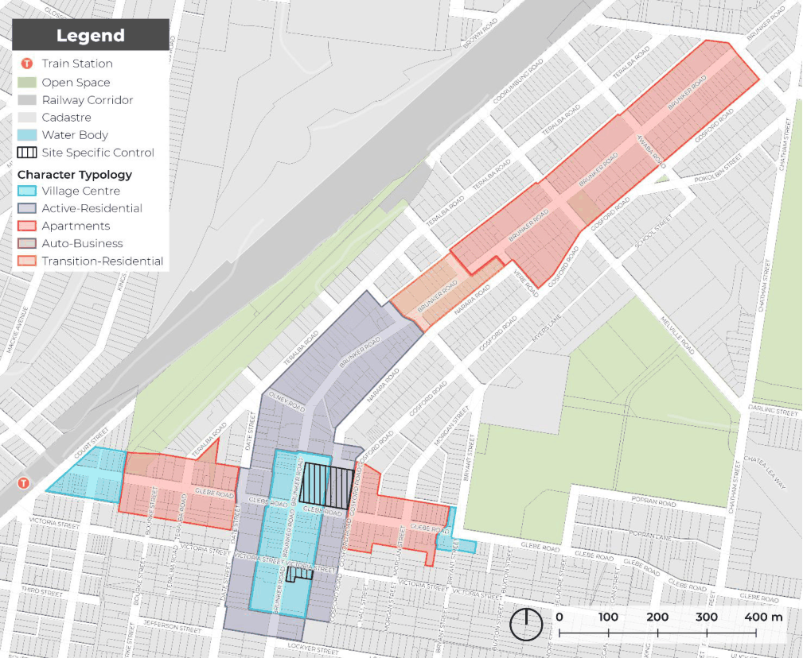
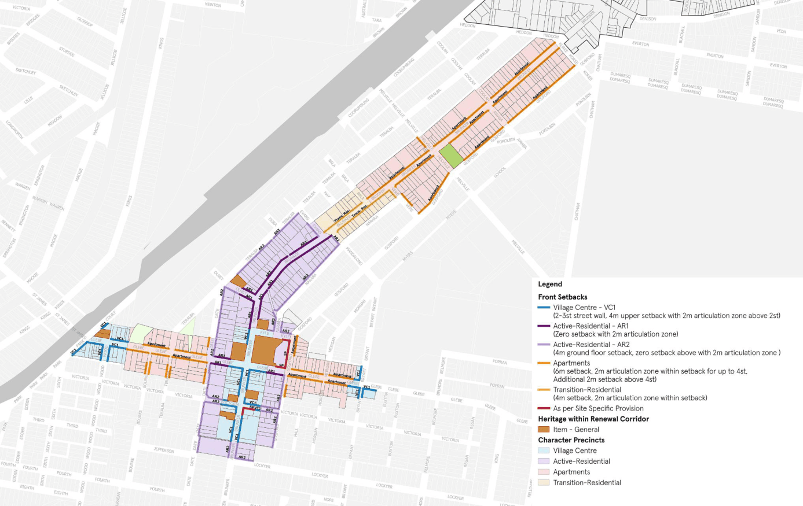
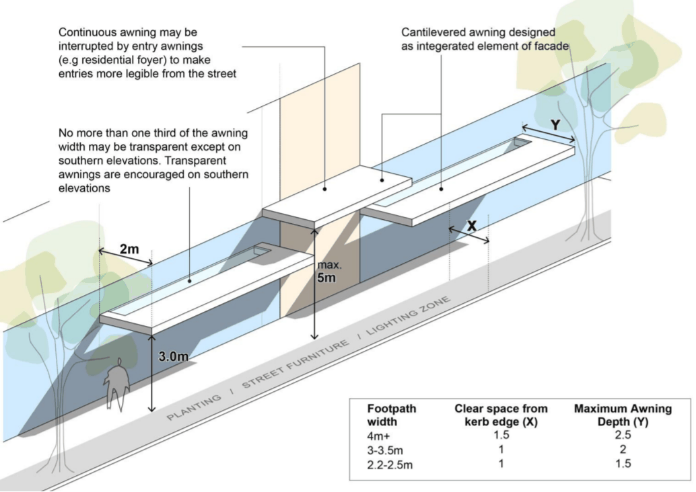
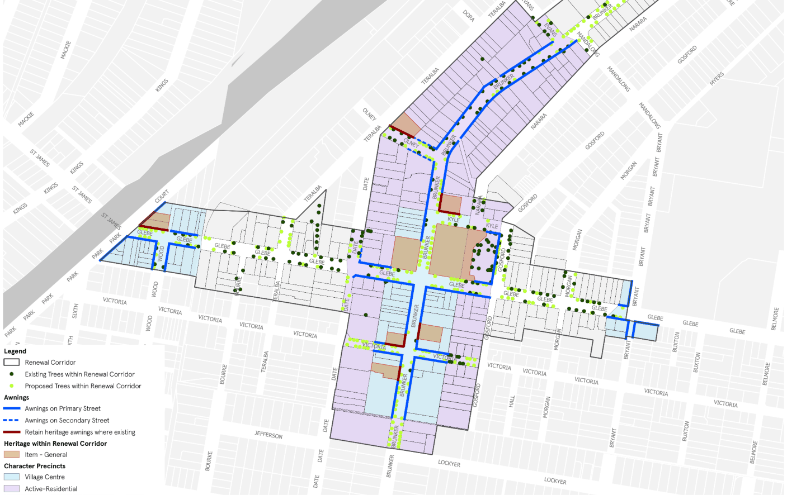
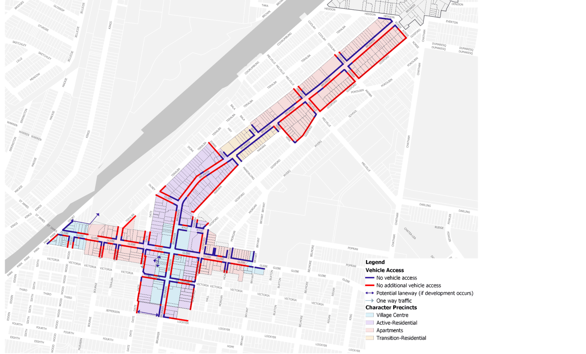
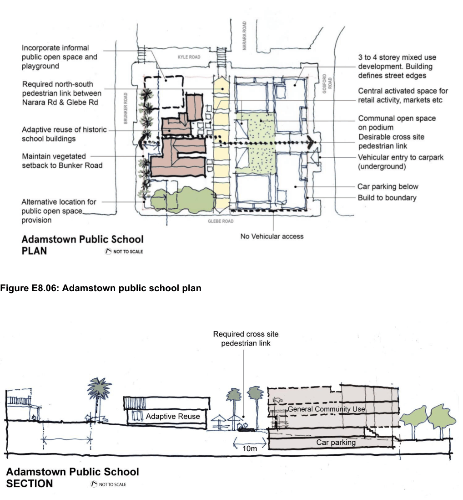
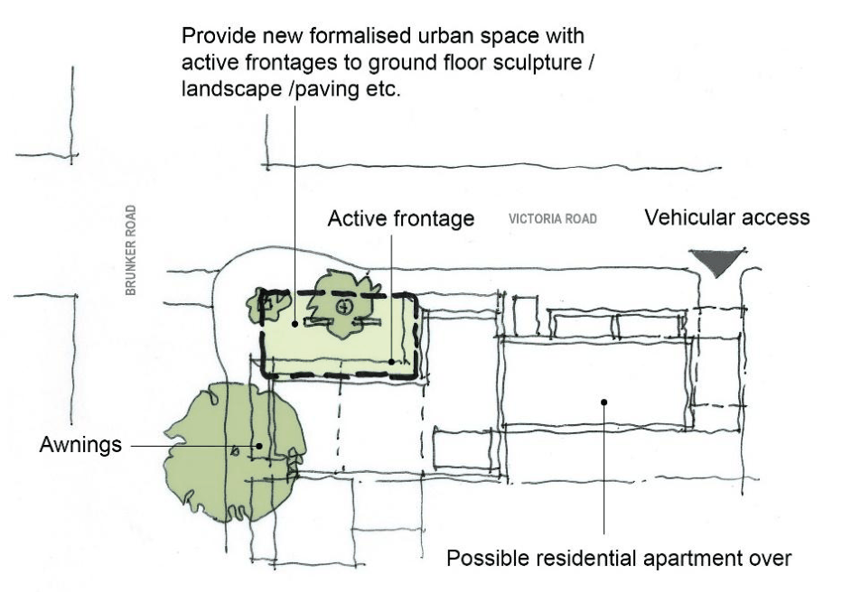

### 1.0 Adamstown renewal corridor

#### Land to which this section applies

This section applies to all land identified in Figure E8.01.

> [Picture on page 13: a picture, saved as a picture (images/section-e8-renewal-corridors-page-13-4.gif, 150 dpi).]

#### Figure E8.01: Adamstown renewal corridor area

Refer to the relevant setback and character typology for overarching development controls.

#### A. Building Setbacks Objectives

1\. Reinforce and maintain a well-defined street edge along Brunker Road and Glebe Road.

2\. Provide space for tree planting and landscaping in desired areas.

#### Controls

1\. Front building setbacks must be consistent with those shown on Figure E8.02:  and the relevant setbacks identified in sub-section 6.0 Character typologies.

2\. Upper level setbacks are encouraged to be used for open space and landscaping, provided privacy of adjoining uses are protected.

3\. An alternative building setback from the character typologies listed in this section may only be accepted where it can demonstrate in urban design terms how the design solution was developed, how it was superior, and that the alternative setback:

a. is more appropriate to the specific characteristics and context of the site and its surroundings, as compared to the setback requirements that have been assigned

b. will not adversely affect the amenity of surrounding properties or the wider community

c. meets the overall objectives of the section in terms of built form, scale, and bulk

d. is consistent with good design principles and the desired character of the area.

Note: Any proposed alternative setback must be submitted to the council for review and approval. The proponent will be required to provide detailed design drawings, elevations, and a written justification for the alternative setback. Council will consider the proposed alternative setback against the criteria outlined in this control and may approve, approve with conditions, or reject the proposal. A pre-DA meeting with council officers is encouraged when intending to vary these controls.

> [Picture on page 15: a picture, saved as a picture (images/section-e8-renewal-corridors-page-15-1.gif, 150 dpi).]

#### Figure E8.02: Adamstown building setbacks

#### B. Awnings and street trees Objectives

1\. Provide consistent awnings along active frontages.

2\. Increase urban tree canopy cover.

3\. Manage the interface between street trees and awnings.

4\. Ensure that awnings, street trees and street infrastructure (such as power poles, street lighting, bus stops, drainage and telecommunication pits) are coordinated in their design and that their placement does not obstruct the public domain.

#### Controls

These controls should be read in conjunction with Section C10 Street awnings and balconies. If there is inconsistency between controls, the controls in this section prevail.

1\. Awnings must be provided in accordance with Figure E8.04.

2\. Awnings are to be consistent with Figure E8.03.

3\. The underside of an awning must be no lower than 3m above the footpath.

4\. As shown in Figure E8.03, the depth of an awning is determined by the footpath width to allow appropriate space for planting, street furniture and lighting.

5\. Continuous awnings must be provided to all active frontages. Breaks in awnings may be permitted for residential lobbies for legibility and for existing street trees.

6\. New awnings should respond to existing awnings in terms of width, height and material. Awning material preference should complement heritage or period facades with similar materials, signage and colour treatments.

7\. Awnings on Primary Streets should provide a continuous awning for the entire length of the frontage. Breaks in awnings may be permitted for residential lobbies for legibility and for existing street trees

8\. Awnings on Secondary Streets should provide a continuation of the awning on the Primary Street, covering any active frontage for an appropriate distance relative to length of development.

9\. Where a proposed street tree is indicated on Figure E8.04, comprehensive redevelopment should provide new street tree planting, as per C3 Vegetation preservation and care and The Newcastle Urban Forest Technical Manual. Alternative tree locations and additional planting will be considered on merit.

Note: The proposed tree locations are dynamic and provided as a guide. Development may consider street blister or vault planting for street trees where continuous awnings are prescribed.

> [Picture on page 17: a picture, saved as a picture (images/section-e8-renewal-corridors-page-17-1.gif, 150 dpi).]

#### Figure E8.03: Awnings diagram

> [Picture on page 18: a picture, saved as a picture (images/section-e8-renewal-corridors-page-18-1.gif, 150 dpi).]

#### Figure E8.04: Adamstown street tree and awning map

#### C. Traffic and transport Objectives

1\. Minimise access onto Brunker and Glebe Road from new development.

2\. Provide sufficient off-street car parking.

3\. Minimise impacts from car parking on the streetscape and outdoor areas on site

4\. Maximise opportunities for walking and cycling and where possible

#### Controls

1\. Vehicle access is not provided directly to Brunker or Glebe Road but is off side streets and rear laneways, except where no other options for access exist, as identified on Figure E8.05 Adamstown Vehicle Access.

2\. Existing laneways and right-of-ways are retained for access by new and existing development.

3\. New public laneways are provided as shown on Figure E8.05 and dedicated to Council.

4\. Where negotiated prior to determination of a development proposal, such laneways may be incorporated into the development or allow development of their airspace but only where this allows for unrestricted public access.

5\. Vehicle entrances do not dominate the streetscape and are recessed from building facades.

6\. At-grade (ground level) car parking is only provided where:

a. it is set back behind other uses that provide activation to the street edge

b. it is under cover and integrated into the built form and covered by upper levels of development or upper level open space/landscaping provision

c. ceiling heights and floor levels allow for future adaption to other uses

d. it is not within building setbacks

e. it is not impeding an ability to meet minimum on site landscape requirements.

7\. Where above-ground car parking facilities are proposed they must be located to the rear of development along Brunker and Glebe Roads and appropriately screened from any street frontages by use of built form, architectural screens or landscaping.

8\. Driveways directly accessing Brunker or Glebe Roads, where necessary, have a maximum width of 3m per direction and contain a centre refuge where allowing two-way access. The design also minimises queuing across footpath.

9\. New development enhances safety and amenity of bus stops by encouraging adjoining active uses, passive surveillance, and weather protection.

10\. Car parking is provided in accordance with C1 Traffic, parking and access

11\. Development is to provide footpaths for the full width of any site frontage. Where the proposed footpath will adjoin and connect to an existing or approved footpath on an adjoining site, the width of the proposed footpath is to match this footpath width. See C2 Movement Networks for detail.

> [Picture on page 20: a picture, saved as a picture (images/section-e8-renewal-corridors-page-20-1.gif, 150 dpi).]

#### Figure E8.05: Adamstown vehicle access map

#### D. Site specific provisions Objectives

1\. Guide development outcomes on specific sites.

2\. Ensure good design outcomes that respect local character and heritage.

#### Controls

Former Adamstown Public School Site Located at 201 Brunker Road, the former Adamstown Public School is a locally listed heritage item Under the LEP 2012. The site is significant due to its landmark qualities and an example of Victorian Gothic architecture that is in excellent conditions. It is complementary to the adjacent Post Office and Adamstown Uniting Church. It was constructed and opened in 1879 as the Adamstown Public School to serve the large local population following the establishment of several mines in the area. It was last used as a school in 1971 and is currently the regional office for the Department of Education, having been re-opened as the Adamstown Teacher's Centre in

1973\. (Heritage NSW).

Redevelopment of the site should improve the public domain through a mixed use redevelopment. This includes improved through site linkages and a perimeter block style development with internal communal open space.

1\. Development of the former Adamstown Public School site should be consistent with the Figure E8.06 and Figure E8.07.

2\. Development of the former Adamstown Public School site at the corner setback of Brunker and Kyle Roads to incorporate an informal public open space with playground facilities.

3\. Through site links and pedestrian links should be provided as shown in Figure E8.06.

4\. On-site car parking associated with redevelopment of the former Adamstown Public School is provided at sub-grade with vehicle access from Gosford Road to maximise landscape opportunities on site, as shown in Figure E8.06.

> [Picture on page 22: a picture, saved as a picture (images/section-e8-renewal-corridors-page-22-1.gif, 150 dpi).]

#### Figure E8.06: Adamstown public school plan

#### Figure E8.07: Adamstown public school section

Council library site

5\. Redevelopment of Council’s existing library site, at the corner of Brunker Road and Victoria Street, incorporates a new formalised civic space that provides opportunities for gathering and outdoor dining, as shown in Figure E8.08.

> [Picture on page 23: a picture, saved as a picture (images/section-e8-renewal-corridors-page-23-5.gif, 150 dpi).]

#### Figure E8.08: Adamstown library plan

#### E. Art in publicly accessible places Objectives

1\. Incorporate publicly accessible art into significant development to enhance the sense of place and cultural identity.

2\. Ensure that publicly accessible art is located in appropriate areas to optimise recognition, amenity, and safety.

3\. Utilise publicly accessible artworks to interpret heritage components, recognise former uses of large development sites and reflect the desired contemporary character of a place.

4\. Recognise and celebrate indigenous and non-indigenous cultural heritage.

5\. Ensure publicly accessible artwork is easy to maintain.

#### Controls

1\. Development over $5 million must contribute art that is publicly accessible.

2\. Development required to provide publicly accessible art (in accordance with control 1) must be accompanied by a public art strategy prepared by a suitable qualified person. The public art strategy is to be in accordance with any strategy/guideline that outlines CN and the Public Art Reference Group's (PARG) process and expectations. Confirmation on the provision of publicly accessible art is required from CN in conjunction with the PARG or similar committee.

3\. The inclusion of publicly accessible art should be considered early in the design process to enable the appropriate integration of art with the detailed fabric and form of architectural, place and landscape designs. Early consultation with CN and affiliated PARG (or similar committee) is recommended.

4\. Publicly accessible art should be readily visible from the street.

5\. Where publicly accessible art is incorporated into building facades, roof features, open spaces, walkways, building foyers, landscaping or infrastructure it should be easily recognisable as an artistic feature and labelled accordingly in a close and noticeable location.

6\. Publicly accessible art installations in laneways are encouraged, including creative lighting to activate the laneway at night.

7\. The artwork should not be climbable unless specifically designed as a play safe artwork.

8\. Applicants should work with a heritage consultant and/or a public artist to develop innovative ways to interpret heritage using publicly accessible art.

9\. Publicly accessible art should respond to the significance and character of the location and where appropriate, interpret indigenous and non-indigenous cultural heritage.

10\. Publicly accessible art should cover a diverse range of themes and mediums to provide visual amenity and encourage interaction.

11\. Publicly accessible art must be safe and durable with consideration to avoid sharp edges, protrusions at eye height, trip hazards, and prevention of vandalism and deterioration over time.

12\. A publicly accessible artwork maintenance plan is developed prior to the installation of each new publicly accessible artwork to ensure the effective management of artwork.

13\. Where art is permanent, use materials that are:

a. appropriate to the landscape/environment

b. resistant to vandalism

c. durable and easily maintained.

Note: Publicly accessible means the ability to be viewed or experienced from publicly accessible places. This may be within the building facade or within the front setback. Early discussions with CN on the design and placement of public art is encouraged. Wherever possible, publicly accessible art should be designed by local artists. The cost of publicly accessible art installations is to be 1% of the cost of construction of the development.
