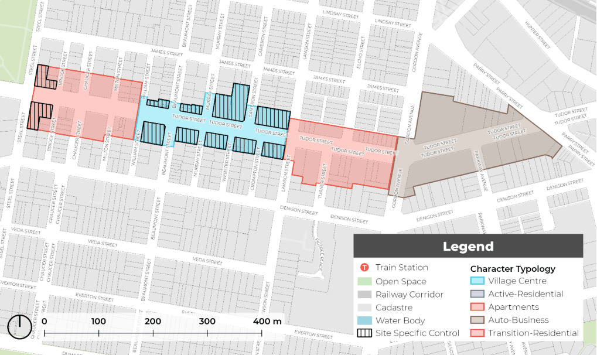
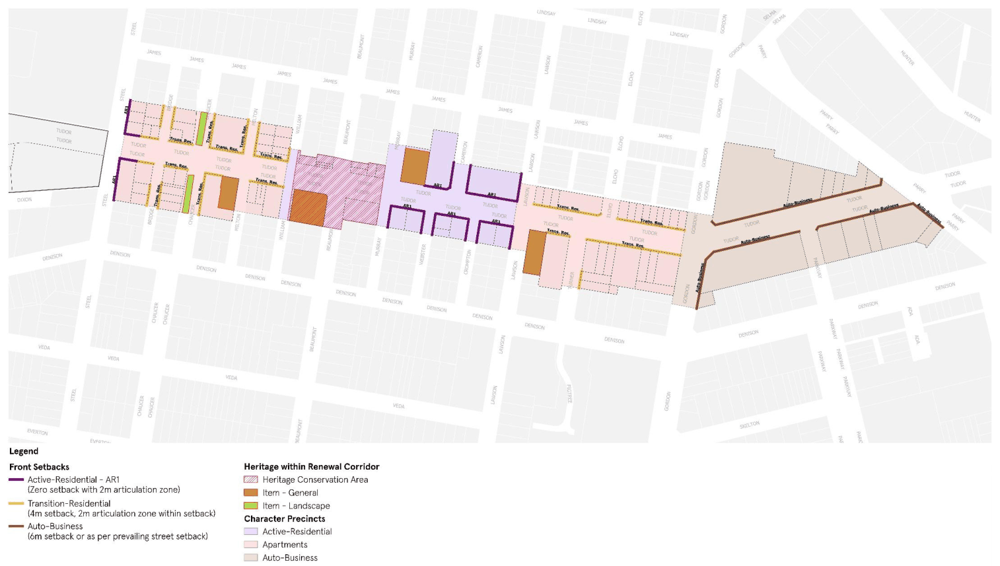
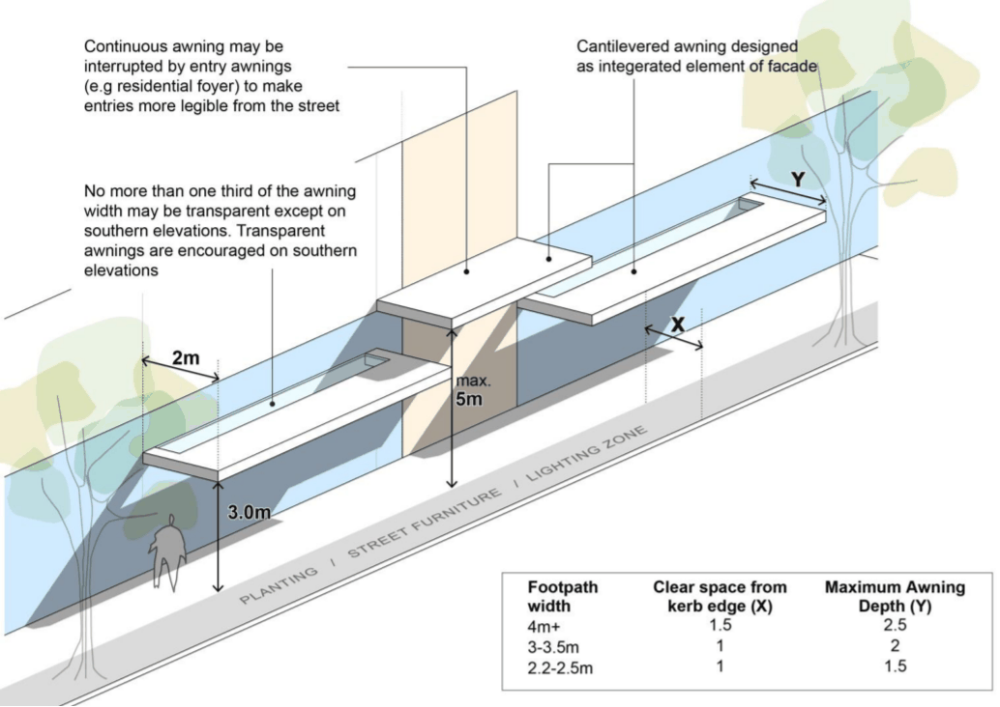
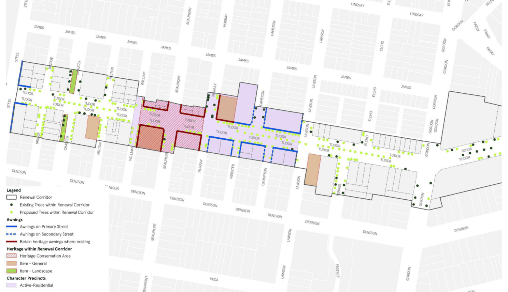
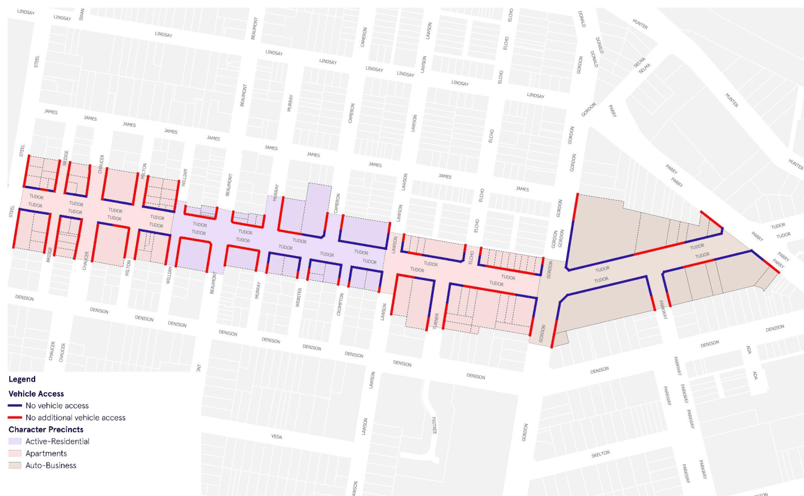
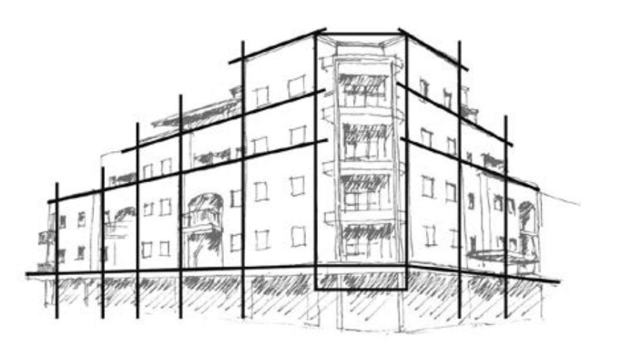

### 3.0 Hamilton renewal corridor

#### Land to which this section applies

This section applies to all land identified in Figure E8.15.

> [Picture on page 34: a picture, saved as a picture (images/section-e8-renewal-corridors-page-34-4.gif, 150 dpi).]

#### Figure E8.15: Hamilton renewal corridor area

Refer to the relevant setback and character typology for overarching development controls.

#### A. Building setbacks Objectives

1\. Reinforce and maintain a well defined street edge along Brunker and Glebe Roads.

2\. Extend and reinforce a strong street edge built form along Tudor Street.

3\. Provide space for tree planting and landscaping in desired areas.

#### Controls

1\. Front building setbacks must be consistent with those shown on Figure E8.16 and the relevant setbacks identified in sub-section 6.0 Character typologies.

2\. Upper level setbacks are encouraged to be used for open space and landscaping, provided privacy of adjoining uses are protected.

3\. An alternative building setback from the character typologies listed in this section may only be accepted where it can demonstrate in urban design terms how the design solution was developed, how it was superior, and that the alternative setback:

a. is more appropriate to the specific characteristics and context of the site and its surroundings, as compared to the setback requirements that have been assigned

b. will not adversely affect the amenity of surrounding properties or the wider community

c. meets the overall objectives of the section in terms of built form, scale, and bulk

d. is consistent with good design principles and the desired character of the area.

Note: Any proposed alternative setback must be submitted to the council for review and approval. The proponent will be required to provide detailed design drawings, elevations, and a written justification for the alternative setback. CN will consider the proposed alternative setback against the criteria outlined in this control and may approve, approve with conditions, or reject the proposal. A pre-DA meeting with council officers is encouraged when proposing an alternative setback.

> [Picture on page 36: a picture, saved as a picture (images/section-e8-renewal-corridors-page-36-1.gif, 150 dpi).]

#### Figure E8.16: Hamilton building setback map

#### B. Awnings and street trees Objectives

1\. Provide consistent awnings along active frontages.

2\. Increase urban tree canopy cover.

3\. Manage the interface between street trees and awnings.

4\. Ensure that awnings, street trees and street infrastructure (such as power poles, street lighting, bus stops, drainage and telecommunication pits) are coordinated in their design and that their placement does not obstruct the public domain.

#### Controls

These controls should be read in conjunction with Section C10 Street awnings and balconies.

1\. Awnings must be provided in accordance with Figure E8.18.

2\. Awnings are to be consistent with Figure E8.17.

3\. The underside of an awning must be no lower than 3m above the footpath.

4\. As shown in Figure E8.17, the depth of an awning is determined by the footpath width to allow appropriate space for planting, street furniture and lighting.

5\. Continuous awnings must be provided to all active frontages. Breaks in awnings may be permitted for residential lobbies for legibility and for existing street trees.

6\. New awnings should respond to existing awnings in terms of width, height and material. Awning material preference should compliment heritage or period facades with similar materials, signage and colour treatments.

7\. Awnings on Primary Streets should provide a continuous awning for the entire length of the frontage. Breaks in awnings may be permitted for residential lobbies for legibility and for existing street trees.

8\. Awnings on Secondary Streets should provide a continuation of the awning on the Primary Street, covering any active frontage for an appropriate distance relative to length of development.

9\. Where a proposed street tree is indicated on Figure E8.18, comprehensive redevelopment should provide new street tree planting, as per C3 Vegetation preservation and care and The Newcastle Urban Forest Technical Manual. Alternative tree locations and additional planting will be considered on merit.

Note: The proposed tree locations are dynamic and provided as a guide. Development may consider street blister or vault planting for street trees where continuous awnings are prescribed.

> [Picture on page 38: a picture, saved as a picture (images/section-e8-renewal-corridors-page-38-1.gif, 150 dpi).]

#### Figure E8.17: Awnings diagram

> [Picture on page 39: a picture, saved as a picture (images/section-e8-renewal-corridors-page-39-1.gif, 150 dpi).]

#### Figure E8.18: Hamilton street tree and awning map

#### C. Traffic and transport Objectives

1\. Reduce potential vehicle and pedestrian conflict along site frontages to Tudor Street.

2\. Provide clear and simple vehicular access from side streets and rear access lanes.

3\. Restrict direct vehicular access to Tudor Street.

4\. Provide sufficient off-street car parking.

5\. Minimise impacts from car parking on the streetscape and open space areas.

6\. Maximise opportunities for walking and cycling and where possible.

#### Controls

General controls applying to all development to which this section applies

1\. Vehicle access for development is restricted to the side roads and rear lanes, where possible.

2\. Vehicular access across the footpath to allow direct vehicular access onto Tudor Street is only to occur where no alternate option is available and the development site has a minimum width of 24m. Consolidation of lots may be necessary to achieve this minimum width.

3\. Car parking is provided as per C1 Traffic, Parking and Access.

4\. Vehicle accesses are recessed from building facades.

5\. At-grade (ground level) car parking is only provided where:

a. it is set back behind other uses that provide activation to street edge

b. it is integrated into the built form and covered by upper levels of development or upper level open space/landscaping provision

c. ceiling heights and floor levels allow for future adaption to other uses

d. it is not within building setbacks

e. it is not impeding on ability to meet minimum on site landscape requirements.

6\. Car parking facilities are screened from Tudor Street through building design.

7\. Development is to provide footpaths for the full width of any site frontage. Where the proposed footpath will adjoin and connect to an existing or approved footpath on an adjoining site, the width of the proposed footpath is to match this footpath width. See C2 Movement networks for detail.

> [Picture on page 41: a picture, saved as a picture (images/section-e8-renewal-corridors-page-41-1.gif, 150 dpi).]

#### Figure E8.19: Hamilton vehicle access map

#### D. Site specific provisions Objectives

1\. Guide development outcomes on specific sites.

2\. Establish gateways to the corridor through built form and landscape improvements.

#### Controls

Envisaged façade treatment for Village Centre character precinct

1\. Facade treatment should incorporate elements that create visual articulation to the building

mass. These may be achieved within 6m - 8m bays as shown in Figure E8.20.

> [Picture on page 42: a picture, saved as a picture (images/section-e8-renewal-corridors-page-42-9.gif, 150 dpi).]

#### Figure E8.20: Facade treatment for Village Centre character precinct

Gateway development at the corner of Tudor and Steel Streets

2\. Development at the corner of Tudor and Steel Streets should establish a ‘gateway’ style mixed use development, with clearly define street corners. A ‘gateway’ development should have visual prominence and clearly defined the street walls.

#### E. Art in publicly accessible places Objectives

1\. Incorporate publicly accessible art into significant development to enhance the sense of place and cultural identity.

2\. Ensure that publicly accessible art is located in appropriate areas to optimise recognition, amenity, and safety.

3\. Utilise publicly accessible artworks to interpret heritage components, recognise former uses of large development sites and reflect the desired contemporary character of a place.

4\. Recognise and celebrate indigenous and non-indigenous cultural heritage.

5\. Ensure publicly accessible artwork is easy to maintain.

#### Controls

1\. Development valued over $5 million must contribute art that is publicly accessible.

2\. Development required to provide publicly accessible art (in accordance with control 1) must be accompanied by a public art strategy prepared by a suitable qualified person. The public art strategy is to be in accordance with any strategy/guideline that outlines CN and the Public Art Reference Group's (PARG) process and expectations. Confirmation on the provision of publicly accessible art is required from CN in conjunction with the PARG or similar committee.

3\. The inclusion of publicly accessible art should be considered early in the design process to enable the appropriate integration of art with the detailed fabric and form of architectural, place and landscape designs. Early consultation with CN and affiliated PARG (or similar committee) is recommended.

4\. Publicly accessible art should be readily visible from the street.

5\. Where publicly accessible art is incorporated into building facades, roof features, open spaces, walkways, building foyers, landscaping or infrastructure it should be easily recognisable as an artistic feature and labelled accordingly in a close and noticeable location.

6\. Publicly accessible art installations in laneways are encouraged, including creative lighting to activate the laneway at night.

7\. The artwork should not be climbable unless specifically designed as a play safe artwork.

8\. Applicants should work with a heritage consultant and/or a public artist to develop innovative ways to interpret heritage using publicly accessible art.

9\. Publicly accessible art should respond to the significance and character of the location and where appropriate, interpret indigenous and non-indigenous cultural heritage.

10\. Publicly accessible art should cover a diverse range of themes and mediums to provide visual amenity and encourage interaction.

11\. Publicly accessible art must be safe and durable with consideration to avoid sharp edges, protrusions at eye height, trip hazards, and prevention of vandalism and deterioration over time.

12\. A publicly accessible artwork maintenance plan is developed prior to the installation of each new publicly accessible artwork to ensure the effective management of artwork.

13\. Where art is permanent, use materials that are:

a. appropriate to the landscape/environment

b. resistant to vandalism

c. durable and easily maintained.

Note: Publicly accessible means the ability to be viewed or experienced from publicly accessible places. This may be within the building facade or within the front setback. Early discussions with CN on the design and placement of public art is encouraged. Wherever possible, publicly accessible art should be designed by local artists. The cost of publicly accessible art installations is to be 1% of the cost of construction of the development.
