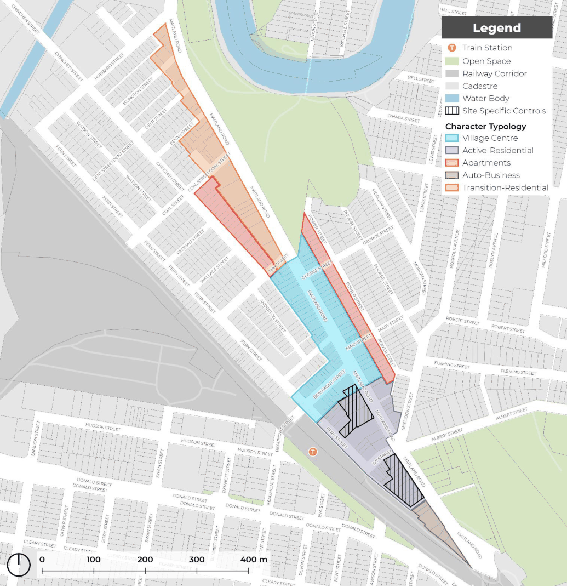
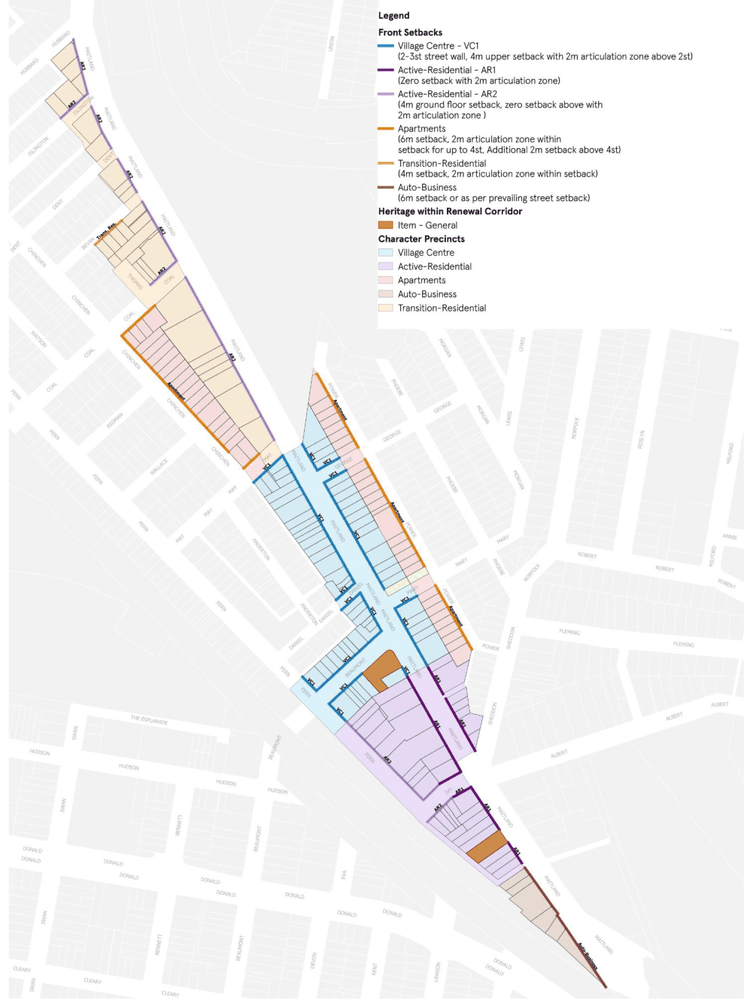
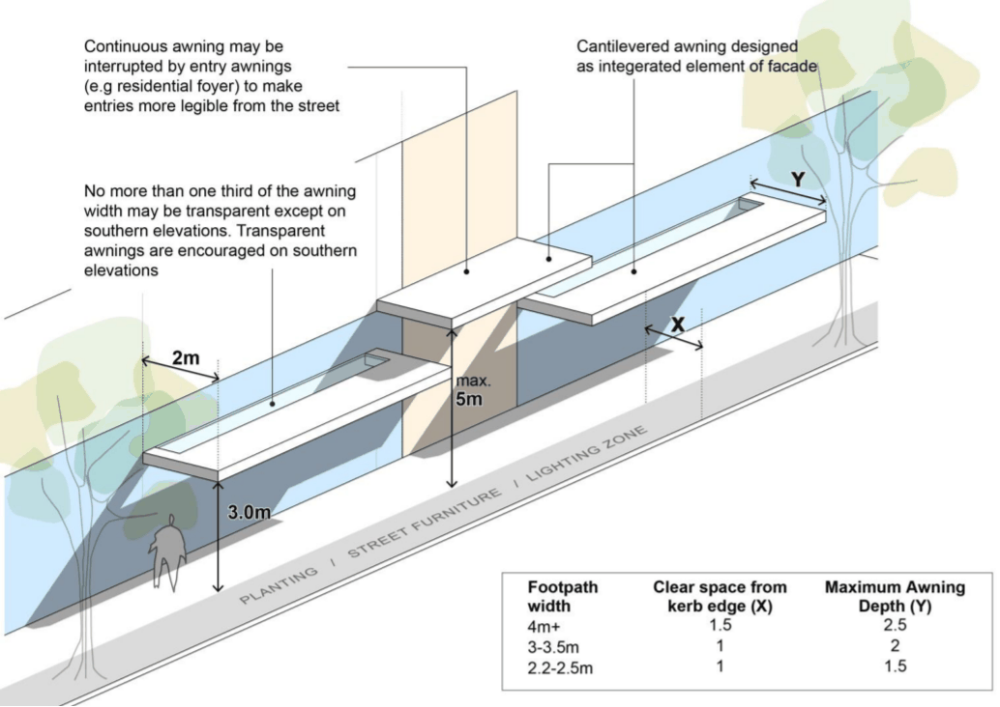
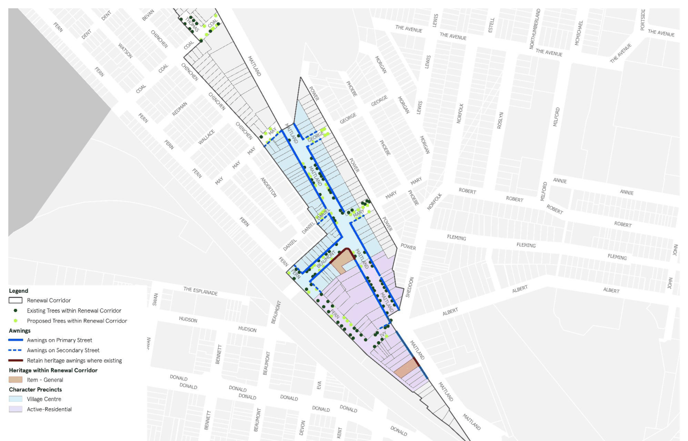
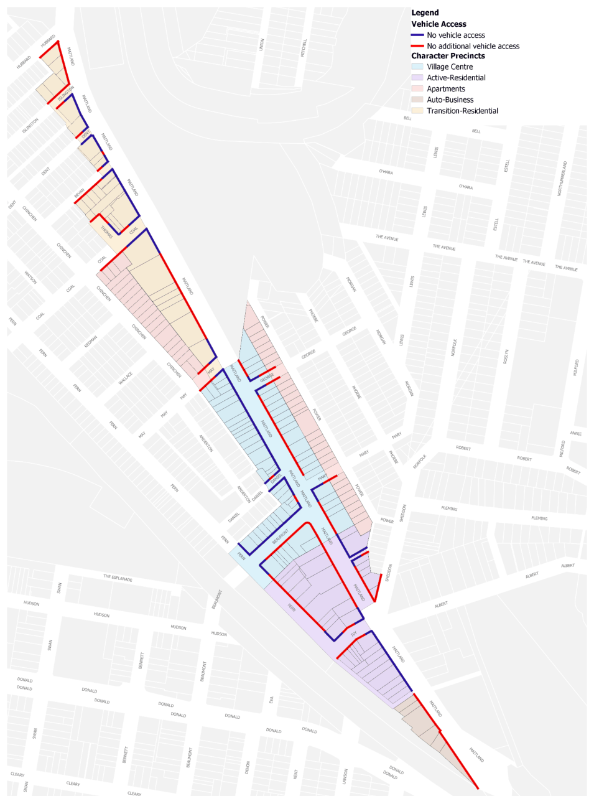
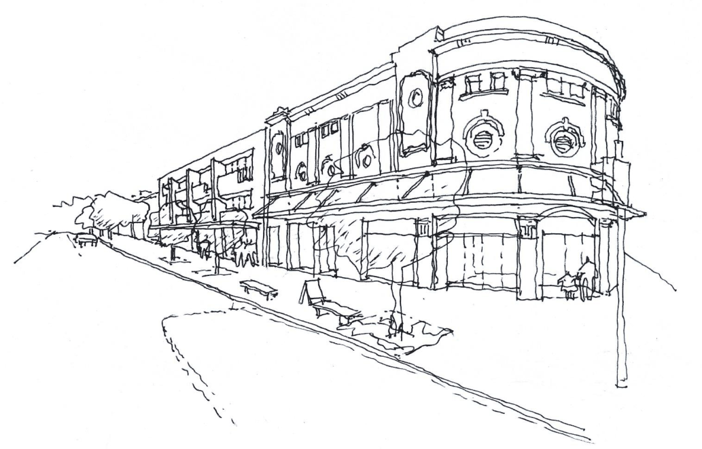
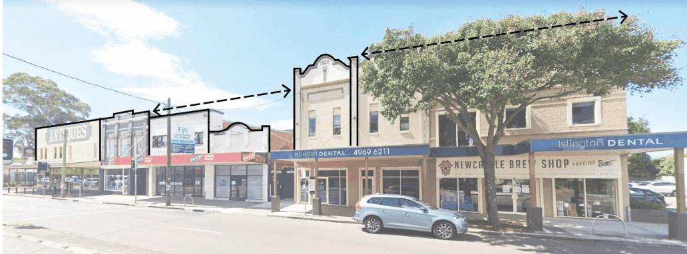
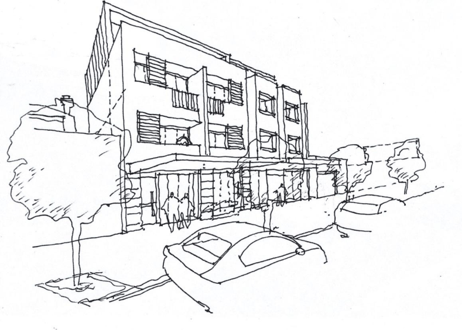

### 5.0 Islington renewal corridor

#### Land to which this section applies

This section applies to all land identified in Figure E8.30.

> [Picture on page 60: a picture, saved as a picture (images/section-e8-renewal-corridors-page-60-4.gif, 150 dpi).]

#### Figure E8.30: Islington renewal corridor area

Refer to the relevant setback and character typology for overarching development controls.

#### A. Building setbacks Objectives

1\. Reinforce a consistent street edge and maintain the scale of facade along the street.

2\. Respect the adjoining residential precinct and commercial centre through the implementation of appropriate building setbacks at each interface.

3\. Provide space for tree planting and landscaping in desired areas.

#### Controls

1\. Front building setbacks must be consistent with those shown on Figure E8.31 and the relevant setbacks identified in sub-section 6.0 Character typologies.

2\. Upper level setbacks are encouraged to be used for open space and landscaping, provided privacy of adjoining uses are protected.

3\. An alternative building setback from the character typologies listed in this section may only be accepted where it can demonstrate in urban design terms how the design solution was developed, how it was superior, and that the alternative setback:

a. is more appropriate to the specific characteristics and context of the site and its surroundings, as compared to the setback requirements that have been assigned

b. will not adversely affect the amenity of surrounding properties or the wider community

c. meets the overall objectives of the section in terms of built form, scale, and bulk

d. is consistent with good design principles and the desired character of the area.

Note: Any proposed alternative setback must be submitted to the council for review and approval. The proponent will be required to provide detailed design drawings, elevations, and a written justification for the alternative setback. Council will consider the proposed alternative setback against the criteria outlined in this control and may approve, approve with conditions, or reject the proposal. A pre-DA meeting with council officers is encouraged.

> [Picture on page 62: a picture, saved as a picture (images/section-e8-renewal-corridors-page-62-1.gif, 150 dpi).]

#### Figure E8.31: Islington building setback map

#### B. Awnings and street trees Objectives

1\. Provide consistent awnings along active frontages.

2\. Increase urban tree canopy cover.

3\. Manage the interface between street trees and awnings.

4\. Ensure that awnings, street trees and street infrastructure (such as power poles, street lighting, bus stops, drainage and telecommunication pits) are coordinated in their design and that their placement does not obstruct the public domain.

#### Controls

These controls should be read in conjunction with Section C10 Street awnings and balconies.

1\. Awnings must be provided in accordance with Figure E8.33.

2\. Awnings are to be consistent with Figure E8.32.

3\. The underside of an awning must be no lower than 3m above the footpath.

4\. As shown in Figure E8.32, the depth of an awning is determined by the footpath width to allow appropriate space for planting, street furniture and lighting.

5\. Continuous awnings must be provided to all active frontages. Breaks in awnings may be permitted for residential lobbies for legibility and for existing street trees.

6\. New awnings should respond to existing awnings in terms of width, height and material. Awning material preference should complement heritage or period facades with similar materials, signage and colour treatments.

7\. Awnings on Primary Streets should provide a continuous awning for the entire length of the frontage. Breaks in awnings may be permitted for residential lobbies for legibility and for existing street trees.

8\. Awnings on Secondary Streets should provide a continuation of the awning on the Primary Street, covering any active frontage for an appropriate distance relative to length of development.

9\. Where a proposed street tree is indicated on Figure E8.33, comprehensive redevelopment should provide new street tree planting, as per C3 Vegetation preservation and care and The Newcastle Urban Forest Technical Manual. Alternative tree locations and additional planting will be considered on merit.

Note: The proposed tree locations are dynamic and provided as a guide. Development may consider street blister or vault planting for street trees where continuous awnings are prescribed.

> [Picture on page 64: a picture, saved as a picture (images/section-e8-renewal-corridors-page-64-1.gif, 150 dpi).]

#### Figure E8.32: Awnings diagram

> [Picture on page 65: a picture, saved as a picture (images/section-e8-renewal-corridors-page-65-1.gif, 150 dpi).]

#### Figure E8.33: Islington street tree and awning map

#### C. Traffic and transport Objectives

1\. Minimise vehicles directly accessing onto Maitland Road from new development.

2\. Provide sufficient off-street car parking.

3\. Minimise impact from car parking on the streetscape and outdoor areas on site.

4\. Maximise opportunities for walking and cycling and where possible.

#### Controls

General controls applying to all development to which this section applies

1\. Vehicular access must comply with Figure E8.34.

2\. Vehicular access onto Maitland Road is only to occur where no alternate option is available, and the development site has a minimum width of 24m.

3\. Vehicle entrances do not dominate the streetscape and should be recessed from building facades.

4\. Vehicular access to loading areas is restricted to side or rear streets and lanes, where these occur.

5\. Rear lanes to the south of Maitland Road should be the primary vehicular access point to redeveloped sites along the southern side of the corridor.

6\. Car parking is provided in accordance with C1 Traffic, Parking and Access.

7\. Development is to provide footpaths for the full width of any site frontage. Where the proposed footpath will adjoin and connect to an existing or approved footpath on an adjoining site, the width of the proposed footpath is to match this footpath width. See C2 Movement networks for detail.

8\. Sub-ground car parking is encouraged, however, where above-ground car parking is provided, it should be located to the rear of sites and appropriately screened from streets through the use of architectural screens, landscape or building forms.

9\. At grade (ground level) car parking is only provided where:

a. set back behind other uses that provide activation to street edge

b. under cover and integrated into the built form and covered by upper levels of development or upper level open space/landscaping provision

c. ceiling heights and floor levels allow for future adaption to other uses

d. not within building setbacks

e. not impeding on ability to meet onsite landscape requirements.

The following controls apply to development in ‘Transition-Residential’ character typology

10\. Existing rear lanes and streets, predominantly Hubbard, Coal and May Streets should be utilised for vehicle access points.

11\. Pedestrian entrances should be predominantly from Maitland Road to activate the street, while vehicle access should be restricted to rear and side streets where possible.

> [Picture on page 67: a picture, saved as a picture (images/section-e8-renewal-corridors-page-67-1.gif, 150 dpi).]

#### Figure E8.34: Islington vehicle access map

#### D. Site specific provisions Objectives

1\. Guide development outcomes on specific sites.

2\. Ensure good design outcomes that respect local character and heritage.

#### Controls

Development adjoining former Regent Theatre The former Regent Theatre has State heritage significance as one of the few examples of picture palaces in NSW (and possibly Australia) that remains substantially unaltered. It has a unique façade with classical detailing and occupies a prominent corner in Islington, giving it landmark qualities.

1\. Development adjacent to the former Regent Theatre reflects and responds to its building form and scale.

2\. New development fronting Beaumont Street and Maitland Road relates to existing parapets in order to complement the existing character and scale of the former Regent Theatre see Figure E8.35 and the Hamilton Station Hotel to the south.

> [Picture on page 68: a picture, saved as a picture (images/section-e8-renewal-corridors-page-68-15.gif, 150 dpi).]

#### Figure E8.35: Scale of development adjoining former Regent Theatre

Development in the Local Village Centre character typology area The existing roof parapets along Maitland Road should be maintained, with new development not detracting from these as the main building feature.

3\. Roof forms do not dominate parapets, which should be the main feature of building facades in this precinct see Figure E8.36.

> [Picture on page 69: a picture, saved as a picture (images/section-e8-renewal-corridors-page-69-6.gif, 150 dpi).]

#### Figure E8.36: Existing parapets dominating the street edge

Development fronting Wickham Park

4\. Development fronting Wickham Park should reinforce a mixed use outcome and respond to existing built form as shown in Figure E8.37.

> [Picture on page 69: a picture, saved as a picture (images/section-e8-renewal-corridors-page-69-11.gif, 150 dpi).]

#### Figure E8.37: Indicative built form outcome for lots facing Wickham Park

#### E. Art in publicly accessible places Objectives

1\. Incorporate publicly accessible art into significant development to enhance the sense of place and cultural identity.

2\. Ensure that publicly accessible art is located in appropriate areas to optimise recognition, amenity, and safety.

3\. Utilise publicly accessible artworks to interpret heritage components, recognise former uses of large development sites and reflect the desired contemporary character of a place.

4\. Recognise and celebrate indigenous and non-indigenous cultural heritage.

5\. Ensure publicly accessible artwork is easy to maintain.

#### Controls

1\. Development valued over $5 million must contribute art that is publicly accessible.

2\. Development required to provide publicly accessible art (in accordance with control 1) must be accompanied by a public art strategy prepared by a suitable qualified person. The public art strategy is to be in accordance with any strategy/guideline that outlines CN and the Public Art Reference Group's (PARG) process and expectations. Confirmation on the provision of publicly accessible art is required from CN in conjunction with the PARG or similar committee.

3\. The inclusion of publicly accessible art should be considered early in the design process to enable the appropriate integration of art with the detailed fabric and form of architectural, place and landscape designs. Early consultation with CN and affiliated PARG (or similar committee) is recommended.

4\. Publicly accessible art should be readily visible from the street.

5\. Where publicly accessible art is incorporated into building facades, roof features, open spaces, walkways, building foyers, landscaping or infrastructure it should be easily recognisable as an artistic feature and labelled accordingly in a close and noticeable location.

6\. Publicly accessible art installations in laneways are encouraged, including creative lighting to activate the laneway at night.

7\. The artwork should not be climbable unless specifically designed as a play safe artwork.

8\. Applicants should work with a heritage consultant and/or a public artist to develop innovative ways to interpret heritage using publicly accessible art.

9\. Publicly accessible art should respond to the significance and character of the location and where appropriate, interpret indigenous and non-indigenous cultural heritage.

10\. Publicly accessible art should cover a diverse range of themes and mediums to provide visual amenity and encourage interaction.

11\. Publicly accessible art must be safe and durable with consideration to avoid sharp edges, protrusions at eye height, trip hazards, and prevention of vandalism and deterioration over time.

12\. A publicly accessible artwork maintenance plan is developed prior to the installation of each new publicly accessible artwork to ensure the effective management of artwork.

13\. Where art is permanent, use materials that are:

a. appropriate to the landscape/environment

b. resistant to vandalism

c. durable and easily maintained.

Note: Publicly accessible means the ability to be viewed or experienced from publicly accessible places. This may be within the building façade or within the front setback. Early discussions with CN staff on the design and placement of public art is encouraged. Wherever possible, publicly accessible art should be designed by local artists. The cost of publicly accessible art installations is to be 1% of the cost of construction of the development.
