### 6.0 Character typologies

#### A. Village Centre

These controls apply to all areas identified as Village Centre on the relevant renewal corridor map.

#### Character Statement

Village Centres are the focus of retail activity. These areas have the character of a traditional high street or main street, featuring active frontages and fine grain shopfronts. Village Centres are built to zero front setback with consistent awnings and respect the existing local character through adaptive reuse of heritage assets and sympathetic bulk and scale. The public domain and footpath are generally paved, providing a high standard of finish and where appropriate, features space for landscape planting and outdoor dining. Tree canopy integrates with building awnings to create a shaded footpath environment.

#### Objectives

1\. Encourage retail and commercial intensification at the ground floor within the established centres by concentrating retail and commercial activity.

2\. Maintain the integrity and viability of ground floor non-residential uses over time and protecting commercial floorspace from conversion to residential uses.

3\. Ensure ground floor uses contribute to centre activity, vibrancy, passive surveillance and local character.

4\. Improve and enhance the function and appearance of ground floor uses such that they are pedestrian oriented and contribute to streetscape amenity.

5\. Reinforce the fine grain character and continuity of ground floor shops within established centres.

6\. Minimise and ameliorate the effect of blank walls (with no windows or entrances) and building services at the ground level.

7\. Where feasible, ensure new development is accessible to all people.

#### Controls

1\. Development in a Village Centre character typology area must demonstrate consistency with the above objectives.

Building setbacks

2\. Front building setbacks must be consistent with the relevant character typology setback diagram identified on the relevant corridor setback map.

3\. Upper-level setbacks are encouraged to be used for open space and landscaping, provided privacy of adjoining uses are protected.

#### Figure E8.38: Setback VC1 - Mid-block

#### Figure E8.39: Setback VC2 – Corner block

Figure E8.40: Setback VC3 - Lots with heritage/contributory facades

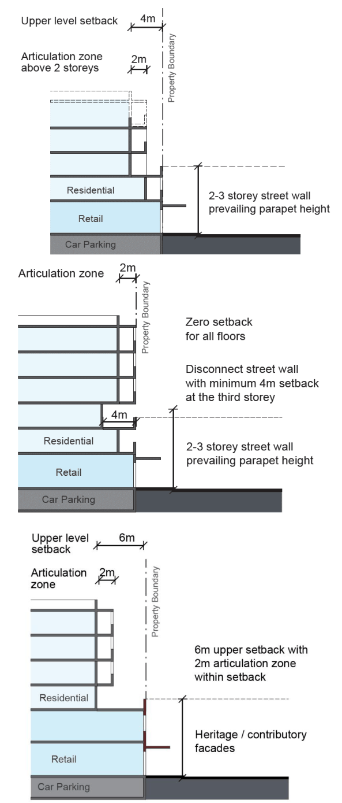

> [Picture on page 73: a picture, saved as a picture (images/section-e8-renewal-corridors-page-73-5.gif, 150 dpi).]

Active frontage

4\. A minimum 85% of street frontage identified with an VC1, VC2 or VC3 setback as are to be active uses, such as cafes, takeaway shops, retail shops, and business premises.

5\. A maximum 15% of lot frontage with an LV1, LV2 or LV3 setback may be for non-active uses, such as commercial foyers or residential lobbies.

6\. Car parking, services, fire doors, switchboards, and the like must be sleeved by active uses, or appropriately concealed and integrated in the design of the facade so as not to create blank or undesirable interfaces to the street.

7\. On corner sites where active frontages cannot be provided to secondary streets, walls should incorporate public art, variation in building materials or other architectural or “green” wall design elements to create street interest.

Ground level floor space

8\. Ground floor non-residential uses should have a minimum depth of 10m from the front property line to accommodate amenities, storage space, general back of house activities and other spatial requirements to support non-residential uses. An example is shown in Figure E8.41.

9\. Residential accommodation uses are not permitted at the ground level.

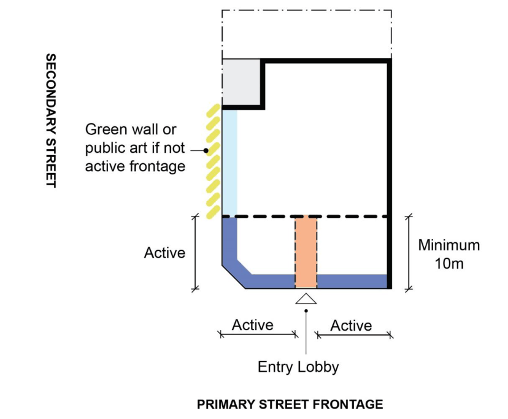

> [Picture on page 74: a picture, saved as a picture (images/section-e8-renewal-corridors-page-74-17.gif, 150 dpi).]

#### Figure E8.41: Ground level floor space and active frontages – Village Centre

Façade design

10\. Ground level facades identified with an LV1, LV2 or LV3 setback should have a solid to void ratio of approximately 80% void (entries and windows) and 20% solid (walls). Openings for new development should be full height (i.e. to street level), unless a better outcome would be achieved in responding to the character of adjacent buildings.

11\. Ground floor frontages identified with an LV1, LV2 or LV3 frontage width greater than 15m should be vertically articulated so as to reflect the fine grain character of the centre. Larger footprint retail shops (such as supermarkets) should be sleeved by smaller shops with individual entries to the street to maintain the fine grain.

12\. The ground floor façade identified with an LV1, LV2 or LV3 setback should be built to the property line (i.e. zero setback) but may have indented entries or bays where it is consistent with existing streetscape character.

13\. Facades should incorporate ‘soft edges’, such as transparent facades, large window openings, double-door entries, and spill out zones for goods on display. Consider ‘openable’ facades (windows and doors) to encourage engagement with the street and natural ventilation.

14\. On corner sites ‘permeable corners’ should be considered such as splayed corner entries, glazed corners, and/or openable window or door treatments.

15\. Where active frontages are predominantly glazed, up to 25% of the glazing may be frosted or semi-opaque should a level of privacy be required for the tenancy use.

16\. Highly reflective finishes and use of vinyl decal signage to address blank walls or long windows is not permitted.

Entries

17\. Entries for non-residential ground floor uses must be located on the primary street frontage.

18\. Ground floor entries to retail, community or commercial uses are to have the same finished floor level as that of the adjacent footpath, unless required to be raised due to flood impacts.

19\. Where the finished floor level is raised, universal access between the street and ground floor uses must be provided and detailed design and landscape considerations given to achieving easy access from the footpath. Level changes may also be accommodated within the building.

20\. Avoid locating the length of access ramps to the primary frontage of the building. Where this is unavoidable, landscaping must be integrated to soften the street edge.

21\. Vehicular parking and/or loading bays are to be accessed via a secondary street or rear lane where possible. Where secondary street or rear lane access is not available, vehicular parking and/or loading is to be at basement level or sleeved at ground level, accessed via no more than a single, two-way driveway from the primary street.

22\. Where vehicular entries are located to the primary or secondary street, entry doors should be recessed a minimum of 6m.

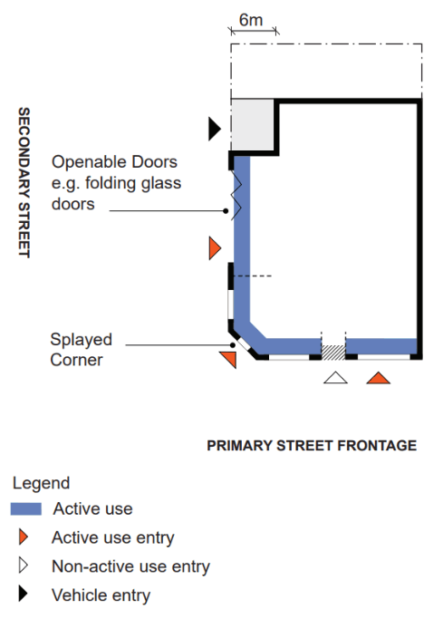

> [Picture on page 76: a picture, saved as a picture (images/section-e8-renewal-corridors-page-76-16.gif, 150 dpi).]

#### Figure E8.42: Entries and active uses – Village Centre

Blank walls

23\. Large areas of blank, minimally or poorly articulated walls are not acceptable. Measures to avoid this may include windows, awnings, sun shading devices, pergolas, green walls, public art or a recognisable increased setback to the upper storey.

24\. Blank walls are not permitted where facing the public domain.

25\. The maximum length of any blank wall must not exceed 5m.

26\. The maximum height of a blank wall must not exceed 3m.

27\. Where adjacent development is unlikely to occur in the short term, blank side walls should include public art or murals, as shown Figure E8.43: Blank wall with public art in Broadmeadow.

> [Picture on page 77: a picture, saved as a picture (images/section-e8-renewal-corridors-page-77-10.gif, 150 dpi).]

#### Figure E8.43: Blank wall with public art in Broadmeadow

Landscaping and deep soil

28\. Non-residential development in the Village Centre character typology area has no onsite deep soil requirement and may develop to 100% site coverage.

#### B. Active-residential

These controls apply to all areas identified as Active-Residential on the relevant renewal corridor map.

#### Character statement

Active-Residential areas cater for a variety of uses with active frontages and non-residential ground floor

uses. Street corners are well defined by buildings with zero front setback, while mid-block setbacks are deeper to allow space for landscape, goods display and outdoor dining (where local amenity permits).

Mid-block setbacks assist in mediating existing uses where there may be a 6m residential setback or a car parking zone to the street.

#### Objectives

1\. Ensure the integrity and viability of non-residential ground floor uses.

2\. Ensure non-residential ground floor uses provide for active frontages.

3\. Ensure ground floor uses are pedestrian oriented and contribute to streetscape amenity, local character and passive surveillance.

4\. Appropriately address interfaces between non-residential and residential ground floor uses.

5\. Minimise and ameliorate the effect of blank walls (with no windows or entrances) and at-grade parking areas at the ground level.

6\. Ensure there is adequate unbuilt upon areas to allow for landscaped areas and deep soil planting capable of supporting large trees that increase urban tree canopy cover.

7\. Ensure that development resulting in multiple dwellings or accommodation is designed efficiently to achieve the full potential of the site, on lots that provide appropriate space for car parking, vehicle access, communal open space, deep soil planting and landscaping.

8\. Promote lot consolidation and ensure it does not result in isolated sites.

9\. Where feasible, ensure new development is accessible to all people.

#### Controls

1\. Development in an Active-Residential character typology area must demonstrate consistency with the above objectives.

Front setbacks

2\. Front building setbacks must be consistent with the relevant character typology setback diagram identified on the relevant corridor setback map.

3\. Upper-level setbacks are encouraged to be used for open space and landscaping, provided privacy of adjoining uses are protected.

#### Figure E8.44: Setback AR1, 4-5 storeys – Corner sites/ general

#### Figure E8.45: Setback AR2, 4-5 storeys – Mid- block

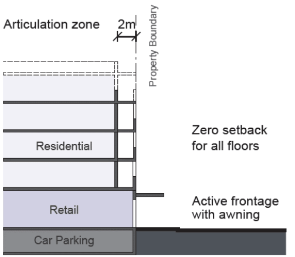

> [Picture on page 79: a picture, saved as a picture (images/section-e8-renewal-corridors-page-79-5.gif, 150 dpi).]

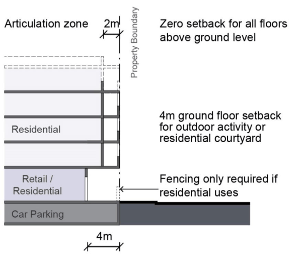

> [Picture on page 79: a picture, saved as a picture (images/section-e8-renewal-corridors-page-79-6.gif, 150 dpi).]

Rear setbacks

4\. Rear setbacks are to be consistent with Table E8.2.

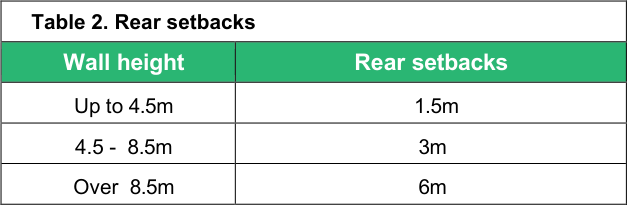

> [Picture on page 80: a picture, saved as a picture (images/section-e8-renewal-corridors-page-80-3.gif, 150 dpi).]

Table 2. Rear setbacks

| Wall height | Rear setbacks |
|---|---|
| Up to 4.5m | 1.5m |
| 4.5 - 8.5m | 3m |
| Over 8.5m | 6m |

5\. In the R3 Medium Density Residential, R4 High Density Residential and MU1 Mixed Use zones side or rear boundary setbacks may be reduced/built to the boundary where:

a. the wall height and length match an existing or similarly constructed wall on the adjoining site; and

b. the proposed wall and the wall on the adjoining property do not contain any openings; and

c. the wall will not impede the flow of stormwater or overland flow paths.

6\. In the R3 Medium Density Residential, R4 High Density Residential and MU1 Mixed Use zones, side and rear boundary setbacks are increased, where the site directly adjoins a site in the R2 Low Density Residential Zone.

7\. Where a rear boundary adjoins a lane, development complies with C11 Development adjoining a laneway.

8\. On corner lots, the boundary opposite the primary road frontage is taken to be the rear boundary for the purposes of applying setbacks.

Ground level frontages

9\. For sites identified with an AR1 or AR2 setback, a minimum 85% of street frontage are to be non-residential uses, preferably active uses, such as cafes, takeaway shops, retail shops, and business premises. For corner sites, active uses are to be focused at the corner of street blocks.

10\. For sites identified with an AR1 or AR2 setback, a maximum 15% of lot frontage may be for residential lobbies.

11\. Car parking, services, fire doors, switchboards, and the like are to be sleeved by active uses, or appropriately concealed and integrated in the design of the façade so as not to create blank or undesirable interfaces to the street.

12\. Where active frontages or non-residential uses cannot be provided to secondary streets, walls should incorporate public art, variation in building materials or other architectural or “green” wall design elements to create street interest.

Ground level floor space

13\. Ground floor non-residential uses should have a minimum depth of 10m from the building line to accommodate amenities, storage space, general back of house activities and other spatial requirements to support non-residential uses.

14\. Ground level floor to ceiling height must be a minimum of 4m to allow for adaptable floor plans that can support either commercial or residential uses.

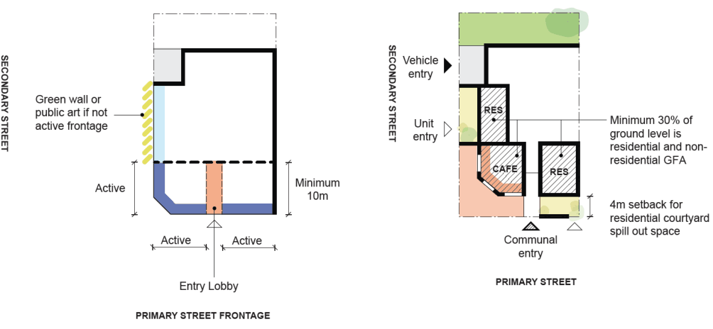

> [Picture on page 81: a picture, saved as a picture (images/section-e8-renewal-corridors-page-81-1.gif, 150 dpi).]

Figure E8.46: Ground level floor space and active frontages – Active-residential

Façade design

15\. For sites identified with an AR1 or AR2 setback, ground level facades for non-residential uses, including residential communal areas, should have a maximum 50% solid to void ratio. Where active uses are provided, a minimum of 80% void (entries and windows) and 20% solid (walls) applies.

16\. Where active frontages are predominantly glazed, up to 25% of the glazing may be frosted or semi-opaque should a level of privacy be required for the tenancy use.

17\. For sites identified with an AR1 setback, the ground floor façade should be built to the property line (i.e. zero setback) but may have indented entries or bays where it is consistent with existing streetscape character.

18\. Facades should incorporate ‘soft edges’, such as transparent facades, large window openings, double-door entries, and spill out zones for goods on display. Consider ‘openable’ facades (windows and doors) to encourage engagement with the street and natural ventilation.

19\. Ground floor frontages greater than 15m should be vertically articulated to reflect a fine grain character.

20\. Highly reflective finishes and use of vinyl decal signage to address blank walls or long windows is not permitted.

Entries

21\. Where development comprises of non-residential and residential activity, separate pedestrian entrances, lift access, increased ground floor height and designated car parking must be provided.

22\. Entries for non-residential ground floor uses must be located on the primary street frontage.

23\. Ground floor entries to retail, commercial uses or other non-residential uses are to have the same finished floor level as that of the adjacent footpath, unless required to be raised due to flood impacts.

24\. Where residential uses are located at the ground floor, ground floor units are to be provided with individual (courtyard) entries to the street to facilitate engagement with the public domain and passive

surveillance.

25\. Avoid locating the length of pedestrian access ramps to the primary frontage of the building. Where this is unavoidable, integrate landscaping to the street edge to create a softer edge to the street.

26\. Continuous awnings must be provided to all active frontages. Breaks in awnings may be permitted for residential lobbies for legibility.

27\. Vehicular parking and/or loading bays are to be accessed via a secondary street or rear lane where possible. Where secondary street or rear lane access is not unavailable, vehicular parking and/or loading is to be at basement level or sleeved at ground level, accessed via no more than a single driveway from the primary street.

28\. Where vehicular entries are located to the primary or secondary street, entry doors should be recessed a minimum of 6m.

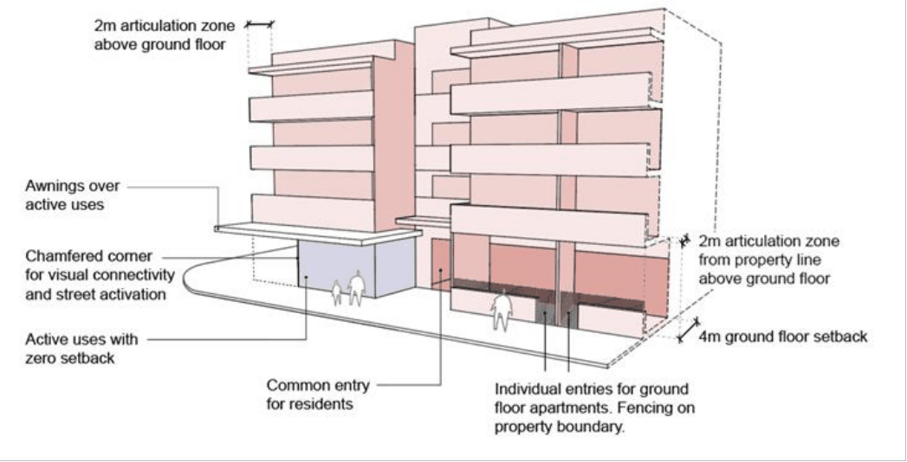

> [Picture on page 82: a picture, saved as a picture (images/section-e8-renewal-corridors-page-82-12.gif, 150 dpi).]

#### Figure E8.47: Non-residential and residential uses at ground level

Fencing

29\. Fencing is only permitted for residential uses. Non-residential uses are to be built to the property boundary as per the building setback controls.

30\. Ground floor residential uses may have a front fence up to 1.5m high. Solid materials, such as masonry, concrete render etc, are to be used to a maximum height of 1m high. This is to be combined with visually permeable treatments (such as slats or battens) to a height of 1.5m or landscape hedging above (any height) with or without piers to 1.5m. Colourbond must be avoided.

Note: Strip footing on fencing should be avoided where deep soil is proposed or there are existing trees.

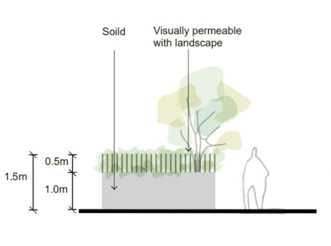

> [Picture on page 83: a picture, saved as a picture (images/section-e8-renewal-corridors-page-83-1.gif, 150 dpi).]

#### Figure E8.48: Active-residential fencing controls

Minimum lot size and frontage

31\. For the development types listed in Table E8.03 and frontage width must be equal to or greater than the minimums specified in Table E8.03.

| Table E8.03: Minimum lot and frontage size |  |  |
|---|---|---|
| Development type | Minimum lot size | Minimum frontage width |
| Boarding houses Hostels Multi dwelling housing Residential flat buildings Shop top housing | 1,000m2 | 18m |

32\. Development for the purpose of residential flat buildings, multi dwelling housing or shop top housing is not to result in the creation of an isolated site that could have been developed in compliance with the relevant planning controls. Appropriate documentary evidence to demonstrate that a genuine and reasonable attempt has been made to purchase an isolated site based on a fair market value.

33\. Where amalgamation of the isolated site is not feasible, applicants will be required to demonstrate that an orderly and economic use and development of the separate sites can be achieved.

34\. The development of existing isolated sites is not to detract from the character of the streetscape and is to achieve a satisfactory level of amenity including solar access, visual and acoustic privacy. Development of existing isolated sites may not achieve the maximum potential, particularly height and floor space ratio, and will be assessed on merit.

35\. Where adjacent sites are developing concurrently, site planning options for development as an amalgamated site are to be explored.

Blank walls

36\. Large areas of blank, minimally or poorly articulated walls are not acceptable. Measures to avoid this may include windows, awnings, sun shading devices, pergolas, green walls, public art or a recognisable

increased setback to the upper storey.

37\. Blank walls are not permitted where facing the public domain.

38\. The maximum length of any blank wall must not exceed 5m.

39\. The maximum height of a blank wall must not exceed 3m.

40\. Where adjacent development is unlikely to occur in the short term, blank side walls should include public art or murals, as shown in Figure E8.49.

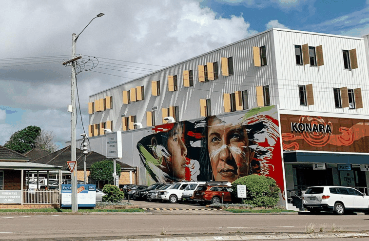

> [Picture on page 84: a picture, saved as a picture (images/section-e8-renewal-corridors-page-84-7.gif, 150 dpi).]

#### Figure E8.49: Blank wall with public art in Broadmeadow

Landscaping and deep soil

41\. Non-residential development should provide deep soil planting at side setback with a minimum width and length of 2m.

42\. The minimum landscaped area that must be provided on a lot is shown in Table E8.04.

#### Table E8.04: Minimum landscaped area.

| Lot Area | Minimum landscaped area | Minimum deep soil zone |
|---|---|---|
| <600m2 | 25% of site area | 12% |
| >600m2 | 30% of site area | 15% |

Note: New and existing trees must be clearly indicated in landscape plans.

43\. Deep soil planting must have a minimum width and length of 2m.

#### C. Apartments

These controls apply to all areas identified as Apartments on the relevant renewal corridor map.

#### Character statement

The Apartments typology reinforces and supports the characteristics of medium to high density neighbourhoods. Residential flat buildings and apartments are built with ground floor residential uses and a 6m landscaped setback. Setbacks may be reduced on corner sites.

Fencing is a consistent size and uses common materials across the corridors, providing space for landscape planting to soften building edges and improve tree canopy cover.

Ground floor apartments address the primary street frontage with individual dwelling entries while vehicular and waste access priorities the uses of rear lanes or secondary streets. Existing road and footpath levels are respected and maintained, where possible avoiding ground floor levels lower than the street.

#### Objectives

1\. Ensure consistent definition of the street edge via setbacks, fencing and landscaping.

2\. Appropriately balance noise attenuation and visual privacy requirements with engagement with the public domain.

3\. Increase opportunities for landscaping and deep soil planting in the front setback, facing the public domain.

4\. Ensure there is adequate unbuilt upon areas to allow for landscaped areas and deep soil planting capable of supporting large trees that increase urban tree canopy cover.

5\. Ensure that development resulting in multiple dwellings or accommodation is designed efficiently to achieve the full potential of the site, on lots that provide appropriate space for car parking, vehicle access, communal open space, deep soil planting and landscaping.

6\. Promote lot consolidation and ensure it does not result in isolated sites.

7\. Where feasible, ensure new development is accessible to all people.

#### Controls

1\. Development in an Apartments character typology area must demonstrate consistency with the above objectives.

Front setback

2\. Front building setbacks must be consistent with the relevant character typology setback diagram identified on the relevant corridor setback map.

3\. Upper-level setbacks are encouraged to be used for open space and landscaping, provided privacy of adjoining uses are protected.

4\. Front setbacks are to provide landscaping and deep soil to support large trees.

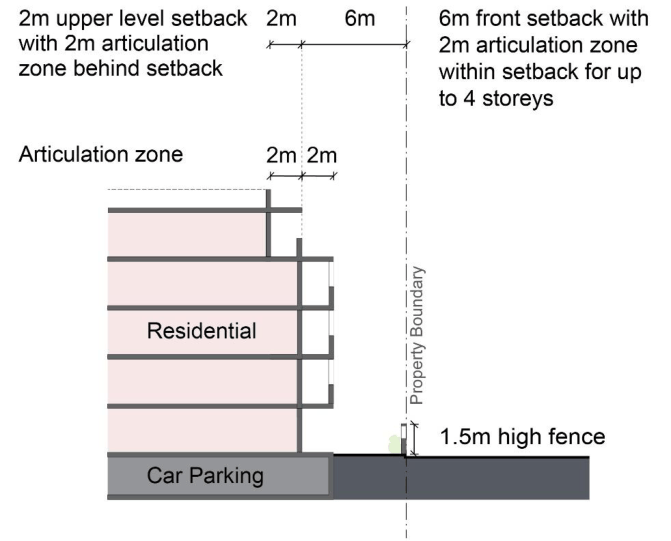

> [Picture on page 86: a picture, saved as a picture (images/section-e8-renewal-corridors-page-86-10.gif, 150 dpi).]

#### Figure E8.50: Residential setback

> [Picture on page 86: a picture, saved as a picture (images/section-e8-renewal-corridors-page-86-13.gif, 150 dpi).]

#### Figure E8.51: Front prevailing setback and articulation zone

Rear setbacks

5\. Rear setbacks are to be consistent with Table E8.05.

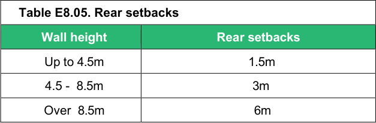

> [Picture on page 87: a picture, saved as a picture (images/section-e8-renewal-corridors-page-87-3.gif, 150 dpi).]

#### Table E8.05. Rear setbacks

| Wall height | Rear setbacks |
|---|---|
| Up to 4.5m | 1.5m |
| 4.5 - 8.5m | 3m |
| Over 8.5m | 6m |

6\. In the R3 Medium Density Residential, R4 High Density Residential and MU1 Mixed Use zones side or rear boundary setbacks may be reduced/built to the boundary where:

a. the wall height and length match an existing or similarly constructed wall on the adjoining site; and

b. the proposed wall and the wall on the adjoining property do not contain any openings; and

c. the wall will not impede the flow of stormwater or overland flow paths.

7\. In the R3 Medium Density Residential, R4 High Density Residential and MU1 Mixed Use zones, side and rear boundary setbacks are increased, where the site directly adjoins a site in the R2 Low Density Residential Zone.

8\. Where a rear boundary adjoins a lane, development complies with C11 Development adjoining a laneway.

9\. On corner lots, the boundary opposite the primary road frontage is taken to be the rear boundary for the purposes of applying setbacks.

Ground level floor space

10\. A minimum 30% of the ground floor of the building must be occupied by residential GFA to ensure the ground level is not wholly occupied by car parking, building services and communal amenities. This is to ensure ground flood activation and screen ground floor car parking from the public domain. Residential GFA must be located to the primary street.

11\. Ground floor residential GFA should result in at least two residential units.

12\. Ground floor residential GFA may include communal facilities such as shared workspaces.

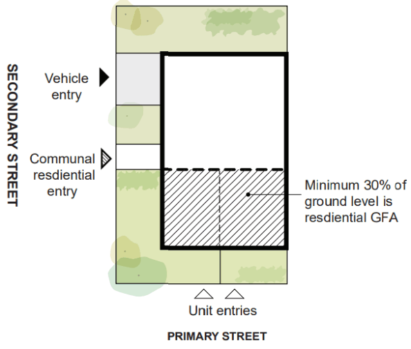

> [Picture on page 88: a picture, saved as a picture (images/section-e8-renewal-corridors-page-88-1.gif, 150 dpi).]

#### Figure E8.52: Ground level floor space – Apartments

Façade design

13\. Car parking, services, fire doors, switchboards, and the like are to be appropriately concealed and integrated in the design of the facade so as not to create blank or undesirable interfaces to the street.

Residential entries

14\. Ground floor units are to be provided with individual (courtyard) entries to the street to facilitate engagement with the public domain and passive surveillance. These entries should look and feel materially different to a communal building entry.

15\. Residential entries must not be located below street or footpath level.

16\. Residential uses at ground floor should be designed so that the ground floor is raised above the finished footpath level to provide for occupant privacy, up to a maximum of 1.2m.

17\. Where the finished floor level is raised, universal access between the street and ground floor uses must be provided and detailed design and landscape considerations given to achieving easy access from the footpath. Level changes may also be accommodated within the building.

18\. The length of access ramps should not be located along the primary frontage of the building. Where this is unavoidable, landscaping must be integrated to the street edge to create a softer edge to the street.

19\. Vehicular parking must be accessed via a secondary street or rear lane where possible. Where secondary street or rear lane access is not unavailable, vehicular parking and/or loading is to be at basement level or sleeved by units at ground level, accessed via no more than a single driveway from the primary street.

#### Figure E8.53: (Right) Ground level entries – apartments

Fencing

20\. Ground floor residential uses must have a front fence up to 1.5m high. Solid materials, such as masonry, concrete render etc, are to be used to a maximum height of 1m high. This is to be combined with visually permeable treatments (such as slats or battens) to a height of 1.5m or landscape hedging above (any height) with or without piers to 1.5m. Colourbond must be avoided.

#### Figure E8.54: (Right) residential fencing controls

Minimum lot size and frontage

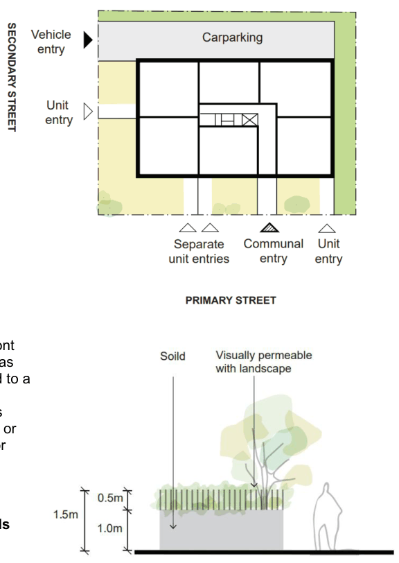

> [Picture on page 89: a picture, saved as a picture (images/section-e8-renewal-corridors-page-89-15.gif, 150 dpi).]

21\. For the development types listed in Table E8.06, lot size and frontage width must be equal to or greater than the minimums specified in Table E8.06.

| Table E8.06: Minimum lot and frontage size |  |  |
|---|---|---|
| Development type | Minimum lot size | Minimum frontage width |
| Boarding houses Hostels Multi dwelling housing Residential flat buildings Shop top housing | 1,000m2 | 18m |

22\. Development for the purpose of residential flat buildings, multi dwelling housing or shop top housing is not to result in the creation of an isolated site that could have been developed in compliance with the relevant planning controls. Council will require appropriate documentary evidence to demonstrate that a genuine and reasonable attempt has been made to purchase an isolated site based on a fair market

value.

23\. Where amalgamation of the isolated site is not feasible, applicants will be required to demonstrate that an orderly and economic use and development of the separate sites can be achieved.

24\. The development of existing isolated sites is not to detract from the character of the streetscape and is to achieve a satisfactory level of amenity including solar access, visual and acoustic privacy. Development of existing isolated sites may not achieve the maximum potential, particularly height and floor space ratio, and will be assessed on merit.

25\. Where adjacent sites are developing concurrently, site planning options for development as an amalgamated site are to be explored.

Blank walls

26\. Large areas of blank, minimally or poorly articulated walls are not acceptable. Measures to avoid this may include windows, awnings, sun shading devices, pergolas, green walls, public art or a recognisable increased setback to the upper storey.

27\. Blank walls are not permitted where facing the public domain.

28\. The maximum length of any blank wall must not exceed 5m.

29\. The maximum height of a blank wall must not exceed 3m.

30\. Where adjacent development is unlikely to occur in the short term, blank side walls should include public art or murals, as shown in Figure E8.55:

> [Picture on page 90: a picture, saved as a picture (images/section-e8-renewal-corridors-page-90-19.gif, 150 dpi).]

#### Figure E8.55: Blank wall with public art in Broadmeadow

Landscaping and deep soil

31\. Non-residential development should provide deep soil planting at front setback or side setback with a minimum width and length of 2m.

32\. The minimum landscaped area that must be provided on a lot is shown in Table E8.07.

#### Table E8.07: Minimum landscaped area

| Lot Area | Minimum landscaped area | Minimum deep soil zone |
|---|---|---|
| <600m2 | 25% of site area | 12% |
| >600m2 | 30% of site area | 15% |

Note: New and existing trees must be clearly indicated in landscape plans.

33\. Deep soil planting must have a minimum width and length of 2m.

#### D. Auto-business

These controls apply to all areas identified as Auto-Business on the relevant renewal corridor map.

#### Character statement

The ‘Auto-Business’ Character Typology applies to areas generally zoned MU1 Mixed Use, R4 High Density, or E1 Local Centre but that are currently occupied by vehicle-oriented businesses such as car yards, petrol stations, vehicle repair shops and the like, which are unlikely to change in the near future.

To help concentrate residential development activity in other areas of the corridors and minimise land use conflict, the current uses and building typologies in these areas should be allowed to continue until significant changes in local character or transport infrastructure dictate a need for these areas to transition to other uses.

Development in these areas should respond to existing rather than future character, while providing opportunities for adaptive reuse of buildings and access arrangements that permit easy conversion to future alternative uses.

Development in these areas should seek to significantly increase deep soil planting and landscaping to help mitigate the impacts of urban heat and improve the public realm.

#### Objectives

1\. Ensure the integrity and viability of non-residential ground floor uses.

2\. Ensure non-residential ground floor uses provide for active frontages.

3\. Ensure ground floor uses are pedestrian oriented and contribute to streetscape amenity, local character and passive surveillance.

4\. Appropriately address interfaces between existing non-residential development and future mixed use development.

5\. Minimise and ameliorate the effect of blank walls (with no windows or entrances) and at-grade parking areas at the ground level.

6\. Ensure that development resulting in multiple dwellings or accommodation is designed efficiently to achieve the full potential of the site, on lots that provide appropriate space for car parking, vehicle access, communal open space, deep soil planting and landscaping.

7\. Promote lot consolidation and ensure it does not result in isolated sites.

8\. Where feasible, ensure new development is accessible to all people.

#### Controls

1\. Development in an Auto-Business character typology area must demonstrate consistency with the above objectives.

Front setback

2\. Front building setbacks must be consistent with the relevant character typology setback diagram identified on the relevant corridor setback map.

3\. Front setbacks are to generally be 6m.

4\. Front setbacks may be altered to an alternative character typology setback where:

a. the setback matches an existing or similarly constructed wall on the adjoining site, and

b. the setback is consistent with the Auto-Business character statement and results in a more appropriate built form outcome; and

c. the minimum landscaping and deep soil provision can still be achieved.

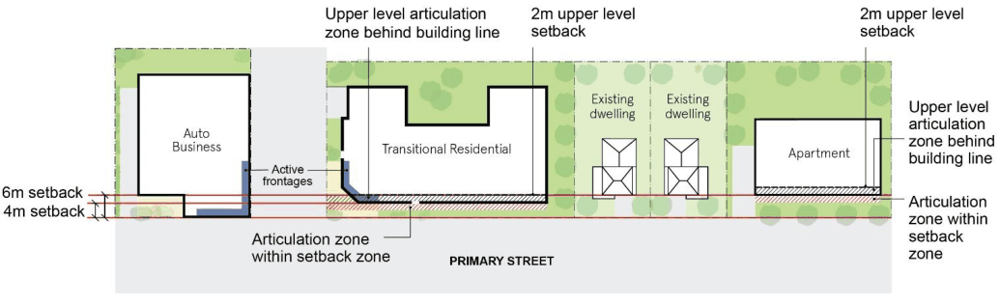

> [Picture on page 93: a picture, saved as a picture (images/section-e8-renewal-corridors-page-93-4.gif, 150 dpi).]

#### Figure E8.56: Front prevailing setback and articulation zone

Rear setbacks

5\. Rear setbacks are to be consistent with Table E8.08.

| Table E8.08: Rear setbacks |  |
|---|---|
| Wall height | Rear setbacks |
| Up to 4.5m | 1.5m |
| 4.5 - 8.5m | 3m |
| Over 8.5m | 6m |

6\. In the R3 Medium Density Residential, R4 High Density Residential and MU1 Mixed Use zones side or rear boundary setbacks may be reduced/built to the boundary where:

a. the wall height and length match an existing or similarly constructed wall on the adjoining site; and

b. the proposed wall and the wall on the adjoining property do not contain any openings; and

c. the wall will not impede the flow of stormwater or overland flow paths.

7\. In the R3 Medium Density Residential, R4 High Density Residential and MU1 Mixed Use zones, side and rear boundary setbacks are increased, where the site directly adjoins a site in the R2 Low Density Residential Zone.

8\. Where a rear boundary adjoins a lane, development complies with Section C11 Development adjoining a laneway.

9\. On corner lots, the boundary opposite the primary road frontage is taken to be the rear boundary for the purposes of applying setbacks.

Ground level frontage

10\. For sites with a frontage of 40m or greater, a minimum 50% of the frontage must be built to the property boundary.

11\. Minimum 85% of frontage built to the boundary should provide for active uses, such as cafes, takeaway

shops, retail shops, and business premises. Where a combination of non-residential and active uses are provided, active uses should be focused at the corners of buildings.

12\. Car parking, services, fire doors, switchboards, and the like are to be sleeved by active uses, or appropriately concealed and integrated in the design of the façade so as not to create blank or undesirable interfaces to the street.

13\. On corner site where active frontages cannot be provided to secondary streets, walls should incorporate public art, variation in building materials or other architectural or “green” wall design elements to create street interest.

Ground level floor space

14\. A minimum 50% of the ground floor of the building must be occupied by non-residential GFA. This is to ensure ground flood activation and screen ground floor car parking from the public domain.

15\. Ground floor non-residential uses should have a minimum depth of 10m from the building line to accommodate amenities, storage space, general back of house activities and other spatial requirements to support non-residential uses.

16\. Floor to floor height must be a minimum of 4m to allow for adaptable floor plans that can support either commercial or residential uses in future.

17\. Habitable residential accommodation uses are not permitted at the ground level. This control does not apply in the Adamstown renewal corridor.

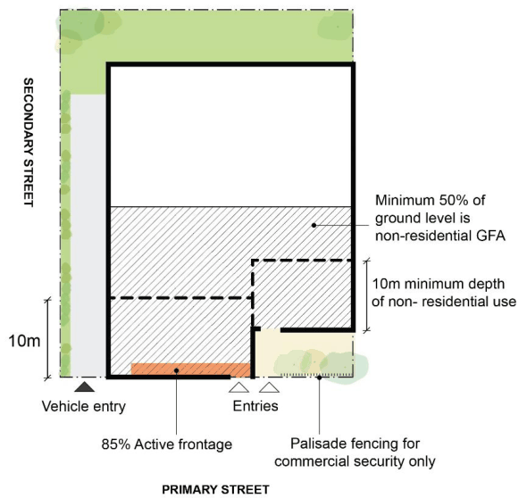

> [Picture on page 94: a picture, saved as a picture (images/section-e8-renewal-corridors-page-94-19.gif, 150 dpi).]

#### Figure E8.57: Ground level floorspace – Auto-business

Façade design

18\. Ground level facades for non-residential uses should have a maximum 50% solid to void ratio. Where active uses are provided, a minimum of 80% void (entries and windows) and 20% solid (walls) applies.

19\. Where active frontages are predominantly glazed, up to 25% of the glazing may be frosted or semi-opaque should a level of privacy be required for the tenancy use.

20\. Facades at the property boundary should incorporate ‘soft edges’, such as transparent facades, large window openings, double-door entries, and spill out zones for goods on display. Consider ‘openable’ facades (windows and doors) to encourage engagement with the street and natural ventilation.

21\. Ground floor frontages greater than 15m should be vertically articulated with recesses generally spaced at 10m-20m intervals, or in response to the existing character of the street.

22\. Highly reflective finishes and use of vinyl decal signage to address blank walls or long windows is not permitted.

Entries

23\. Where development comprises of non-residential and residential activity, separate pedestrian entrances, lift access, increased ground floor height and designated car parking must be provided.

24\. Entries for non-residential ground floor uses must be located on the primary street frontage.

25\. Ground floor entries to retail, commercial uses or other non-residential uses are to have the same finished floor level as that of the adjacent footpath, unless required to be raised due to flood impacts.

26\. Where the finished floor level is raised, universal access between the street and ground floor uses must be provided and detailed design and landscape considerations given to achieving easy access from the footpath. Level changes may also be accommodated within the building.

27\. Avoid locating the length of pedestrian access ramps to the primary frontage of the building. Where this is unavoidable, integrate landscaping to the street edge to create a softer edge to the street.

28\. Continuous awnings must be provided to all active frontages if built to property boundary. Breaks in awnings may be permitted for residential lobbies for legibility.

29\. Vehicular parking and/or loading bays are to be accessed via a secondary street or rear lane where possible. Where secondary street or rear lane access is not unavailable, vehicular parking and/or loading is to be at basement level or sleeved at ground level, accessed via no more than a single driveway from the primary street.

30\. Where vehicular entries are located to the primary or secondary street, entry doors should be recessed a minimum of 6m.

Fencing

31\. Fencing is permitted for non-residential uses where it is required for security purposes. Black palisade fencing up to 1.8m should be used, combined with landscaping and tree planting where appropriate.

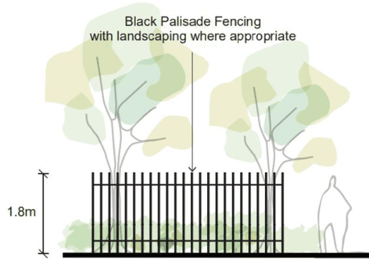

> [Picture on page 96: a picture, saved as a picture (images/section-e8-renewal-corridors-page-96-1.gif, 150 dpi).]

#### Figure E8.58: Non-residential fencing controls

Minimum lot size and frontage

32\. For the development types listed in Table E8.09, lot size and frontage width must be equal to or greater than the minimums specified in Table E8.09.

| Table E8.09: Minimum lot and frontage size |  |  |
|---|---|---|
| Development type | Minimum lot size | Minimum frontage width |
| Boarding houses Hostels Multi dwelling housing Residential flat buildings Shop top housing | 1,000m2 | 18m |

33\. Development for the purpose of residential flat buildings, multi dwelling housing or shop top housing is not to result in the creation of an isolated site that could have been developed in compliance with the relevant planning controls. Council will require appropriate documentary evidence to demonstrate that a genuine and reasonable attempt has been made to purchase an isolated site based on a fair market value.

34\. Where amalgamation of the isolated site is not feasible, applicants will be required to demonstrate that an orderly and economic use and development of the separate sites can be achieved.

35\. The development of existing isolated sites is not to detract from the character of the streetscape and is to achieve a satisfactory level of amenity including solar access, visual and acoustic privacy. Development of existing isolated sites may not achieve the maximum potential, particularly height and floor space ratio, and will be assessed on merit.

36\. Where adjacent sites are developing concurrently, site planning options for development as an amalgamated site are to be explored.

Blank walls

37\. Large areas of blank, minimally or poorly articulated walls are not acceptable. Measures to avoid this may include windows, awnings, sun shading devices, pergolas, green walls, public art or a recognisable increased setback to the upper storey.

38\. Blank walls are not permitted where facing the public domain.

39\. The maximum length of any blank wall must not exceed 5m.

40\. The maximum height of a blank wall must not exceed 3m.

41\. Where adjacent development is unlikely to occur in the short term, blank side walls should include public art or murals, as shown in Figure E8.59.

> [Picture on page 98: a picture, saved as a picture (images/section-e8-renewal-corridors-page-98-1.gif, 150 dpi).]

#### Figure E8.59: Blank wall with public art in Broadmeadow

Landscaping and deep soil

42\. Non-residential development should provide deep soil planting at front setback or side setback with a minimum width and length of 2m.

43\. The minimum landscaped area that must be provided on a lot is shown in Table E8.10.

#### Table E8.10: Minimum landscaped area

| Lot Area | Minimum landscaped area | Minimum deep soil zone |
|---|---|---|
| <600m2 | 25% of site area | 12% |
| >600m2 | 30% of site area | 15% |

Note: New and existing trees must be clearly indicated in landscape plans.

44\. Deep soil planting must have a minimum width and length of 2m.

#### E. Transition-residential

These controls apply to all areas identified as Transition-Residential on the relevant renewal corridor map.

#### Character statement

The ‘Transition-Residential’ Character Typology applies to areas where the surrounding character is primarily residential, but businesses premises operate along main road corridors in a range of building typologies. The future character of these areas is a transition between the ‘Active-Residential’ and ‘Apartments’ character typologies, reflecting how the current built form has been slow to respond to the underlying planning controls.

#### Objectives

1\. Establish a primarily residential interface at the ground level.

2\. Appropriately address interfaces between existing non-residential development and future residential development.

3\. Ensure consistent definition of the street edge via setbacks, fencing and landscaping.

4\. Appropriately balance noise attenuation and visual privacy requirements with engagement with the public domain.

5\. Provide opportunities for landscaping and deep soil planting at the street interface.

6\. Ensure that development resulting in multiple dwellings or accommodation is designed efficiently to achieve the full potential of the site, on lots that provide appropriate space for car parking, vehicle access, communal open space, deep soil planting and landscaping.

7\. Promote lot consolidation and ensure it does not result in isolated sites.

8\. Where feasible, ensure new development is accessible to all people.

#### Controls

1\. Development in a Transition-residential character typology area must demonstrate consistency with the above objectives.

Front setback

2\. Front building setbacks must be consistent with the relevant character typology setback diagram identified on the corridor setback map.

3\. Front setbacks may be altered to an alternative character typology setback where:

a. the setback matches an existing or similarly constructed wall on the adjoining site; and

b. the setback is consistent with the character statement and results in a more appropriate built form outcome; and

c. the minimum landscaping and deep soil provision can still be achieved.

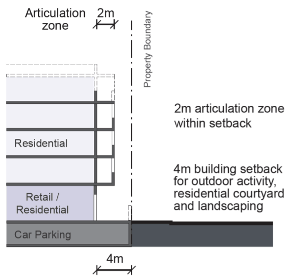

> [Picture on page 100: a picture, saved as a picture (images/section-e8-renewal-corridors-page-100-1.gif, 150 dpi).]

#### Figure E8.60: Setback transition - residential

> [Picture on page 100: a picture, saved as a picture (images/section-e8-renewal-corridors-page-100-3.gif, 150 dpi).]

#### Figure E8.61: Front prevailing setback and articulation zone

Rear setbacks

4\. Rear setbacks are to be consistent with Table E8.11.

| Table E8.11: Rear setbacks |  |
|---|---|
| Wall height | Rear setbacks |
| Up to 4.5m | 1.5m |
| 4.5 - 8.5m | 3m |
| Over 8.5m | 6m |

5\. In the R3 Medium Density Residential, R4 High Density Residential and MU1 Mixed Use zones side or rear boundary setbacks may be reduced/built to the boundary where:

a. the wall height and length match an existing or similarly constructed wall on the adjoining site; and

b. the proposed wall and the wall on the adjoining property do not contain any openings; and

c. the wall will not impede the flow of stormwater or overland flow paths.

6\. In the R3 Medium Density Residential, R4 High Density Residential and MU1 Mixed Use zones, side and rear boundary setbacks are increased, where the site directly adjoins a site in the R2 Low Density Residential zone.

7\. Where a rear boundary adjoins a lane, development complies with C11 Development adjoining a laneway.

8\. On corner lots, the boundary opposite the primary road frontage is taken to be the rear boundary for the purposes of applying setbacks.

Ground level floor space

9\. A minimum 30% of the ground floor of the building must be occupied by residential and/or non-residential GFA to ensure the ground level is not wholly occupied by car parking, building services and communal amenities. This is to ensure ground flood activation and screen ground floor car parking from the public domain. Residential GFA must be located to the primary street.

10\. Where non-residential uses are provided at ground level, active uses such as cafes, takeaway shops, retail shops, and business premises are preferred.

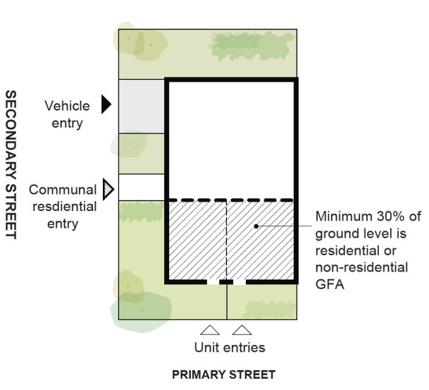

> [Picture on page 101: a picture, saved as a picture (images/section-e8-renewal-corridors-page-101-17.gif, 150 dpi).]

#### Figure E8.62: Ground level floor space transition-residential

Façade design

11\. Car parking, services, fire doors, switchboards, and the like are to be appropriately concealed and integrated in the design of the façade so as not to create blank or undesirable interfaces to the street.

12\. Where active uses are provided, a minimum of 80% void (entries and windows) and 20% solid (walls) applies.

13\. Where active frontages are predominantly glazed, up to 25% of the glazing may be frosted or semi-opaque should a level of privacy be required for the tenancy use.

Entries

14\. Ground floor units are to be provided with individual (courtyard) entries to the street to facilitate engagement with the public domain and passive surveillance.

15\. Residential entries must not be located below street or footpath level.

16\. Residential uses at ground floor should be designed so that the ground floor is raised above the finished footpath level to provide for occupant privacy, up to a maximum of 1.2m.

17\. Where the finished floor level is raised, universal access between the street and ground floor uses must be provided and detailed design and landscape considerations given to achieving easy access from the footpath. Level changes may also be accommodated within the building.

18\. The length of access ramps should not be located along the primary frontage of the building. Where this is unavoidable, landscaping must be integrated to the street edge to create a softer edge to the street.

19\. Vehicular parking should be accessed via a secondary street or rear lane where possible. Where secondary street or rear lane access is not unavailable, vehicular parking and/or loading is to be at basement level or sleeved by units at ground level, accessed via no more than a single driveway from the primary street.

20\. Where vehicular entries are located to the primary or secondary street, entry doors should be recessed a minimum of 6m.

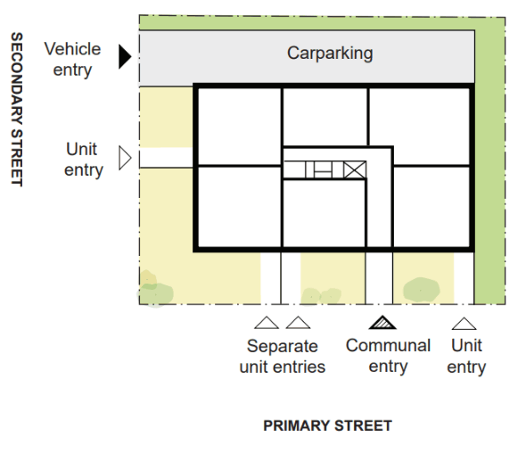

> [Picture on page 102: a picture, saved as a picture (images/section-e8-renewal-corridors-page-102-25.gif, 150 dpi).]

#### Figure E8.63: Ground level entries transition-residential

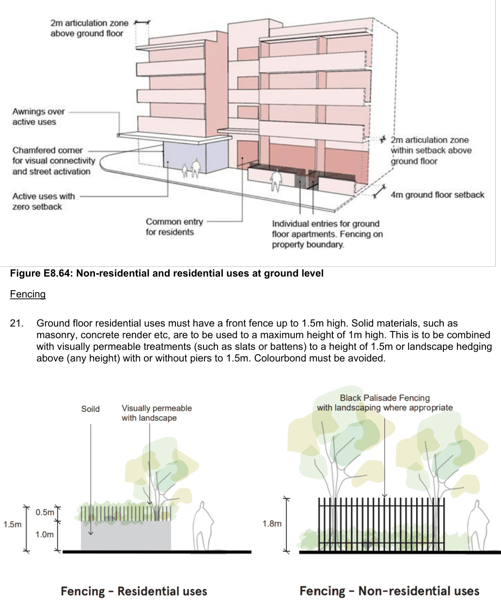

> [Picture on page 103: a picture, saved as a picture (images/section-e8-renewal-corridors-page-103-1.gif, 150 dpi).]

#### Figure E8.64: Non-residential and residential uses at ground level

Fencing

21\. Ground floor residential uses must have a front fence up to 1.5m high. Solid materials, such as masonry, concrete render etc, are to be used to a maximum height of 1m high. This is to be combined with visually permeable treatments (such as slats or battens) to a height of 1.5m or landscape hedging above (any height) with or without piers to 1.5m. Colourbond must be avoided.

#### Figure E8.65: Fencing controls

Minimum lot size and frontage

22\. For the development types listed in Table E8.12, lot size and frontage width must be equal to or greater than the minimums specified in Table E8.12.

| Table E8.12: Minimum lot and frontage size |  |  |
|---|---|---|
| Development type | Minimum lot size | Minimum frontage width |
| Boarding houses Hostels Multi dwelling housing Residential flat buildings Shop top housing | 1,000m2 | 18m |

23\. Development for the purpose of residential flat buildings, multi dwelling housing or shop top housing is not to result in the creation of an isolated site that could have been developed in compliance with the relevant planning controls. Council will require appropriate documentary evidence to demonstrate that a genuine and reasonable attempt has been made to purchase an isolated site based on a fair market value.

24\. Where amalgamation of the isolated site is not feasible, applicants will be required to demonstrate that an orderly and economic use and development of the separate sites can be achieved.

25\. The development of existing isolated sites is not to detract from the character of the streetscape and is to achieve a satisfactory level of amenity including solar access, visual and acoustic privacy. Development of existing isolated sites may not achieve the maximum potential, particularly height and floor space ratio, and will be assessed on merit.

26\. Where adjacent sites are developing concurrently, site planning options for development as an amalgamated site are to be explored.

Blank walls

27\. Large areas of blank, minimally or poorly articulated walls are not acceptable. Measures to avoid this may include windows, awnings, sun shading devices, pergolas, green walls, public art or a recognisable increased setback to the upper storey.

28\. Blank walls are not permitted where facing the public domain.

29\. The maximum length of any blank wall must not exceed 5m.

30\. The maximum height of a blank wall must not exceed 3m.

31\. Where adjacent development is unlikely to occur in the short term, blank side walls should include public art or murals, as shown Figure E8.66.

> [Picture on page 105: a picture, saved as a picture (images/section-e8-renewal-corridors-page-105-1.gif, 150 dpi).]

#### Figure E8.66: Blank wall with public art in Broadmeadow

Landscaping and deep soil

32\. Non-residential development should provide deep soil planting at front setback or side setback with a minimum width and length of 2m.

33\. The minimum landscaped area that must be provided on a lot is shown in the following Table E8.13.

#### Table E8.13: Minimum landscaped area

| Lot area | Minimum landscaped area | Minimum deep soil zone |
|---|---|---|
| <600m2 | 25% of site area | 12% |
| >600m2 | 30% of site area | 15% |

Note: New and existing trees must be clearly indicated in landscape plans.

34\. Deep soil planting must have a minimum width and length of 2m.
