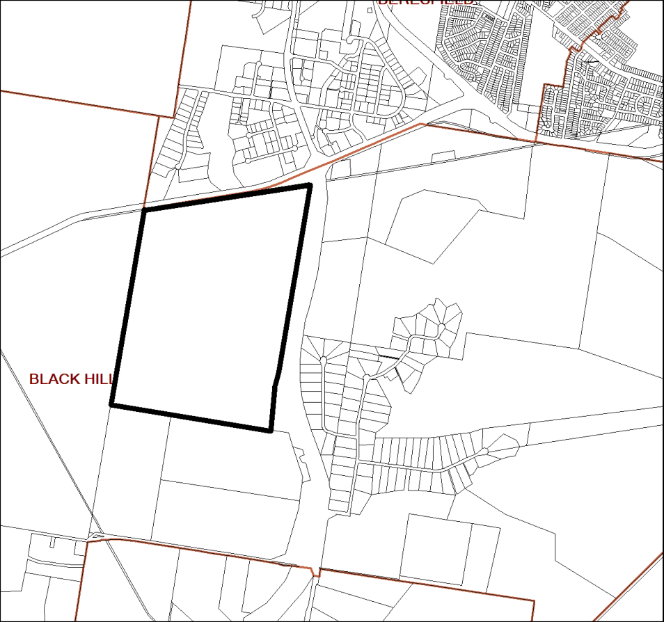

### 6.16 – Black Hill Employment Lands

#### Relationship with Concept Approval MP 10_0093

Concept Approval MP 10_0093 for the development of the site was issued by the Minister for Planning and Infrastructure on 19 November 2013 under the provisions of Section 75O and 75P of the Environmental Planning and Assessment Act 1979.

Section 1.8 of the Concept Approval requires that future development of the Black Hill Employment Lands is to comply with the Urban Design Guidelines (UDGs) which generally reflect Newcastle Development Control Plan.  The UDG are to be presented in a form to be adopted as site specific controls within Council’s DCP.  This DCP section provides revised ‘Urban Design Guidelines’ consistent with the Concept Approval and supporting documents, and as amended in accordance with the relevant conditions of approval.

The Concept Approval provides for the following:

▪ Staged development of a 183 hectares site for an employment lands development;

▪ Dedication of 545 hectares of conservation lands;

▪ Conceptual road, pedestrian and cycleway network;

▪ Conceptual lot layout;

▪ Indicative staging; and

▪ Associated infrastructure.

In the event of any inconsistency between this DCP section or any environmental planning instrument and the Concept Approval, the terms of the approval will prevail to the extent of the inconsistency.

#### Amendment history

| Version Number | Date Adopted by Director General NSW Planning & Environment | Commencement Date | Amendment Details |
|---|---|---|---|
| V1 |  |  | Draft lodged with NCC 4 April 2017 |
| V2 |  |  | Draft comments provided to Stevens Group 26 May 2017 |
| V3 |  |  | Amended following consultation with Department of Planning & Environment on 13 June 2018 |
| V4 |  |  | Amended following consultation with Department of Planning & Environment on 21 June 2018 |

Date Adopted

#### Land to which this section applies

This section applies to all land within the heavy line marked on Map 1 – Black Hill Employment Lands

#### Map 1: Black Hill Employment Land

> [Picture on page 4: a picture, saved as a picture (images/section-e9-black-hill-employment-area-page-4-8.gif, 150 dpi).]

#### Development (type/s) to which this section applies

This section applies to all development within the Black Hill Employment Lands requiring development consent.

#### Applicable environmental planning instruments and legislation

The provisions of the following listed environmental planning instruments also apply to development applications to which this section applies:

▪ Newcastle Local Environmental Plan 2012

In the event of any inconsistency between this DCP section and the above listed environmental planning instrument, the environmental planning instrument will prevail to the extent of the inconsistency.

#### Related Sections

The following sections of this DCP will apply to development to which this section applies:

• 3.01 Subdivision

• 3.13 Industrial Development

• 7.02 Landscape open space and visual amenity

• 7.03 Traffic, Parking and Access

• 7.04 Movement Networks

• 7.06 Storm Water

• 7.07 Water Efficiency

• 7.09 Outdoor Advertising and Signage

The following sections of this DCP may apply to development to which this section applies, noting the above paragraphs with respect to any inconsistencies that may arise.

• Any applicable land use specific provision under Part 3.00;

• 4.01 Flood Management - all land which is identified as flood prone under the Newcastle Flood Policy or within a PMF or area likely to flood.

• 4.02 Bush Fire Protection - within a mapped bush fire area/zone.

• 4.03 Mine Subsidence - within mine subsidence area

• 4.04 Safety and Security - development with an accessibility to general public, access to laneways and/or communal areas.

• 4.05 Social Impact - where required for site specific developments under 'Social Impact Assessment Policy for Development Applications'., 1999;

• 5.01 Soil Management

• 5.02 Land Contamination

• 5.03 Tree Management - within 5 m of a development footprint or those trees likely to be affected by the development

• 5.04 Aboriginal Heritage - known/likely Aboriginal heritage item/site and/or potential soil disturbance.

• 5.05 Heritage Items - known heritage item or in proximity to a heritage item

• 5.06 Archaeological Management - know/likely archaeological site or potential soil disturbance.

• 7.05 Energy Efficiency;

• 7.08 Waste Management;

• 8.00 Public Participation; and

• 9.00 Glossary

#### Additional information

• Concept Plan Application MP 10_0093

#### Definitions

A word or expression used in this development control plan has the same meaning as it has in Newcastle Local Environmental Plan 2012, unless otherwise defined in this development control plan. Other words and expressions referred to within this section are defined within Part 9.00 - Glossary of this plan.

#### Aims of this section

1\. To ensure that the Black Hill Employment land is developed generally in accordance with the Concept Approval (MP10_0093) for the site.

2\. To provide for the development employment land to support a range of employment generating activities and associated support facilities and infrastructure.

3\. To ensure the timely and efficient release of land that makes provision for the staging of necessary infrastructure whilst maximising employment land yields.

4\. To provide for industrial buildings and development which is both functional to meet the user’s needs, as well as contributing to a good quality streetscape when viewed from public places.

5\. To provide a flexible design layout and a simple and safe road network to cater for a range of future uses including large scale industrial development.

6\. To ensure the ongoing management of Viney Creek riparian corridor is achieved by incorporating best practice environmental management and water sensitive urban design methods.

7\. To provide employment lands directly accessible to major transportation corridors, incorporating public transport networks that link bus services with the rail system to promote public transport as an alternative and effective transport choice.

8\. To create additional employment opportunities locally and regionally, in an established employment node.

9\. To provide a visual buffer along the transport corridors to encourage a green entry.

#### 6.16.01 Subdivision Design

#### A. Layout Objectives

1\. To provide for the subdivision of land in response to the opportunities and constraints of the site.

2\. To provide a variety of lot sizes and configurations to enable a range of industrial and ancillary activities to be undertaken to accommodate a functional and desirable mix of development.

3\. To provide a reasonable site area for buildings, manoeuvring, parking and landscaping.

4\. To ensure adequate provision is made for green buffer zones between major road corridors and development.

#### Controls

1\. Development applications for subdivision shall be generally in accordance with the Black Hill Concept Plan Approval (10_0093) and the indicative road and lot layout approved by Council in accordance with Condition 1.10 of the Concept Approval.

2\. All industrial lots are to be a minimum of 1000m2 in area, with a minimum frontage of 20m.

3\. The staging plan shall provide for the schedule of delivery and dedication, where relevant, of the provision and management of infrastructure and servicing, including roads, stormwater, open space, and asset protection zones.

4\. Vegetated Buffer zones are to be provided or retained as follows:

▪ Northern boundary (John Renshaw Drive) – 20m

▪ Eastern boundary (M1/F3 Freeway) – 20m, supplementing the Green Buffer Zone on the RMS land along the road corridor.

▪ Southern boundary (private landowners) – 20m

5\. A landscape plan is to be submitted to Council in accordance with Section 7.02 of the Newcastle DCP 2012.

#### B. Road Network Objectives

1\. To provide direct access and egress from both the M1 and John Renshaw Drive in accordance with the requirements of the RMS.

2\. To ensure connectivity through the site by the establishment of a clear and easily identifiable road hierarchy and a network of open space, cyclist and pedestrian routes.

3\. To design an effective road network consistent with Council’s Standard Drawing Register

4\. To minimise the number of road crossings of Viney Creek.

5\. To ensure appropriate access and egress for bushfire protection and fire fighting.

#### Controls

1\. The road network comprises a flexible layout which will provide the foundation for the future subdivision of the Black Hill Employment Lands and create good traffic circulation.

2\. The roads are to be designed to cater for large articulated vehicles including B- Doubles.

3\. Detailed design for the access locations to be determined in consultation with the RMS and shall include the staged construction of the works as required as a consequence of the development for each stage.

4\. Ensure that vehicular and pedestrian circulation is clearly identified and separated.

5\. A traffic and transport impact study shall be submitted with each precinct-based (stage) subdivision application, updating the traffic model based on current movements and having regard to any improvements to existing intersections and the road network that may have been undertaken and alternative access arrangements that may be required.

6\. No direct property access to individual lots is permitted to or from John Renshaw Drive or the M1 Motorway.

7\. Provision for access shall be provided to allow for the future extension of the road network into lands to the south and to the west.

8\. The internal road network for each stage, including provisions for on-road cycleways, shall have regard to the overall hierarchy of the road network and the intended future use of the land.

9\. On-road cycleways will be provided on industrial collector roads only.  Shared off-road pathways are not required within the Black Hill Employment Lands.

10\. All bridge structures must accommodate SM 1600 loading.

#### C. Public Transport and Cycleway Network Objectives

1\. To ensure connectivity through the site by the establishment of a safe and easily identifiable network of and cycleway routes.

2\. To promote the integration of cycling infrastructure within the site and links to existing and proposed infrastructure in the wider region.

3\. To facilitate the provision of public transport connections to and throughout the Black Hill Employment Lands.

#### Controls

1\. Provide for a safe and convenient cycleway network along collector roads throughout the site.

2\. Cycling infrastructure is to be designed and integrated with public transport facilities and the regional cycling network.

3\. The road network is to be designed to provide for a clear and convenient bus route throughout the site, including the provision of bus shelters and seating as required.

4\. Provide details with the subdivision application for each stage, demonstrating consultation with the relevant bus company and the demand to extend or provide an additional bus route throughout the development including the proposed location of bus stops to service the development.

5\. A network plan is to be prepared to meet the requirements of condition 1.19 of the Concept Approval.

#### D. Earthworks and Clearing Objectives

1\. To enable the clearing of land to facilitate the development of the Black Hill Employment Lands.

2\. To enable bulk earthworks to be undertaken on site and managed in a co-ordinated approach to minimise the necessity for future site specific earthworks.

3\. To encourage the design of the subdivision having regard to the protection of the riparian corridor and retention of visual buffers along the site boundaries/road frontages.

4\. To minimise and manage any impacts on mature and hollow bearing trees and fauna within the site during clearing.

#### Controls

1\. Clearing for the purposes of providing access or service infrastructure within the riparian corridor and where required within the visual buffer areas is permitted.

2\. Prepare a management strategy to provide for the staged clearing of land, addressing measures to minimise any impacts on fauna including appropriate tree clearing protocols for the removal of trees containing suitable habitat hollows, the treatment and relocation of displaced fauna, and the identification and protection of any trees to be retained outside of the subdivision footprint.

3\. Provide details of erosion and sediment control measures that should be implemented to protect vegetation within the riparian corridor and within any buffer areas.

4\. Provide a bulk earthworks plan identifying proposed cut and fill and finished final contours.

5\. Provide details of the suitability of any externally sourced fill, if required.

#### E. Riparian Corridor Objectives

1\. To recognise the importance of Viney Creek as a significant watercourse.

2\. To encourage the protection and rehabilitation of the Viney Creek riparian corridor.

3\. Ensure the integrity of the riparian corridor is maintained and protected.

4\. To ensure future development protects and enhances these environmental attributes.

5\. To ensure that open spaces areas can be easily managed and maintained.

6\. To preserve the character and habitat value of the corridor and maintain a vegetated setting.

#### Controls

1\. The riparian corridor is reflected by the E2 Environmental Conservation zoning and includes the buffer zones endorsed by the Concept Approval.

2\. Restrict pedestrian access to the core riparian corridor by limiting any pedestrian network to the road crossings, to protect and maintain the integrity and biodiversity value of the site.

3\. Install appropriate nutrient and sediment control measures for each stage of subdivision outside of the riparian corridor to ensure on-going water quality and management of direct and potential indirect impacts to the site and downstream environs.

4\. Retain riparian vegetation, as far as practicable, to provide a wildlife corridor and filter stormwater runoff.

5\. Preparation of a rehabilitation plan for the Viney Creek riparian corridor in conjunction with the subdivision application, identifying management measures for the removal of any waste, revegetation, weed management and on-going monitoring and management of the corridor including costs.

6\. Best practice water sensitive urban design measures will be utilised in accordance with Section 7.06 of Council's DCP.

7\. Works within the riparian corridors, including the approved road and services crossing, are to be designed in accordance with the requirements of the NSW Office of Water.

Note:  A 20m buffer zone to Viney Creek has been endorsed by the Concept Approval.

#### F. Cultural Heritage Objectives

1\. To identify and manage any potential impacts on Aboriginal cultural heritage.

#### Controls

1\. An Aboriginal Cultural Heritage Management Plan (ACHMP) shall be prepared for the site in consultation with the Registered Aboriginal Parties and in accordance with OEH guidelines and the Preferred Project Report – Final Heritage Impact Statement (prepared by ERM, June 2011).

2\. A copy of the ACHMP shall be submitted to Council prior to the commencement of works on site.

3\. Development of the site shall be undertaken in accordance with the recommendations of the ACHMP prepared for the site.

4\. The ACHMP shall be implemented prior to the commencement of any construction works on site for each stage.

#### G. Geotechnical / Contamination Objectives

1\. To identify and manage any potential impacts on future development as a result of mine subsidence, contamination or groundwater.

2\. To ensure the safety of future users of the site.

3\. Provide durable infrastructure to ensure it is not affected by mine subsidence

#### Controls

1\. A remediation action plan is to be prepared with each precinct-based (stage) subdivision application in accordance with the relevant guidelines and the Preliminary Geotechnical, Contamination and Mine Subsidence Assessment prepared by Douglas Partners, February 2011, should the likelihood of contamination be identified, including details of the staging of remediation works where necessary.

2\. Any remediation of the site is to be staged in line with the future development and undertaken prior to use for its intended industrial purpose.

3\. A site validation plan is to be submitted to Council prior to issue of a subdivision certificate for that part of the site identified as requiring remediation.

4\. Identification of any potential risks and proposed management measures associated with mine subsidence within the site, where relevant for each stage of subdivision.

5\. Any bulk earthworks plan is to identify the depth of excavation works proposed and address the likelihood of the interception of groundwater.

6\. If groundwater is likely to be encountered during works, an appropriate dewatering permit is to be obtained from the NSW Office of Water prior to that activity commencing.

7\. The potential management of any water seepage likely to occur from mine workings within the site is to be addressed, if identified.

8\. The potential management of any water seepage likely to occur from mine workings within the site is to be addressed, if identified.

#### H. Noise Mitigation Objectives

1\. To manage and mitigate any potential noise impacts during construction and operation of industrial developments.

2\. To minimise any potential land use conflicts within the site.

3\. To minimise external noise between unlike land uses.

#### Controls

1\. Prepare a Noise Management Plan for the site in conjunction with the subdivision of the land.

2\. All works should be undertaken generally in accordance with the Noise Management Plan prepared for the site.

3\. Noise attenuation for buildings are to be addressed primarily through the placement of uses and then the design of the built form.

#### I. Infrastructure and Utilities Objectives

1\. To ensure the adequate provision of infrastructure and utilities to service the development.

2\. To ensure legal access is available to infrastructure for maintenance purposes.

#### Controls

1\. Provide for the provision of utility infrastructure to service the development including, but not limited to, electricity, water, sewer, and communication services (NBN Policy).

2\. Details of consultation with relevant service providers shall be submitted for each precinct-based (stage) subdivision application, demonstrating satisfactory arrangements can be made available for the provision of services and infrastructure.

3\. Crossings of riparian corridors for utility infrastructure are to be co-located with road crossings.

4\. New services within the precinct are to be provided underground.

5\. Provide for the creation of suitable easements for utility services that encroach onto private land.

#### J. Water Management Objectives

1\. To ensure stormwater is managed on site to minimise the potential impacts of development and to protect the quality of receiving waters;

2\. To apply the principles of water sensitive urban design;

3\. To ensure stormwater infrastructure is identified on site and can be appropriately managed and maintained.

4\. To ensure stormwater infrastructure to be dedicated to Council is completed in accordance with DCP Section 7.06 and associated Technical Manual.

#### Controls

1\. All stormwater management devices are to be designed in accordance with the NSW Office of Water (NOW) guidelines for Controlled Activities, and any relevant Council policies.

2\. The subdivision and development of the site is to be designed in accordance Section

7.06 of DCP.

3\. Details of the maintenance and management arrangements for public stormwater facilities, where relevant, are to be provided to Council for approval.

4\. Pipe network is to be inspected (via CCTV) prior to handover of infrastructure to Council in accordance with DCP Section 7.06 and associated Technical Manual.

5\. Preparation of a revised flood assessment of the site with consideration to the impacts of mine subsidence on the site, detailing the following:

a) Changes to the flood behaviour as a result of the proposal;

b) Rise times and flash floods;

c) Revised flood planning levels; and

d) Procedures for evacuation in the event of a flash flood.

6\. Each Development Application is to demonstrate that buildings would be located above the flood planning levels for the site.

Note: A revised flood assessment is required to reflect updated data as at the time of detailed subdivision design.

#### K. Construction Management Objectives

1\. To ensure that the construction of the land is adequately managed to minimise any potential impacts on the built or natural environment, or the amenity of the locality.

#### Controls

1\. A Construction Management Plan is to be prepared and submitted to Council in conjunction with each stage of the development of the site.

#### 6.16.02 Site and Building Elements

#### A. Site Coverage and Design Objectives

1\. To ensure that sites are developed to a level that maintains their efficient operation.

2\. To ensure development responds positively to the particular environmental attributes and constraints affecting the site, including:

▪ Geotechnical constraints (subsidence)

▪ Flooding and riparian zones

3\. To ensure the safety of future users of the site.

#### Controls

1\. Proposals are to clearly define spaces for pedestrians, utilities, service, parking and storage areas;

2\. Buildings are to be orientated towards the primary street frontage within the site;

3\. Buildings are to provide outdoor seating where possible;

4\. Proposals locate the majority of service areas, refuse and mechanical services behind buildings and/or screened from key streets and public open space;

5\. Future development is to comply with the requirements of the Bushfire Management Plan and the Planning for Bushfire Protection 2006 Guidelines (as amended).

6\. Future buildings are not to encroach within the designated APZ areas.

7\. Visual buffers and Asset Protection Zones (APZs) required for bushfire protection purposes are to be located and maintained within each individual site.

#### B. Setbacks Objectives

1\. To ensure that adequate area is available at the front of buildings to accommodate satisfactory landscaping, access and manoeuvring of vehicles.

2\. To reduce the visual impact of industrial development on the streetscape and surrounding development.

#### Controls

1\. Development is to be setback 5m from the front property boundary, however, this setback may be reduced by up to 50% for half the width of the site provided that:

(a) the remaining portion of the development is setback a distance equivalent to the concession taken;

(b) the building design contributes to the enhancement of the streetscape;

(c) the setback area is landscaped;

(d) the front setback does not have any car parking spaces.

2\. For corner lots, a secondary setback of 2m – 5m should be provided.

3\. Buildings, external work and storage areas are to be setback a minimum of 6m from side and rear boundaries on sites of 10,000m2 or more.

#### C. Car Parking, Access and Loading Objectives

1\. To locate and design any car parking, driveways and servicing areas so that they are efficient, safe, convenient and easily identified.

2\. To ensure adequate areas are set aside on site to allow for the safe and efficient manoeuvring of delivery and service vehicles.

3\. To ensure car parking areas are of suitable dimensions/layout to allow for vehicle manoeuvring.

4\. To provide sufficient off-street car parking facilities that do not detract from the overall visual amenity and character of developments when viewed from the street.

#### Controls

1\. Provide an appropriate level of landscaping to minimise the visual impact of loading and car parking areas from the street.  For sites with less than 20 spaces, visual planting to the perimeter of the car park shall be sufficient.  For sites with more than 20 spaces, tree bays should be incorporated at one bay for every 20 spaces where practicable, except where bays abut rear or side walls of buildings.

2\. Driveways are to be designed to enable vehicles to enter and leave the site in a forward direction.

3\. Loading docks are to be located such that they minimise conflicts between other vehicles accessing the site.

4\. Parking is to be provided in accordance with DCP Section 7.03.

5\. Parking requirements for other uses are to be determined by reference to the Newcastle City Council or RMS car parking requirements.

6\. Car parking is not permitted within the front setback.

7\. Provision of appropriate end of trip facilities for developments such as motor bike and bicycle parking.

#### D. Design and Appearance of Development Objectives

1\. To promote industrial development that is both functional and attractive in the context of its local environment through appropriate design.

2\. The building facade design should enhance the pedestrian comfort of the streetscape.

3\. To encourage sustainable design in the future development of the industrial precinct.

#### Controls

1\. Elevations of buildings which are visible from a public area are to be constructed using glass, brick, masonry, pre-coloured metal cladding, ‘tilt-slab’ concrete or a combination of these materials.

2\. Ancillary offices, staff amenities and other low-scale building elements are to be, wherever practicable, located at the front of the premises and constructed in brick or masonry materials to enhance the appearance of the development.

3\. Roofing materials are to consist of low-reflective materials.

4\. Building facade treatment reflects the activities carried out within the building.

5\. Open work and storage areas are to be located at the rear of industrial developments and screened from view by the use of landscaping and screen fencing.

6\. Security fencing should be visually unobtrusive and, except in special circumstances, should be located behind the landscape setback area.

#### E. Waste Management Objectives

1\. To promote efficient waste management.

2\. To minimise waste transfer.

#### Controls

1\. Future developments should optimise on-site recycling and reduce waste production.

2\. Individual waste storage and collection areas are required for developments, which are appropriately screened and accessible.

3\. A waste management plan is to be prepared for each development application in accordance with Council’s requirements.

#### F. Landscaping Objectives

1\. To enhance the visual amenity of Black Hill Employment Lands.

2\. To encourage a high standard of landscaping to enhance the streetscape and amenity of Black Hill Employment Lands.

3\. To minimise landscape maintenance requirements.

#### Controls

1\. Areas required to be landscaped:

▪ The front building setback;

▪ Secondary setbacks where visible from a public place;

▪ Areas adjacent to building entrances and pedestrian access points;

▪ The perimeter of all approved open storage areas and staff/visitor parking areas. Large car parking areas should be interspersed with internal planting bays to reduce the visual impact of large areas of paved surfaces;

2\. An unobstructed root area 1m deep and 20 – 40m2 is to be provided around each tree (no building or pavements permitted in this area).

3\. Passive watering techniques are to be utilised as part of the road drainage system.

4\. A landscape plan is to be prepared for all future development applications, which includes details of both hard and soft landscaping.

#### G. Stormwater Management Objectives

1\. To ensure integrated water cycle management best practices are utilised throughout the Estate.

2\. To protect the natural environment from the effects of stormwater run-off.

3\. To manage stormwater on an individual lot basis.

4\. To maximise use of recycled water within the Estate.

5\. Future buildings should demonstrate a commitment to Ecologically Sustainable Development (ESD) principles, with particular regard to water re-use and management.

#### Controls

1\. Development of the site is designed in accordance with Section 7.06 of the DCP.

2\. A Stormwater Management Plan is to be prepared for the development of each individual allotment.

3\. Each lot should provide water quality treatment.

4\. On site detention may be provided in the form of landscaped swale/depression, subterranean detention tanks or above ground water tanks (with surrounding landscaping to minimise visual impact).

5\. All water leaving a site to be treated for the removal of sediments, heavy metals and other contaminants.

6\. Best practice water sensitive urban design measures will be utilised in accordance with Section 7.06 of Council's DCP.
