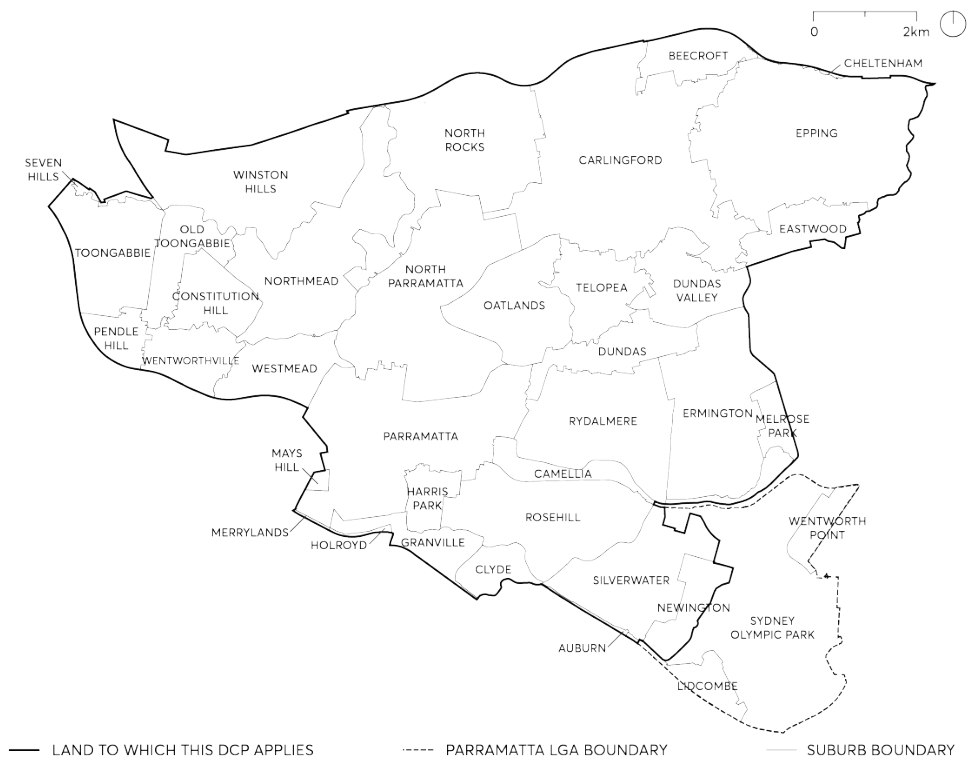

### 1.3 WHERE THIS DEVELOPMENT CONTROL PLAN APPLIES

This plan applies to all land within the City of Parramatta (LGA) as shown in Figure 1.3.1.

> [Picture on page 4: a picture, saved as a picture (images/part-01-introduction-page-4-4.gif, 150 dpi).]

Figure 1.3.1 – The City Suburb Boundaries, City of Parramatta

RELATIONSHIP TO OTHER PLANS AND POLICIES
