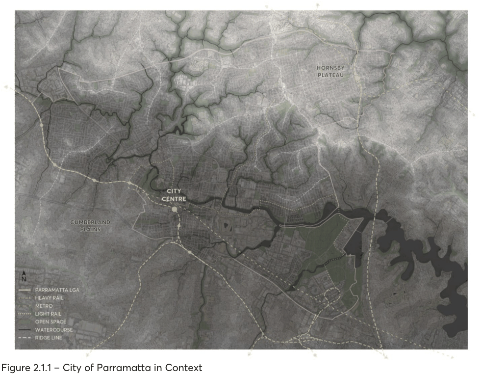

### 2.1 DESIGN IN CONTEXT

An understanding of the City of Parramatta (the City) context begins with Country, the traditional land of the Burramattagul people of the Dharug Nation. The City is unique in its location where it marks the head of Sydney Harbour at the confluence between freshwater and salt water and at the edge of the Cumberland Plains. With the river at its heart, the City is shaped by its Indigenous and colonial history and its landscape, marked by a considerable network of creek tributaries, riparian corridors, ridges, and valleys. These features create natural boundaries and define the extent and local character of the City’s centres, precincts, and neighbourhoods.

In the City’s north, a series of river valleys carve their way through suburban development from the top of the Hornsby Plateau. The curvilinear street patterns and cul-de-sacs define neighbourhoods bounded by riparian corridors and connected by a network of ridge roads.

To the south, the shale hills of the Cumberland Plains are flatter with a gently undulating landform which facilitates gridded streets with regular lot patterns. These areas more easily support greater densities with a diversity of building types and land uses.

This Section of the DCP describes requirements for designing within the City and in response to the different scales of development. By considering the contribution each individual building makes to the different context scales, the design ensures greater compatibility between developments and a cohesive public domain to define the future character of the City.

> [Picture on page 5: a picture, saved as a picture (images/part-02-design-in-context-page-5-1.gif, 150 dpi).]

Figure 2.1.1 – City of Parramatta in Context

Objectives

O.01 Encourage development to respond to its context and contribute to the overall character of any place.

O.02 Recognise and reinforce the distinctive attributes and qualities of the City’s neighbourhoods and centres.

O.03 Protect and enhance the public places, parks, and streets. O.04 Ensure that the spaces of the public domain – streets, parks and other public places – are comfortable, inviting, and accessible.

O.05 Promote design that maintains and enhances the character and heritage significance of heritage items and Heritage Conservation Areas.

O.06 Encourage ecologically sustainable development to protect and improve the natural environment.

CONTEXT ANALYSIS
