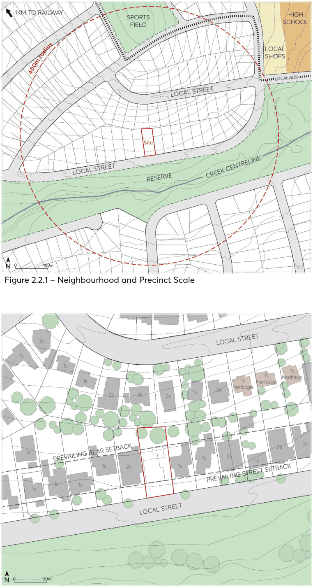
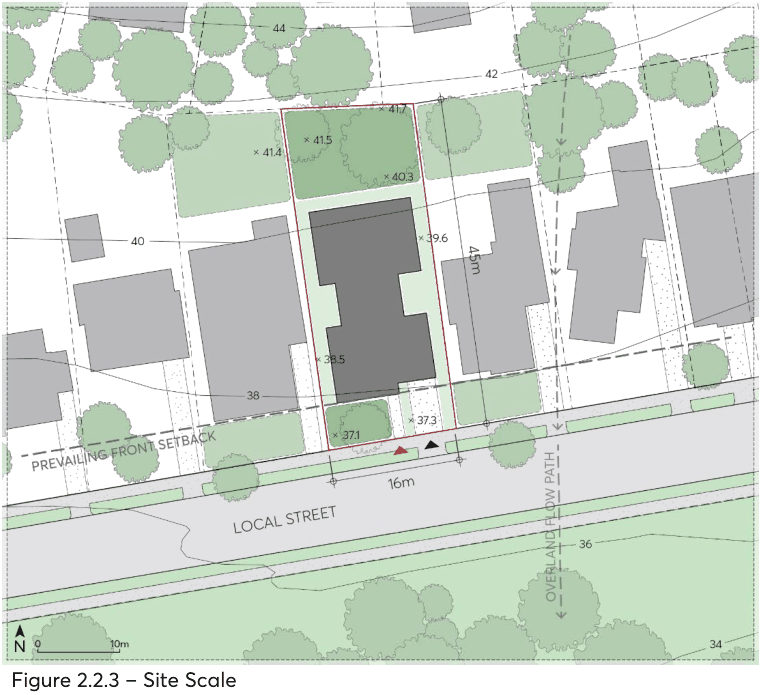

### 2.2 CONTEXT ANALYSIS

Development must respond sensitively to the broader urban context. This includes the topography, block patterns and subdivision, street alignment, landscape, views and vistas, and patterns of development within the area. A comprehensive context analysis, undertaken across multiple scales, should be submitted alongside a development application to ensure proposals are compatible with their surrounding context, add to the character positively, and contribute to the continuity of the streetscape. The comprehensive context analysis should include:

• A neighbourhood or precinct analysis that provides an understanding of the underlying urban structure that defines an area. At a minimum, this scale of analysis accurately details the topography, street network, the subdivision pattern, adjacent uses, open spaces and landscape features, and the surrounding public transport framework within a 400 metre radius of the subject site.

• A streetscape analysis that describes the character of the street(s) that the proposed development addresses and demonstrations how it is defined by buildings and landscape elements. At a minimum, this scale of analysis accurately details the immediate topographical conditions, subdivision and built form pattern, any heritage items, building heights, front and rear setbacks, and the location of significant trees.

• A site analysis that involves a detailed consideration of the individual development site relative to its neighbouring properties, buildings directly across the street and adjacent public domain. At a minimum, this scale of analysis accurately details the site slope, orientation, vegetation and deep soil, proposed and removed trees, hydrological conditions, easements, retaining walls and fencing, driveway locations and vehicular crossovers, and public domain alignment.

• A street elevation that, at a minimum, includes the neighbouring properties either side of the proposed development.

CONTEXT ANALYSIS

> [Picture on page 7: a picture, saved as a picture (images/part-02-design-in-context-page-7-2.gif, 150 dpi).]

Figure 2.2.1 – Neighbourhood and Precinct Scale

Figure 2.2.2 – Streetscape Scale

CONTEXT ANALYSIS

> [Picture on page 8: a picture, saved as a picture (images/part-02-design-in-context-page-8-2.gif, 150 dpi).]

Figure 2.2.3 – Site Scale

PRELIMINARY BUILDING ENVELOPE
