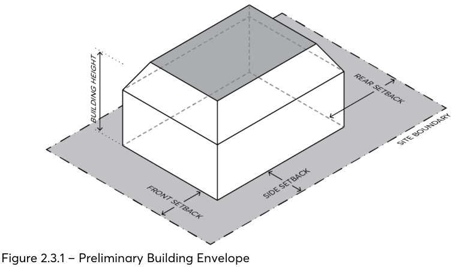

### 2.3 PRELIMINARY BUILDING ENVELOPE

The building envelope resulting from specific setbacks and height controls for each development type outlined in Part 3 – Residential Development and Part 4 – Non-Residential Development of this DCP constitute a three-dimensional volume within which, together with all other applicable controls, a coherent built form may be designed. Once the preliminary building envelope has been determined, refinement of the envelope is necessary so that the development may meet the objectives of this DCP.

Site constraints such as steep topography, heritage, or significant vegetation impact on building envelopes and how the maximum floor space ratio as shown in the Parramatta LEP 2023 is expressed.

The building height provisions in the Parramatta LEP 2023 indicate the maximum building height expressed in metres. This DCP specifies height limits measured both in storeys and metres for each development type. This DCP may specify instances where, for reasons of consistency of character, streetscape, or heritage considerations, pitched roof forms will be encouraged.

Additionally, certain places have special characteristics, such as heritage significance, view corridors, and amenity considerations require particular design outcomes and may impact on

> [Picture on page 9: a picture, saved as a picture (images/part-02-design-in-context-page-9-17.gif, 150 dpi).]

building height.

Figure 2.3.1 – Preliminary Building Envelope

Controls

C.01 Articulation zones for blade walls, shading devices and similar must be included within the building envelope and may not project into the required setback zones.

C.02 Unless otherwise specified, balconies, bay windows, chimneys, gutters, lift overruns, and eaves may project into the required setback zones subject to assessment of other development objectives.

PRELIMINARY BUILDING ENVELOPE

C.03 Balconies and eaves are not to project more than 800mm beyond the building envelope. If balconies are orientated towards side boundaries, they must be contained within the building envelope and address issues of privacy and overlooking.

C.04 Juliet balconies and bay windows are not to project more than 600mm beyond the building envelope.

C.05 Development must not exceed the height limit in metres and the noted number of storeys where specified in this DCP.

C.06 The ground floor level (finished) of any building must not exceed 500mm above or below natural ground level.

C.07 Refer to Part 8 – Centres, Precincts, Special Character Areas and Specific Sites of this DCP for further site-specific height controls.

BUILDING FORM AND MASSING
