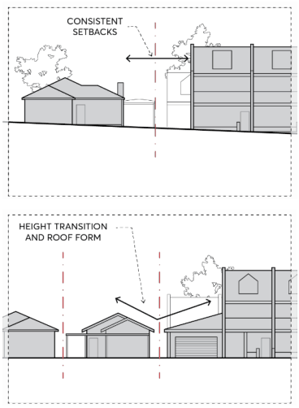
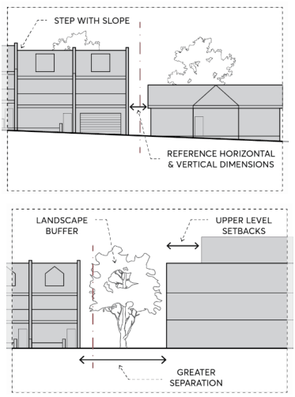

### 2.4 BUILDING FORM AND MASSING

The form and massing of individual buildings, including height, bulk and scale, is a critical element in defining character and creating unity within a streetscape. To ensure successful integration of new development within existing neighbourhoods and centres in the City of Parramatta (the City), it is important to have sympathetic relationships between the form and massing of buildings, and for development to be compatible with site conditions.

Objectives

O.01 Ensure the distribution of building height, mass, and form preserves or enhances neighbourhood amenity, site characteristics, and environmental features.

O.02 Ensure that where changes in building scale, mass and/or height is proposed, it occurs in a manner that is sensitive to amenity issues of surroundings or nearby development.

O.03 Ensure development that achieves the maximum floor space ratio permitted on any site does not inhibit any other objective or design controls contained within this DCP.

Controls

C.01 Buildings are to be of a height that responds to the topography and the shape of the site. C.02 The proportion and massing of buildings is to relate to the form, proportions, and massing of existing and proposed buildings patterns in the street.

C.03 Building height, and mass should not result in unreasonable loss of amenity to adjacent properties, open space, or the public domain.

C.04 Buildings are to be modulated in plan and elevation to reduce the appearance of bulk. C.05 Facades of buildings should be designed with a balance of horizontal and vertical elements that express the building’s architecture.

C.06 A mix of building materials and/or colours should be used to reduce the appearance of bulk and to integrate the building within the material and colour palette of the local area.

C.07 Development adjoining land use zone boundaries should provide a transition in form and massing, considering elements such as height, scale, landscape, appearance, and setbacks, as per Figure 2.4.1.

BUILDING FORM AND MASSING

> [Picture on page 12: a picture, saved as a picture (images/part-02-design-in-context-page-12-2.gif, 150 dpi).]

> [Picture on page 12: a picture, saved as a picture (images/part-02-design-in-context-page-12-3.gif, 150 dpi).]

Figure 2.4.1 – Methods for transitioning between land use zones

STREETSCAPE AND BUILDING ADDRESS
