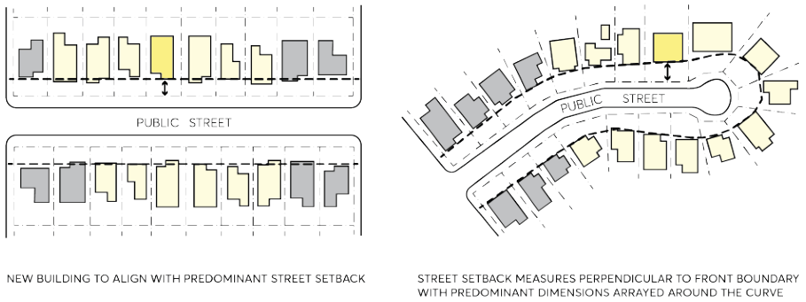
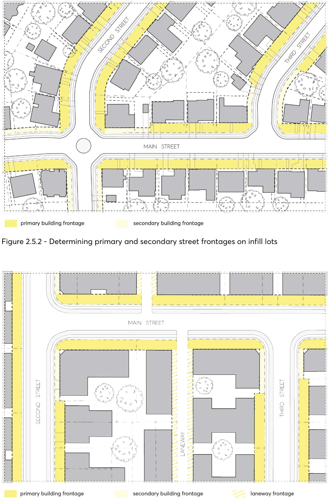

### 2.5 STREETSCAPE AND BUILDING ADDRESS

The streetscape embodies the inter-relationship between buildings, landscape, the public domain, and open spaces which all contribute to the whole street scene. The quality of the streetscape impacts on the local amenity and identity. The streetscape qualities are often attributed to building form, scale, landscape, material, and colours. Together, these elements support the identified character of the local area.

Facade treatment, design detail and quality of construction contribute significantly to the way a building ‘reads’ from the street. The composition of the building facade also has an impact on the apparent bulk and scale of a building. It is important when considering the design of new development that the articulation of facades reinforces the character and continuity of the streetscape. This does not mean replicating the appearance of buildings. Instead, contemporary design solutions based on sound design principles, which refer to the underlying elements that create the character of the area are encouraged.

Objectives

O.01 Ensure the appearance of buildings reinforce, complement, and enhance neighbourhood and streetscape character.

O.02 Respond to, reinforce, and sensitively relate new development to the spatial characteristics of the existing urban environment such as setbacks, location of open space, and building grain.

O.03 Increase the legibility of streetscapes and urban spaces so that the inter-relationship between development, landscape, and open space is visually coherent and harmonious.

O.04 Encourage contemporary designs which integrate with the appearance of the streetscape. O.05 Integrate development with the built and natural elements that define the streetscape, including street layout, building patterns, and landscape elements including street trees and front gardens.

O.06 Interpret and respond to the positive character of the locality, including the dominant patterns, textures, and material compositions of buildings.

O.07 Provide attractive building facades which establish identity, enable depth to the façade, have a legible sense of street address and contribute to the streetscape.

Controls

C.01 New buildings must recognise and enhance the patterns and elements of facades within the street. Designs are to provide visual cohesion, continuity and distinction, having regard to the horizontal and vertical proportions of building elements which create the visual scene.

C.02 Design consideration must be given to the underlying building elements that contribute to the character of the area. Such things include roof shape, pitch and overhangs; entry porches, verandas, balconies and terraces; materials, finishes, fixtures, patterns, fenestrations, colours and detailing; and the location and proportion of windows and doors.

STREETSCAPE AND BUILDING ADDRESS

C.03 Building setbacks from the street boundary are to be consistent with prevailing setbacks and alignment of adjoining and nearby buildings. A minimum of three lots either side of the subject lot and six lots directly across the street must be utilised to determine the prevailing street setback, as per Figure 2.5.1.

> [Picture on page 14: a picture, saved as a picture (images/part-02-design-in-context-page-14-6.gif, 150 dpi).]

Figure 2.5.1 – Prevailing street setbacks – rectilinear and curvilinear streets

C.04 Buildings on corner sites are to be articulated to address each street frontage and are to define prominent corners.

C.05 Primary and secondary frontages on corner lots are to be determined based on development type and surrounding context. On lower-density infill sites, the primary frontage typically refers to the street which the front entry of an existing dwelling is facing – in most cases this is the short edge of a lot, as per Figure 2.5.2. On higher-density consolidated sites, the primary frontage responds to the street hierarchy, as per Figure 2.5.3.

STREETSCAPE AND BUILDING ADDRESS

> [Picture on page 15: a picture, saved as a picture (images/part-02-design-in-context-page-15-2.gif, 150 dpi).]

Figure 2.5.2 - Determining primary and secondary street frontages on infill lots

Figure 2.5.3 – Determining primary and secondary street frontages on amalgamated lots

C.06 Building frontages and entries must provide a legible sense of street address and visual interest from the street through clear building frontages and entries.

STREETSCAPE AND BUILDING ADDRESS

C.07 Buildings are to be constructed of suitably robust and durable materials which add to the depth of the façade and contribute to the overall quality of the streetscape.

C.08 Garages or parking structures must not dominate the building facade and front setback. C.09 Vehicular access points must be minimised and should not break the continuity of the streetscape. Landscaping should be used to minimise the visual intrusion of vehicular access points.

C.10 Where development adjoins an existing or desired pedestrian or vehicle laneway, development should provide an address to the laneway and provide opportunities to activate the space to improve pedestrian amenity and safety. This could be achieved by creating pedestrian entries directly off the laneway, encourage passive surveillance of the laneway through building design, or provide landscaping to the laneway.

C.11 Any alterations and additions are to be compatible with design elements of the existing building.

C.12 Satellite dish and telecommunication antennae, air conditioning units, ventilation stacks and any ancillary structures must:

a) be located away from the street frontage,

b) integrate into the roof design and in a position where such facilities will not become a skyline feature at the top of any building,

c) be adequately set back from the perimeter wall or roof edge of buildings, and

d) use a master antenna for residential apartment buildings.

FENCES
