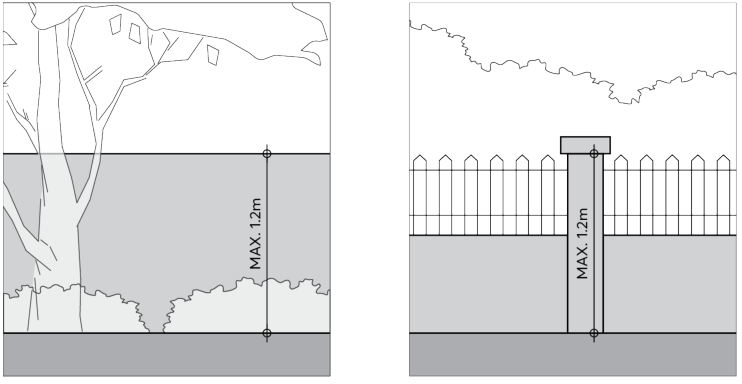

### 2.6 FENCES

In most residential areas, fences make a significant contribution to the streetscape and building address. Fences also impact upon the views between private areas and the public domain. It is important that fences are designed to promote high quality streetscapes, good passive surveillance, and provide sufficient privacy to residences.

Additional requirements for fences are also contained in Part 7 – Heritage and Archaeology and Part 8 – Centres, Precincts, Special Character Areas and Specific Sites where certain areas or items have historical significance and special character.

Objectives

O.01 Complement and conserve the visual character of the street and neighbourhood. O.02 Define the boundaries or edges between public, communal, and private land. O.03 Contribute positively to the public domain.

Controls

C.01 Front fences are to be a maximum height of 1.2 metres, as per Figure 2.6.1. C.02 On sloping sites, front fences should vary in height to suit the topography of the site up to a maximum height of 1.2 metres. Front fences should form a horizonal plinth with minimal stepping.

C.03 All other fences are to be a maximum height of 1.8 metres. Site fencing should respond to the topography of a site by providing a masonry base with a minimum height of 300mm. Upper portions of the fence are to be made of lightweight material that retains a relatively horizontal line, with minimal stepping.

C.04 Where a property is located on a corner, a higher side fence up to 1.8 metres may be considered along the secondary street frontage if required for privacy or security.

C.05 Where noise attenuation or protection of amenity requires a higher fence, front fences may be permitted to a maximum height of 1.8 metres and must be set back a minimum of 1 metre from the boundary to allow landscape screening to be provided. Landscape species chosen should be designed to screen the fence without impeding pedestrian movement along the street. Front fences and landscape screening must not compromise vehicular movement sightlines.

C.06 New fences and walls are to be constructed of robust and durable materials which reduce the possibility of graffiti. The material should be compatible with the associated building and adjoining fences.

C.07 Sheet metal fencing is not to be used at the street frontage, forward of the building line, or in any location that has an interface with the public domain.

C.08 Front fences should not be erected where the streetscape is characterised by an absence of front fences. Instead, landscaping should be used to create street address and privacy.

C.09 Continuous lengths of blank walls at street level are to be avoided.

FENCES

C.10 The edges of fences between properties and the interface of the public domain are to be softened with suitable planting.

C.11 Fences should not be constructed in floodways. Where this is unavoidable, fences are to be constructed of flood compatible and open type materials that will not restrict the flow of flood waters and be resistant to blockage.

> [Picture on page 18: a picture, saved as a picture (images/part-02-design-in-context-page-18-7.gif, 150 dpi).]

Figure 2.6.1 – Combined fencing and landscape design

OPEN SPACE AND LANDSCAPE
