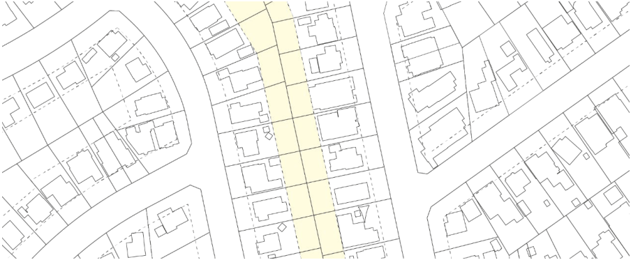

### 2.7 OPEN SPACE AND LANDSCAPE

Reducing the impact on vegetation has benefits to increase amenity and enjoyment of places and spaces throughout the City. In private development, maintaining an appropriate level of tree cover and natural landscaping enhances the biodiversity of areas, provides shade, reduces the visual impact of development, and contributes to reducing urban heat island effect.

Landscaped area has the same meaning as in the Parramatta LEP 2023 and is defined as a part of the site used for growing, plants, grasses and trees, but does not include any building structure or hard paved area. Buildings should be designed to maintain, incorporate and enhance natural features on the site such as trees, rock outcrops, cliffs, ledges, indigenous species, and vegetation communities.

Objectives

O.01 Conserve significant natural features of the site and contribute to the effective management of biodiversity.

O.02 Retain and provide for mature vegetation, particularly large and medium sized trees. O.03 Provide landscape and deep soil zones that contribute to continuous vegetation corridors across the street and block.

O.04 Encourage the planting of indigenous, native, and low water consumption plants and trees. O.05 Enhance the streetscape through planting in the private front setback. O.06 Promoting a scale and density of planting that softens the visual impact of buildings and provides privacy and amenity to dwellings.

O.07 Promote energy efficiency by planting species that enhance both solar access and shade. O.08 Provide landscape that enables infiltration of water to the water table, minimises run-off and assists with stormwater management.

O.09 Ensure developments make an equitable contribution to the landscape setting of the locality. O.10 Provide sufficient and high-quality deep soil areas for canopy trees and vegetation planting.

Controls

C.01 The area of landscaping required for each development type may be included in landscape area calculations if it meets the following criteria:

a) is a minimum of 2 metres by 2 metres is size,

b) is located at ground level,

c) has a minimum soil depth of 1.2 metres,

d) is permeable, soft landscape or the water surface of a swimming pool, and

e) is not an impervious surface such as driveway, paved area, roofed area, carparking, storm water structure, or deck, which is to be excluded from landscape calculations.

OPEN SPACE AND LANDSCAPE

C.02 Refer to Part 3 – Residential Development and Part 4 – Non-Residential Development of this DCP for private open space and landscape area requirements of each development type.

C.03 Deep soil areas must:

a) be a minimum of 4 metres by 4 metres in size,

b) be located at ground, and

c) not be located on any structures including buildings, basements, podium terraces, roof gardens, outbuildings or any other structures.

d) Not include swimming pools, tennis courts, patios and decks, or other impervious surfaces such as paved areas, roofed areas, driveways and carparking.

C.04 Refer to Part 3 – Residential Development and Part 4 – Non-Residential Development of this DCP for deep soil requirements of each development type.

C.05 Deep soil zones should adjoin the deep soil zones of neighbouring properties where practicable to provide a contiguous area of deep soil and vegetation across blocks, as per Figure 2.7.1.

> [Picture on page 20: a picture, saved as a picture (images/part-02-design-in-context-page-20-15.gif, 150 dpi).]

Figure 2.7.1 – Contiguous deep soil network

C.06 Existing healthy trees are to be retained and protected, wherever possible, and incorporated into the design of the development.

C.07 Where an existing tree is approved for removal, Council will seek the planting of a suitable canopy replacement tree or trees in a suitable location on the site. Any replacement trees will need to be grown to maturity and replaced if the planting fails to survive and thrive. In circumstances where there is no suitable location on site (for example, in the case of small backyards), a financial contribution will be required to be paid to support public tree planting. Offset fees are contained within Council’s published fees and charges.

C.08 Trees should be planted to the front and rear of properties to encourage a generous tree canopy across the block and continuity of the landscape pattern. Refer to Part 3 – Residential Development and Part 4 – Non-Residential Development of this DCP for tree planting requirements for each development type.

C.09 Indigenous species, especially low water consumption plants, should be used in preference to exotic species, reflecting the vegetation communities of the locality. Refer to Part 5 –

OPEN SPACE AND LANDSCAPE

Environmental Management, Section 5.3.1 – Biodiversity of this DCP for endemic species to be considered for planting in the City of Parramatta.

C.10 Landscaping abutting the C2 Environmental Conservation zone under the Parramatta LEP 2023 is to be landscaped with local indigenous specifies to protect bushland, wildlife corridors, and soften the interface between the natural landscape and urban environment.

C.11 Landscaping is to be designed to integrate new development with the existing landscape character of the street and be sensitive to site attributes, existing landscape features, and streetscape views and vistas.

C.12 Landscaping is to be designed to minimise overlooking between properties. C.13 Landscaping should provide shade in summer without reducing solar access in winter. C.14 Landscaped areas must be designed to require minimal maintenance by using robust landscape elements and using hardy plants with low fertiliser requirements.

C.15 The amount of hard surface area must be minimised to reduce run-off. Run-off should be reduced by directing the overland flow from rainwater to permeable surfaces such as garden beds.

C.16 A landscape plan prepared by a qualified landscape architect or designer is to be submitted for the following development types:

a) Development including any forms of residential accommodation.

b) Development abutting the RE1 Public Recreation zone, E2 Environmental Conservation zone or W1 Natural Waterways zone under the Parramatta LEP 2023.

c) Land identified as ‘Biodiversity’ or ‘Riparian Land and Waterways’ on the Natural Resources Map in the Parramatta LEP 2023.

d) Commercial development.

e) Industrial development

f) Childcare centres.

g) Places of public worship.

h) Any other development that, in Council’s opinion, will significantly alter the landscape character of that area.

VIEWS AND VISTAS
